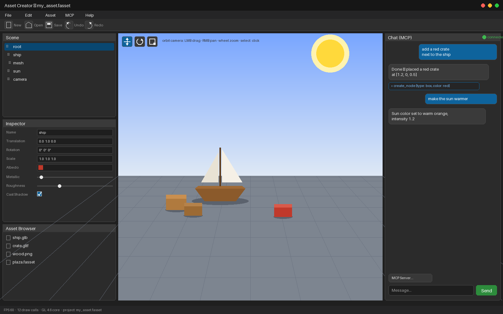

# FuhGlGraphics — Asset Creator (G12) design

Status: **implemented (phases P1, P2, P4; P5 polish open — see §10).** Language of this
document: English (docs at this level are English-only, see [README.md](README.md)).
Code, comments and API docs stay English; the tool UI is multilingual (see §2).

## 1. Goal

A Qt6 desktop tool — the **asset creator** — to **create, load and edit assets**:

- a **data-structures area** (scene tree + inspector + asset browser),
- a **viewport with editing tools** that renders through the G3 `DeferredRenderer`
  of this library (`fuhglgraphics::render`),
- a **chat area** to talk to an LLM over **MCP** (Model Context Protocol).

The tool is a separate executable on top of the library; the library core stays
Qt-free (`-DFUHGLGRAPHICS_WITH_QT=OFF` still builds headless).

Planned layout (mockup — left: scene tree + inspector + asset browser, center: G3
renderer viewport with gizmo toolbar, right: MCP chat):



## 2. Agreed decisions

| Topic | Decision |
|---|---|
| Location | `tools/asset_creator/` in this repo; executable target `fuhglgraphics_asset_creator`, links `FuhGlGraphics::fuhglgraphics` + `Qt6::Widgets Qt6::OpenGLWidgets` (AUTOMOC); qmake alternative `tools/asset_creator/asset_creator.pro` |
| Build | new CMake option `FUHGLGRAPHICS_BUILD_TOOLS` (default ON when `FUHGLGRAPHICS_WITH_QT=ON`) → `add_subdirectory(tools)`; CI (ubuntu, `qt6-base-dev`) builds the tool, win/mac keep building the Qt-free core |
| Project file | own **`.fasset` JSON** (`io::Json` + new `io::writeJson`); glTF/texture references stored as paths; glb export is a later phase |
| MCP | **stdio transport** with a **configurable server command** (settings dialog, never hardcoded; no secrets in the project file — API keys come from the environment). JSON-RPC 2.0, line-delimited; handshake `initialize` → `notifications/initialized`, then `tools/list` / `tools/call`; server→client requests (e.g. `sampling/createMessage`) and HTTP/streamable transport are later phases |
| MCP server for testing | recommendation for a Mistral subscription: run a small own MCP server (Python or Node) that reads `MISTRAL_API_KEY` from the env and exposes the Mistral chat API as an MCP tool; any other MCP server works the same via the server-command setting — no vendor lock-in |
| UI language | **multilingual, English default**, German as the first translation (`QTranslator` + `.ts` files); code/comments/docs stay English |
| Conventions | C++17, MVC (model = asset/scene data, view = panels/viewport, controller = input/chat), PIMPL for GL/Qt-resource classes, bool + log instead of exceptions for domain errors, compact documented code, descriptive variable names (see [DEVELOPMENT.md](DEVELOPMENT.md)) |

## 3. Architecture (MVC)

```
tools/asset_creator/
  main.cpp                    QApplication, MainWindow, --project x.fasset CLI
  mainwindow.{hpp,cpp}        View: QMainWindow, 3 QDockWidgets (data structures |
                              viewport | chat), menus/toolbar (new/open/save, undo/redo,
                              connect MCP)
  viewport_widget.{hpp,cpp}   View: QOpenGLWidget — initializeGL() -> DeferredRenderer::
                              create(w,h,msaa); resizeGL() -> resize(); paintGL() ->
                              Scene::updateWorldTransforms/fillFrame, effects.applyTo,
                              renderer.render(frame.view, &materialIds, &castShadow,
                              &particleSystems), blit output FBO to the default FB;
                              render on demand (dirty flag) + QTimer while animating
  asset_document.{hpp,cpp}    Model: owns scene::Scene + GL resources (io::instantiateGltf),
                              QUndoStack, dirty flag; new/open/save .fasset via
                              scene::serialize + io::writeJson; load .gltf/.glb via io::loadGltf
  scene_tree_model.{hpp,cpp}  Model adapter: QAbstractItemModel over scene::Node*
                              (internalPointer); refreshed after each QUndoCommand
                              (the Qt-free core has no change signals)
  scene_tree_panel.{hpp,cpp}  View: QTreeView + context menu (add/remove/rename node,
                              attach child, load glTF here)
  inspector_panel.{hpp,cpp}   View: properties of the selection — node TRS, MeshEntry
                              (albedo color, metallic/roughness/AO, texture paths,
                              castShadow, materialId), LightComponent, per-node Effects +
                              EffectParams, Instancing; edits go back as QUndoCommands
  asset_browser_panel.{hpp,cpp} + asset_browser_model  View/Model: QFileSystemModel on the
                              project asset folder, filter *.gltf *.glb *.png *.fasset;
                              double-click / drag&drop -> LoadGltfCommand; thumbnails later
  commands.{hpp,cpp}          Controller/Model: QUndoCommands (AddNode, RemoveNode,
                              SetTrs, SetMaterial, AttachComponent, LoadGltf, ...)
                              applied to the model + viewport->update()
  viewport_controller.{hpp,cpp}  Controller: orbit camera (fuhgl::Camera), picking ray
                              vs. node world AABBs for selection, keyboard translation;
                              3D gizmo (translate/rotate/scale axes) in a later phase
  chat_panel.{hpp,cpp}        View: QListWidget (user/assistant/tool/system roles),
                              input line, status label, MCP settings dialog
  chat_controller.{hpp,cpp}   Controller: ChatPanel <-> McpClient; tools/list cached on
                              connect; chat message sent as tools/call to the configured
                              chat tool (args: message + history); content[] text parts and
                              tool calls shown in the panel; tool results carrying an
                              `assetAction` JSON are translated locally into QUndoCommands
                              (LLM -> editor bridge)
  mcp/mcp_client.{hpp,cpp}    Controller: QProcess spawns the MCP server (stdio),
                              JSON-RPC 2.0 line-delimited on stdin/stdout, async Qt
                              signals (messageReceived, toolResult, error); framing/parsing
                              via the Qt-free fuhglgraphics::mcp::jsonrpc helpers
```

## 4. Library extensions (Qt-free, unit-testable) — implemented

- `io::writeJson` / `writeJsonFile` in `include/fuhglgraphics/io/json.hpp` (G19) — the writer
  the MCP requests and `.fasset` saving need. Test: roundtrip in `tests/test_io.cpp`.
- `include/fuhglgraphics/scene/serialize.hpp` — `sceneToJson` / `sceneFromJson` (G19) plus
  the public effect-JSON mapping `effectsToJson` / `effectsFromJson` / `setEffectParam` /
  `effectParamToJson` / `effectParamNames` (used by the MCP render tools and the G11 JSON
  renderer config). Test: `tests/test_serialize.cpp` + `tests/test_mcp.cpp` (`unit`).
- `include/fuhglgraphics/io/asset_cache.hpp` — G11 on-disk asset cache keyed by FNV-1a
  content hash (`io::AssetCache`). Test: `tests/test_mcp.cpp` (`unit`).
- `include/fuhglgraphics/mcp/jsonrpc.hpp` — Qt-free JSON-RPC 2.0 build/parse helpers
  (request/notification/response/error, line framing, id matching) on top of `io::Json`.
- `include/fuhglgraphics/mcp/tool_catalog.hpp` — the **tool catalog**: `toolsListJson()` /
  `callTool()` over a `ToolHost`. Groups: scene ops (`scene_*`), deferred-render settings
  (`render_list_effects`, `render_set_effect`, `render_get_settings`, `render_set_param(s)` —
  all `render::Effect` + `scene::EffectParams`), G13 water (`water_add_to_scene`,
  `water_get_params`, `water_set_params`) and the procedural generators G24–G31
  (`procedural_noise`, `procedural_marching_cubes`, `procedural_lsystem`, `procedural_wfc`,
  `procedural_voronoi`, `procedural_sdf`, `procedural_creature`, `procedural_worldgen`,
  each with `attach:true` to add the result as a scene node via the host's GL resolvers).
- `include/fuhglgraphics/mcp/mcp_server.hpp` — stdio MCP server (initialize /
  notifications/initialized / ping / tools/list / tools/call), plus the standalone Qt-free
  executable `tools/mcp_server` → `fuhglgraphics_mcp_server`.
- `scene::Node::removeChild` / `takeChild` — node removal with undo support.

All of these keep the `WITH_QT=OFF` CI jobs green (no Qt includes). Tests:
`tests/test_mcp.cpp` (`unit`).

## 5. The three areas

1. **Data structures (left dock):** scene tree (`SceneTreeModel`) + inspector +
   asset browser. Selection is shared between tree and viewport via the controller.
   Every edit goes through a QUndoCommand → model changes `scene::Scene` → viewport
   marks dirty.
2. **Viewport (center):** `ViewportWidget` with the G3 `DeferredRenderer` (MSAA, render
   scale, per-node effects like `examples/scene_screenshot`). Editing tools: selection,
   orbit camera, axis translation, component attach, glTF drag&drop; 3D gizmo later.
3. **Chat (right dock):** `ChatPanel` + `ChatController` + `McpClient` (stdio). The MCP
   server hosts the LLM and optionally asset tools; answers/tool calls appear in the
   chat history, asset actions are applied as commands on the model.

## 6. `.fasset` project format (sketch)

```json
{
  "format": "fuhglgraphics-asset",
  "version": 1,
  "name": "my_asset",
  "assets": [ { "id": "ship", "kind": "gltf", "path": "assets/ship.glb" } ],
  "scene": { "nodes": [ { "name": "root-node",
      "translation": [0,0,0], "rotation": [0,0,0,1], "scale": [1,1,1],
      "components": [ { "type": "mesh", "asset": "ship", "albedo": [1,1,1],
                        "metallic": 0.0, "roughness": 0.5, "castShadow": true } ],
      "effects": { "list": ["shadows"], "params": {} },
      "instancing": { "enabled": false, "count": 0 },
      "children": [] } ] }
}
```

## 7. MCP client design

- **Transport (phase 1):** stdio — `QProcess` starts the configured server command;
  JSON-RPC 2.0 messages as single lines on stdout/stdin.
- **Handshake:** `initialize` (protocolVersion, capabilities) → `notifications/initialized`;
  then `tools/list` (cached, shown in the chat panel), `tools/call` for chat + asset tools.
- **Chat flow:** user message → `tools/call { name: <chatTool>, arguments: { message,
  history } }` → response `content[]` text parts rendered as assistant messages; tool calls
  and results rendered as tool entries; errors as system entries.
- **LLM → editor bridge:** tool results may carry an `assetAction` object
  (e.g. `{ "op": "addNode", "name": "box", "translation": [0,1,0] }`); `ChatController`
  maps known ops onto QUndoCommands.
- **Security:** server command + env come from the settings dialog / env only; no
  credentials in `.fasset`; child process gets a clean, explicit environment.
- **Reference dev server:** `tools/asset_creator/mcp_server.py` — Python 3 stdlib only
  (no pip), speaks MCP over stdio (line-delimited JSON-RPC 2.0). Tools: `chat` (Mistral
  API via `MISTRAL_API_KEY`/`MISTRAL_MODEL` env, offline stub without a key),
  `list_assets`, `inspect_gltf` (.gltf/.glb parse), `render_preview` (runs the compiled
  `fuhglgraphics_gltf_demo` headless through the G3 renderer, returns the PNG as MCP
  image content), `asset_action` (returns the `assetAction` JSON the editor maps onto
  QUndoCommands), `editor_command` (appends to `EDITOR_BRIDGE_FILE` for direct control,
  e.g. via QFileSystemWatcher). Optional `--http <port>` loopback mode
  (127.0.0.1 only: `/health`, `/tools`, `POST /call`). Tests:
  `python3 tools/asset_creator/test_mcp_server.py`.
- **Later:** HTTP/streamable transport via `Qt6::Network`; server→client
  `sampling/createMessage` for real LLM sampling; client-side MCP tools.

## 8. Build / CI / tests / docs

- CMake `FUHGLGRAPHICS_BUILD_TOOLS` (default ON with `WITH_QT`) → `tools/`;
  target links `fuhglgraphics` + `Qt6::Widgets Qt6::OpenGLWidgets`; qmake `.pro`.
- CI: ubuntu job (`qt6-base-dev`) additionally builds `fuhglgraphics_asset_creator`;
  smoke = build + `--version` under xvfb. win/mac: unchanged (Qt-free core).
- Tests: `tests/test_io.cpp` (writeJson), `tests/test_scene_serialize.cpp`,
  `tests/test_mcp.cpp` — all label `unit`, no GL, no Qt.
- Docs: this design doc; after implementation: REQUIREMENTS G12, USER_GUIDE,
  DEVELOPMENT layout, tutorial `docs/en/tutorials/g12_asset_creator.md` +
  `docs/de/tutorials/`, README/README.de, CHANGELOG.

## 9. Phases

1. **P1 skeleton — done:** CMake (`FUHGLGRAPHICS_BUILD_TOOLS`) + qmake target,
   `io::writeJson`, `scene/serialize`, MainWindow + `ViewportWidget` (G3 renderer +
   orbit camera) + new/open/save `.fasset`.
2. **P2 data structures — done:** SceneTreeModel, inspector (TRS, per-node effect toggles,
   common EffectParams, G13 water params), selection (tree + viewport picking), QUndoCommands,
   context menu, primitives (box/quad/sphere).
3. **P3 assets — done:** asset browser on the project folder, glTF load (double-click /
   context menu), project `.fasset` + `<project>/.cache` (G11 `io::AssetCache`).
4. **P4 MCP chat — done:** `mcp::jsonrpc` + `McpClient` (stdio QProcess, configurable server
   command; `builtin` = in-repo catalog in-process), ChatPanel/ChatController, settings
   dialog, `assetAction` → QUndoCommand bridge; the catalog exposes the procedural G24–G31
   functions, the deferred-render settings and the G13 water params (see §4).
5. **P5 polishing — mostly done:** 3D gizmo (translate/rotate/scale, View menu or T/R/S;
   drag axes/rings/center, one undoable command per drag — `gizmo.{hpp,cpp}`, rendered as
   extra emissive draw items in the document's FrameData so it shares the G-buffer depth,
   picked via `scene::pick` on a gizmo-only scene), glTF **thumbnails** in the asset browser
   (`thumbnailer.{hpp,cpp}`: offscreen DeferredRenderer preview cached as PNG in
   `<project>/.cache/thumbs`, proxy model supplies the icons), **animation playback** in the
   viewport (View → Play animation / Space; advances every `AnimationComponent` per frame,
   restores the node TRS of play start on stop). Open: glb export.

Delivery: branch `vibe/<slug>-<id>`, one PR per phase after review (per
[DEVELOPMENT.md](DEVELOPMENT.md) "Adding a feature").

## 10. Open points

- glb export from the asset creator — P5 remainder.
- MCP chat-tool contract for **external** servers (name/arguments) — still defined by the
  configured server; the tool stays generic and shows `tools/list` results. The **builtin**
  contract is now fixed in-repo: `mcp/tool_catalog.hpp` (scene ops, `render_*` settings,
  `water_*` G13 params, `procedural_*` G24–G31; `attach:true` adds generated meshes as nodes
  when the host binds GL resolvers), served in-process or via `fuhglgraphics_mcp_server`.
