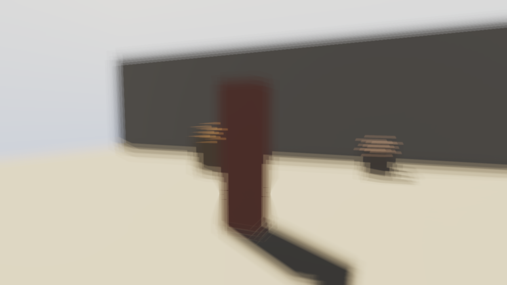
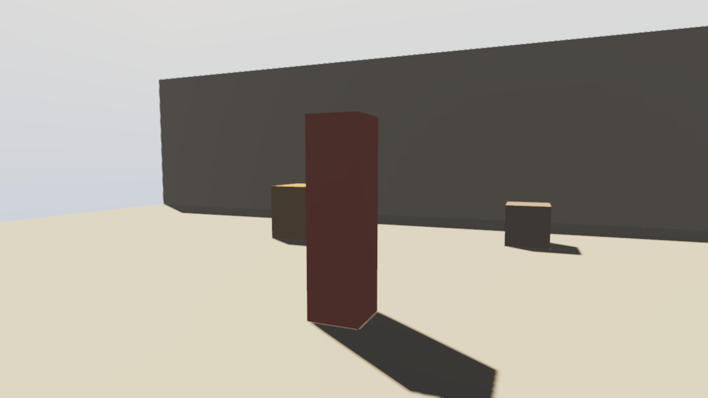
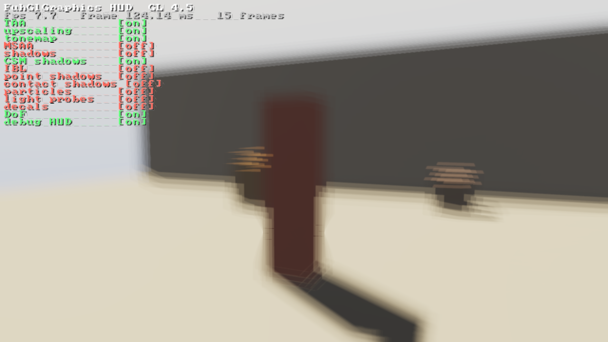

# Tutorial G10 — Quick-Upgrades: DoF-Bokeh, Debug-HUD, CI-Screenshot-Diff

> 🇬🇧 **English version:** [docs/en/tutorials/g10_upgrades.md](../../en/tutorials/g10_upgrades.md)

**Ziel:** die „kleineren schnell sichtbaren Upgrades" aus Roadmap-Punkt 7, die noch offen
waren (MSAA-Wiring, CSM-Penumbra-Härtung und FSR1-artiges temporales Upscaling kamen bereits
mit G3/#4): **Depth of Field mit hexagonalem Bokeh-Kernel** (`Effect::Dof`), ein **Mini-
Debug-HUD** auf FuhGLCore's TextRenderer (`Effect::DebugHud`) und ein **perzeptueller
Screenshot-Diff in der CI**.

## DoF-Bokeh (`Effect::Dof`)

Ein neuer Post-Graph-Pass `dof` läuft zwischen Upscale und Tonemap (auf dem hochskalierten
HDR-Bild in Ausgabeauflösung): der Circle of Confusion kommt aus der linearisierten
G-Buffer-Tiefe (`coc = clamp(|viewDepth - focusDist| * strength, 0, maxCoC)`), und ein
hexagonaler Bokeh-Gather (6 Taps auf dem vollen CoC-Ring + 6 Halbradius-Taps um 30°
versetzt) mittelt die Nachbarn, gewichtet mit deren eigenem CoC. Ist der Effekt aus, ist
der Pass eine reine Kopie. Parameter: `EffectParams::dofFocusDist / dofStrength /
dofMaxCoC` (per Frame via `Effects::applyTo` gesetzt).

```cpp
scene.root().effects.enable(fuhglgraphics::render::Effect::Dof);
scene.root().effects.params.dofFocusDist = 9.f;  // Hintergrund scharf
scene.root().effects.params.dofStrength = 14.f;  // CoC pro Fokusfehler-Einheit
scene.root().effects.params.dofMaxCoC = 26.f;    // max. Unschärfe-Radius in Pixeln
```

## Debug-HUD (`Effect::DebugHud`)

`render::DebugHud` (`render/debug_hud.hpp`, PIMPL über FuhGLCore's `TextRenderer` mit
eingebettetem 8x8-Font — keine externen Font-Dateien) zeichnet ein Panel oben links: GL-
Version, geglättete fps + Frame-Millisekunden und je eine `[on]`/`[off]`-Zeile pro
`render::Effect`. `DeferredRenderer::render()` zeichnet es nach dem Post-Graphen in
`output()`, wenn `Effect::DebugHud` aktiv ist; `renderer.hud().fps()` /
`renderer.lastFrameMs()` liefern die Werte für eigene UIs.

## CI-Screenshot-Diff

`docs/screenshot_diff.py` (pures Python 3 — zlib + struct, ohne PIL) vergleicht jedes PNG,
das der `docs-screenshots`-Job nach `docs/images/ci/` rendert, mit der eingecheckten
Referenz in `docs/images/` und failt den Job unter einer PSNR-Schwelle:

```bash
python3 docs/screenshot_diff.py docs/images docs/images/ci --min-psnr 28
```

## Demo + Ergebnis

`examples/dof_screenshot` — rote Säule nah im Vordergrund, Kisten/Wand hinten, Fokus auf
den Hintergrund (PCSS-Schatten, Sky-Cubemap, God Rays):

```bash
cmake --build build --target fuhglgraphics_dof_screenshot
FUHGL_BACKEND=surfaceless ./build/examples/fuhglgraphics_dof_screenshot \
    --out dof.png --width 1280 --height 720 --frames 16 --focus 9
```

DoF an — die nahe Säule ist mit Bokeh unscharf, der Hintergrund bleibt scharf:



Dieselbe Szene mit `--no-dof`:



Mit `--hud` — das Debug-Panel (fps, Frame-ms, Effekt-Schalter) oben links:



## Tests

- `tests/test_render.cpp` (unit): Effekt-Registry jetzt kEffectCount = 14 mit
  `Effect::Dof` („DoF“) und `Effect::DebugHud` („debug HUD“).
- `tests/gl_smoke_g10.cpp` (Label `gl_context`, skip mit 77): nahe Kiste + entfernter
  Boden — `Effect::Dof` an vs. aus unterscheidet sich in der Kisten-Region (Unschärfe),
  `Effect::DebugHud` ändert die Pixel oben links, `hud().isCreated()`,
  `lastFrameMs() >= 0`, kein GL-Fehler.
- CI: der `docs-screenshots`-Job führt `docs/screenshot_diff.py` über alle gerenderten
  Bilder aus (lokaler Self-Test: `python3 docs/screenshot_diff.py docs/images docs/images`).
