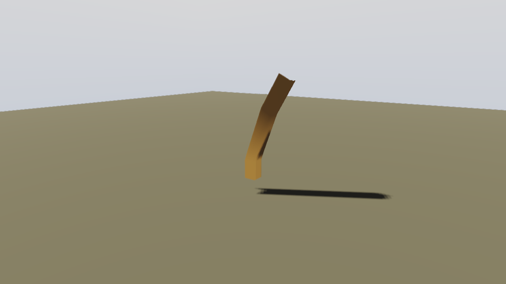
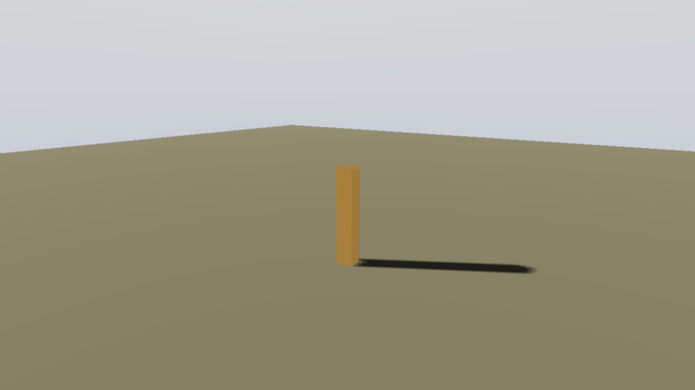

# Tutorial G14 — GPU-Skinning (GL ≥ 4.3, Matrix-Palette-SSBO)

> 🇬🇧 **English version:** [docs/en/tutorials/g14_gpu_skinning.md](../../en/tutorials/g14_gpu_skinning.md)

**Ziel:** die in G6 als „future work" markierte Fortsetzung — skeletales Skinning **auf der
GPU** statt auf der CPU. `anim::GpuSkinner` besitzt die GPU-Seite eines geskinnten Meshes
(VAO mit den Bind-Pose-Vertexdaten + `JOINTS_0`/`WEIGHTS_0` als float4-Attribute an den
Locations 5/6 sowie einen SSBO mit der Joint-Matrix-Palette an Binding 0). Ist
`render::Effect::GpuSkinning` aktiv und die GPU GL ≥ 4.3, zeichnet der G3-G-Buffer-Pass den
Skinner mit einem Skinning-Vertex-Shader (`#version 430`, `kGBufferVertSkin`), der pro
Vertex `skin = Σ wᵢ · uPalette[jᵢ]` rechnet. Unter GL 4.3 (oder mit abgeschaltetem Effekt)
fällt der Renderer auf das normale Mesh zurück — dort greift weiterhin das CPU-Skinning
(`anim::skinMeshCpu`, G6).

## Anbindung

```cpp
anim::SkinWeights skin;              // JOINTS_0 / WEIGHTS_0 (4+4 pro Vertex)
fuhgl::render::MeshData base = ...;  // Bind-Pose
fuhgl::render::Mesh mesh;  mesh.create(); mesh.setMeshData(base); // Fallback-Mesh
anim::GpuSkinner skinner;
skinner.create(base, skin);          // braucht aktuellen GL-≥-4.3-Kontext

scene::MeshEntry& e = node.attach<scene::MeshComponent>().addMesh(&mesh);
e.gpuSkin = &skinner;                // Scene::fillFrame -> FrameData::skins (parallel zu items)
e.meshData = &base;                  // CPU-Kopie, z. B. für G18-Picking

// pro Frame, nach Skeleton::updatePalette(jointNodePtrs):
skinner.uploadPalette(skeleton.palette);            // Palette -> SSBO
renderer.render(frame.view, &frame.materialIds, &frame.castShadow,
                &frame.particleSystems, frame.lightProbes, &frame.decals,
                frame.water, &frame.skins);          // G14: Skins an den G-Buffer-Pass
```

`Effect::GpuSkinning` ist kapazitätsgesteuert (`effectSupported(Effect::GpuSkinning, ...)`
verlangt GL ≥ 4.3 — pure Funktion, unit-getestet). glTF-Assets bekommen Skinner automatisch:
`io::instantiateGltf()` erzeugt auf GL ≥ 4.3 je einen `GpuSkinner` pro geskinntem Primitiv
und setzt `MeshEntry::gpuSkin` (+ `meshData` für jedes Primitiv).

```cpp
scene.root().effects.enable(fuhglgraphics::render::Effect::GpuSkinning); // Default an
// renderer.setEffectEnabled(render::Effect::GpuSkinning, false);       // -> CPU-Fallback
```

## Demo + Ergebnis

`examples/gpu_skinning_screenshot` — der G6-Roboterarm, per Joint-Palette auf der GPU
gebogen (kein CPU-Skinning pro Frame):

```bash
cmake --build build --target fuhglgraphics_gpu_skinning_screenshot
FUHGL_BACKEND=surfaceless ./build/examples/fuhglgraphics_gpu_skinning_screenshot \
    --out g14_on.png --width 1280 --height 720 --frames 16 --bend 1.05
FUHGL_BACKEND=surfaceless ./build/examples/fuhglgraphics_gpu_skinning_screenshot \
    --out g14_off.png --width 1280 --height 720 --frames 16 --bend 1.05 --cpu
```

GPU-Skinning an — das obere Armsegment ist per Palette gebogen:



Dieselbe Szene mit `--cpu` (`Effect::GpuSkinning` aus — normales Bind-Pose-Mesh, G6-Fallback):



## Tests

- `tests/test_render.cpp` (Unit): `kEffectCount = 16`, `effectName(Effect::GpuSkinning)`,
  `effectFromName()`-Roundtrip für jeden Effekt, `effectSupported(GpuSkinning, 4, 3) = true`,
  `(4, 2) / (3, 3) = false`.
- `tests/gl_smoke_gpu_skin.cpp` (Label `gl_context`, skippt mit 77 unter GL 4.3): ein
  2-Joint-Skinned-Ribbon wird mit `Effect::GpuSkinning` mit zwei Paletten gerendert — die
  Frames unterscheiden sich; mit ausgeschaltetem Effekt sind beide Frames identisch
  (Fallback zeichnet das Bind-Pose-Mesh); kein GL-Fehler.
- CI: `docs-screenshots` rendert `docs/images/ci/g14_gpu_skinning_{on,off}.png`.
