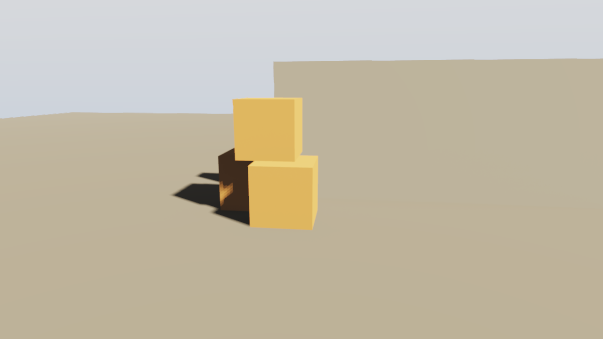
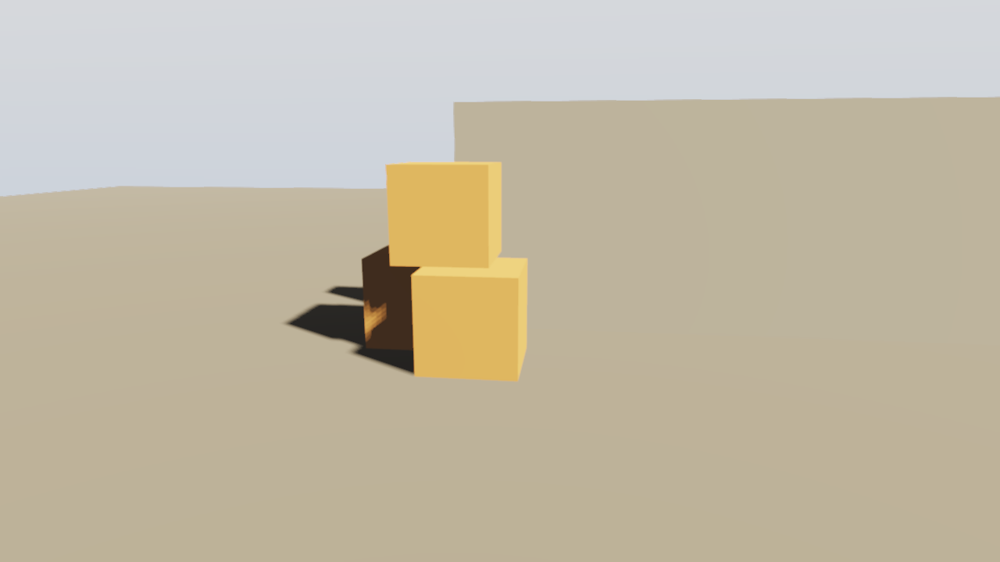

# Tutorial G15 — SSAO (Screen-Space Ambient Occlusion)

> 🇬🇧 **English version:** [docs/en/tutorials/g15_ssao.md](../../en/tutorials/g15_ssao.md)

**Ziel:** Screen-Space Ambient Occlusion aus dem erweiterten G-Buffer — ein neuer
Post-Graph-Pass `ssao` läuft **vor** dem Lighting-Pass: Er rekonstruiert Weltpositionen aus
der G-Buffer-Tiefe, sampelt einen deterministischen Hemisphären-Kernel (pro Pixel rotiert)
um die Oberflächennormale, projiziert jeden Sample mit der Kamera-viewProj und vergleicht
linearisierte Tiefen mit Range-Check. Das Ergebnis landet in der Ressource `ssao`
(RG16F, `.r` = AO-Faktor, 1 = nicht okkludiert); der Lighting-Pass multipliziert den
Material-AO (`gPbr.b`) auf Textureinheit 6 damit. `Effect::Ssao` ist standardmäßig aus
(kostet einen Vollbild-Kernel-Loop).

## Verwendung

```cpp
scene.root().effects.enable(fuhglgraphics::render::Effect::Ssao);
scene.root().effects.params.ssaoRadius = 1.5f;    // Welt-Raum-Sample-Radius
scene.root().effects.params.ssaoIntensity = 1.4f; // Okklusionsstärke
scene.root().effects.params.ssaoBias = 0.03f;     // Tiefen-Bias (gegen Acne)
scene.root().effects.params.ssaoSamples = 24;     // Kernel-Samples (max 64)
// renderer.texSsao() zeigt die rohe AO-Textur zur Inspektion
```

Pure Helfer (unit-getestet, ohne GL): `render::ssaoKernel(samples, seed)` (deterministischer
Hemisphären-Kernel, Skalierung lerp(0.1,1,(i/n)²)), `render::ssaoRotation(px, py, seed)`,
`render::linearizeDepth(d, zn, zf)` in `render/ssao.hpp`.

## Demo + Ergebnis

`examples/ssao_screenshot` — Hof mit Kisten und Wand; die Kontaktkanten werden mit SSAO
sichtbar dunkler:

```bash
cmake --build build --target fuhglgraphics_ssao_screenshot
FUHGL_BACKEND=surfaceless ./build/examples/fuhglgraphics_ssao_screenshot \
    --out g15_on.png --width 1280 --height 720 --frames 16
FUHGL_BACKEND=surfaceless ./build/examples/fuhglgraphics_ssao_screenshot \
    --out g15_off.png --width 1280 --height 720 --frames 16 --no-ssao
```

SSAO an — abgedunkelte Kontaktkanten (Kiste/Boden, Kiste/Wand, Wand/Boden):



Dieselbe Szene mit `--no-ssao` (nur der Sonnenschatten bleibt, Kanten heller):



## Tests

- `tests/test_ssao.cpp` (Unit): Kernel-Größe/Hemisphäre/Skalierung/Determinismus/
  Seed-Empfindlichkeit, `ssaoRotation` Wertebereich + Determinismus, `linearizeDepth`
  Endpunkte + Monotonie.
- `tests/test_render.cpp` (Unit): `kEffectCount = 17`, `effectName(Effect::Ssao) == "SSAO"`.
- `tests/gl_smoke_ssao.cpp` (Label `gl_context`, skippt mit 77): Kiste auf Boden — SSAO an
  vs aus unterscheiden sich, und die geänderten Pixel werden *dunkler* (AO ist multiplikativ);
  kein GL-Fehler.
- CI: `docs-screenshots` rendert `docs/images/ci/g15_ssao_{on,off}.png`.
