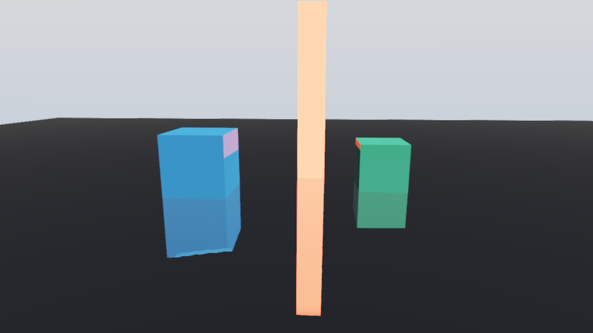
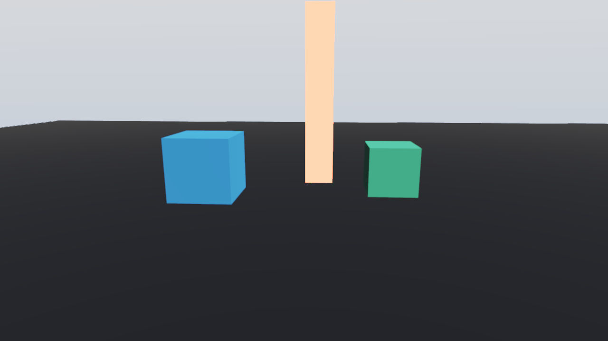

# Tutorial G16 — Screen-Space Reflections (SSR)

> 🇬🇧 **English version:** [docs/en/tutorials/g16_ssr.md](../../en/tutorials/g16_ssr.md)

**Ziel:** Screen-Space Reflections in der Deferred-Pipeline — ein neuer Post-Graph-Pass `ssr`
läuft **nach** dem Lighting: Er rekonstruiert Weltposition/Normale aus dem G-Buffer, marched
den Reflexionsvektor `reflect(-V, N)` im Weltraum gegen die G-Buffer-Tiefe (linearisierter
Vergleich mit Dickenband + binäre Verfeinerung bei Hit) und addiert die HDR-Farbe am Hit-Texel,
maskiert mit Fresnel × (1−Roughness)² × Screen-Edge-Fade × Distanz-Fade. Eingaben
`hdr/gNormal/gDepth/gPbr`, Ausgabe `hdrS` (die dann in die Wasser-/Partikel-Pässe geht).
`Effect::Ssr` ist standardmäßig aus (Raymarch-Kosten).

## Verwendung

```cpp
scene.root().effects.enable(fuhglgraphics::render::Effect::Ssr);
scene.root().effects.params.ssrMaxSteps = 48;     // Raymarch-Schritte (max 128)
scene.root().effects.params.ssrThickness = 0.4f;  // Hit-Band in Welt-Einheiten
scene.root().effects.params.ssrMaxDist = 30.f;    // max. March-Distanz
scene.root().effects.params.ssrStrength = 0.9f;   // Reflexionsstärke
// G22 Wetness addiert renderer.ssrWetnessBoost auf ssrStrength
```

Pure Helfer (unit-getestet) in `render/ssr.hpp`: `ssrEdgeFade(uv, margin)` und
`ssrMask(roughness, ndotv, metallic)` (die Shader-Maske).

## Demo + Ergebnis

`examples/ssr_screenshot` — Showroom mit Spiegelfußboden (metallic 1, roughness 0.05), einer
hellen emissiven roten Säule und farbigen Kisten:

```bash
cmake --build build --target fuhglgraphics_ssr_screenshot
FUHGL_BACKEND=surfaceless ./build/examples/fuhglgraphics_ssr_screenshot \
    --out g16_on.png --width 1280 --height 720 --frames 16
FUHGL_BACKEND=surfaceless ./build/examples/fuhglgraphics_ssr_screenshot \
    --out g16_off.png --width 1280 --height 720 --frames 16 --no-ssr
```

SSR an — der Boden spiegelt die rote emissive Säule und die Kisten (Bodenbereich ~18 % heller,
rötlicher Reflexionsfleck vor der Säule):



Dieselbe Szene mit `--no-ssr` — normaler PBR-Boden ohne Spiegelungen:



## Tests

- `tests/test_ssr.cpp` (Unit): `ssrEdgeFade` (Mitte 1, Rand 0, glatt monoton), `ssrMask`
  (Dielektrikum F0 frontal/Grazing, rau ≈ 0, Metall > Dielektrikum bei Grazing, Clamping).
- `tests/test_render.cpp` (Unit): `kEffectCount = 18`, `effectName(Effect::Ssr) == "SSR"`.
- `tests/gl_smoke_ssr.cpp` (Label `gl_context`, skippt mit 77): Spiegelfußboden + emissive
  Box — mit `Effect::Ssr` ist der Bodenbereich heller und verschieden; kein GL-Fehler.
- CI: `docs-screenshots` rendert `docs/images/ci/g16_ssr_{on,off}.png`.
