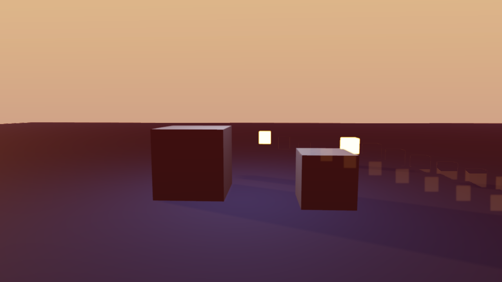
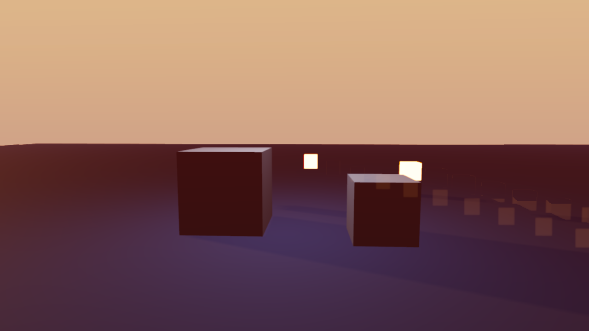

# Tutorial G17 — Bloom (einstellbarer Threshold)

> 🇬🇧 **English version:** [docs/en/tutorials/g17_bloom.md](../../en/tutorials/g17_bloom.md)

**Ziel:** Bloom in der HDR-Post-Kette — ein neuer Post-Graph-Pass `bloom` läuft **nach den
Partikeln, vor TAA** (der Halo wird damit von TAA temporal stabilisiert): per-Kanal
Bright-Pass oberhalb von `bloomThreshold`, 9-Tap-Golden-Angle-Blur mit `bloomRadius` Texeln,
addiert mit `bloomStrength`. Eingabe `hdrP`, Ausgabe `hdrB` (vom TAA-Pass konsumiert).
`Effect::Bloom` ist standardmäßig aus.

## Verwendung

```cpp
scene.root().effects.enable(fuhglgraphics::render::Effect::Bloom);
// Parameter auf den gemergten Frame-Effects setzen (nach fillFrame) oder direkt am Renderer:
frame.effects.params.bloomThreshold = 1.0f;  // HDR-Wert, ab dem ein Pixel bloomet
frame.effects.params.bloomStrength = 0.6f;   // Halo-Stärke
frame.effects.params.bloomRadius = 1.0f;     // Blur-Radius in Texeln
```

Pure Helfer (unit-getestet) in `render/bloom.hpp`: `bloomBrightPass(c, threshold)` und das
deterministische `bloomTaps(count)`-Muster.

## Demo + Ergebnis

`examples/bloom_screenshot` — Dämmerungsplatz mit HDR-hellen Lampen und der tiefen Sonne
(die ebenfalls bloomt und die God Rays speist):

```bash
cmake --build build --target fuhglgraphics_bloom_screenshot
FUHGL_BACKEND=surfaceless ./build/examples/fuhglgraphics_bloom_screenshot --out g17_on.png  --width 1280 --height 720 --frames 16
FUHGL_BACKEND=surfaceless ./build/examples/fuhglgraphics_bloom_screenshot --out g17_off.png --width 1280 --height 720 --frames 16 --no-bloom
FUHGL_BACKEND=surfaceless ./build/examples/fuhglgraphics_bloom_screenshot --out g17_thr4.png --width 1280 --height 720 --frames 16 --threshold 4
```

Bloom an (Threshold 1) — Halos um die Lampen und die Sonne:



Bloom aus:


Dasselbe mit `--threshold 4` — nur die hellsten Kerne (Lampen, Sonne) bloomen, der Halo ist
enger (einstellbarer Threshold):



## Tests

- `tests/test_bloom.cpp` (Unit): `bloomBrightPass` (ab/am Threshold abgeschnitten, darüber c−t,
  negativer Input, Threshold 0), `bloomTaps` (Anzahl, Radius-Wachstum, Determinismus, Streuung).
- `tests/test_render.cpp` (Unit): `kEffectCount = 19`, `effectName(Effect::Bloom) == "bloom"`.
- `tests/gl_smoke_bloom.cpp` (Label `gl_context`, skippt mit 77): dunkle Szene + HDR-Lampe —
  Bloom an erzeugt einen helleren Halo-Ring; Threshold 100 unterdrückt ihn (einstellbarer
  Threshold); kein GL-Fehler.
- CI: `docs-screenshots` rendert `docs/images/ci/g17_bloom_{on,off,thr4}.png`.
