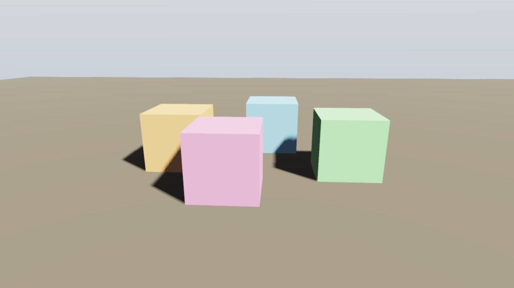

# Tutorial G18 — Picking / Ray-Casting auf dem Szenengraphen

> 🇬🇧 **English version:** [docs/en/tutorials/g18_picking.md](../../en/tutorials/g18_picking.md)

**Ziel:** CPU-Ray-Casting gegen den G9-Szenengraphen — Basis für Selektion und Gizmos im
Editor (G2/G11/G12). `scene/picking.hpp` (pure Math, kein GL): `rayFromScreen()` baut einen
Welt-Raum-Strahl durch ein Pixel, `rayIntersectAabb()` (Slab-Test) culled Node-Teilbäume über
ihre World-AABBs, `rayIntersectTriangle()` (Möller–Trumbore) testet die Dreiecke von
`MeshEntry::meshData` (die CPU-Kopie des Meshes — der glTF-Loader setzt sie für jedes Primitiv;
für prozedurale Meshes selbst setzen). `scene::pick()` liefert den nächsten `PickHit`
(Node, Mesh-Entry, Distanz, Welt-Punkt, Dreiecksindex).

## Verwendung

```cpp
fuhglgraphics::scene::MeshEntry& e = node.attach<fuhglgraphics::scene::MeshComponent>().addMesh(&mesh);
e.meshData = &myMeshData; // CPU-Dreiecke fürs Picking (glTF setzt das automatisch)

fuhglgraphics::scene::PickHit hit;
if (fuhglgraphics::scene::pick(scene, &cam, width, height, mouseX, mouseY, hit)) {
    // hit.node, hit.meshEntry, hit.distance, hit.point, hit.triangle
    placeMarkerAt(hit.point);
}
```

## Demo + Ergebnis

`examples/picking_screenshot` — Platz mit vier Kisten; pickt Pixel (560, 400), gibt den Hit
aus (`node=crateD dist=6.26 point=(-0.50, 1.04, 1.60) tri=9`) und rendert einen hellgelben
Marker-Würfel am Trefferpunkt:

```bash
cmake --build build --target fuhglgraphics_picking_screenshot
FUHGL_BACKEND=surfaceless ./build/examples/fuhglgraphics_picking_screenshot \
    --out g18.png --width 1280 --height 720 --frames 16 --px 560 --py 400
```

Marker am Pick-Punkt auf der pinken Kiste:


Derselbe Szene mit `--no-marker`:



## Tests

- `tests/test_picking.cpp` (Unit): `rayFromScreen` (Zentralstrahl = Kamera-vorwärts,
  Eckstrahlen symmetrisch), `rayIntersectAabb` (Hit/Miss/hinter Kamera/ innen),
  `rayIntersectTriangle` (Hit + Baryzentrik, Miss, Rückseite) sowie ein komplettes
  `scene::pick()` (nahe vs ferne Box, leere Ecke = Miss, Null-Kamera).
- `tests/gl_smoke_picking.cpp` (Label `gl_context`, skippt mit 77): pickt das Zentrum einer
  gerenderten Szene (Hit-Node + Distanz geprüft) und verifiziert, dass ein am Trefferpunkt
  platzierter Marker in den gerenderten Pixeln sichtbar ist; kein GL-Fehler.
- CI: `docs-screenshots` rendert `docs/images/ci/g18_picking_{marker,nomarker}.png`.
