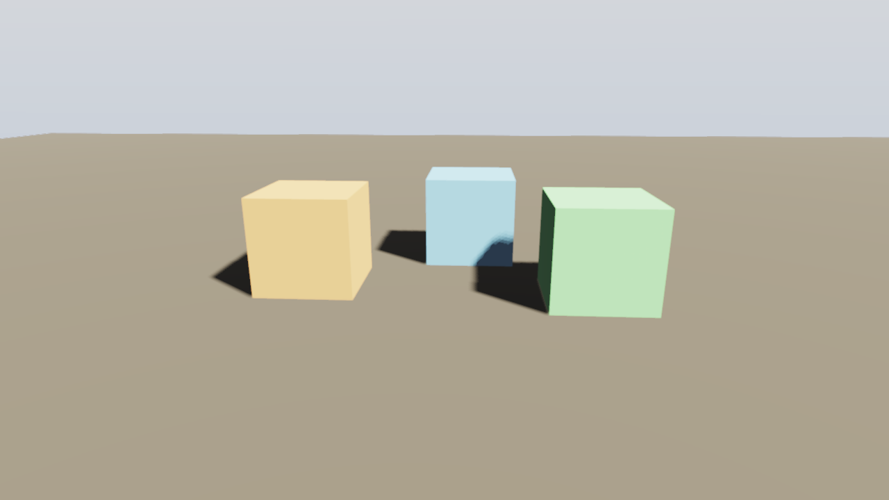

# Tutorial G19 — Szenen-Serialisierung (JSON)

> 🇬🇧 **English version:** [docs/en/tutorials/g19_serialization.md](../../en/tutorials/g19_serialization.md)

**Ziel:** eine G9-`scene::Scene` als JSON speichern und laden — Basis für speicherbare Demos und
die `.fasset`-Projektdateien des Asset Creators (G12). `scene/serialize.hpp` wandelt den
Szenengraphen nach/von `io::Json` um: Node-Hierarchie (Name + Translation/Rotation/Scale),
per-Node-Effekte (Liste + Parameter), Instancing sowie die reinen Daten-Komponenten —
`MeshComponent`-Einträge (Material-Parameter, materialId, castShadow, localOffset),
`LightComponent`, `DecalComponent`, `AnimationComponent`-Clips. GL-Ressourcen-Komponenten
(Partikel, Light Probes, Wasser) werden nicht serialisiert. Darüber hinaus stellen
`io::writeJson()` / `io::writeJsonFile()` die Pretty-Printer-Hälfte des JSON-Moduls
(`parseJson` gab es schon); Zahlen werden als kürzeste Zeichenkette geschrieben, die exakt
round-trippt.

## Mesh-Referenzen über einen Resolver

GL-Meshes können nicht serialisiert werden — das JSON speichert pro Eintrag eine **Mesh-Spec**
(z. B. `{"shape":"box","halfExtents":[0.8,0.8,0.8],"color":[1,1,1]}`), und ein
vom Aufrufer gelieferter `MeshResolver` macht daraus wieder ein `fuhgl::render::Mesh`, das einer
Arena gehört:

```cpp
std::vector<std::unique_ptr<fuhgl::render::Mesh>> meshArena;
fuhglgraphics::scene::Scene loaded;
fuhglgraphics::scene::loadScene(loaded, "scene.json",
                                fuhglgraphics::scene::defaultShapeResolver, meshArena);
// defaultShapeResolver kennt die prozeduralen Shapes "box" und "quad"; für .gltf-Dateien einen
// Resolver übergeben, der io::loadGltf/io::instantiateGltf ausführt. Unbekannte Specs -> nullptr
// (Mesh-loser Eintrag, wird trotzdem serialisiert).
```

## Verwendung

```cpp
// speichern
fuhglgraphics::scene::saveScene(scene, "scene.json");
// oder im Speicher: io::Json j = fuhglgraphics::scene::sceneToJson(scene);
//                   std::string text = fuhglgraphics::io::writeJson(j, 2);

// laden
fuhglgraphics::scene::Scene scene;
std::vector<std::unique_ptr<fuhgl::render::Mesh>> meshArena;
std::string err;
if (!fuhglgraphics::scene::loadScene(scene, "scene.json",
                                     fuhglgraphics::scene::defaultShapeResolver, meshArena, &err))
    std::fprintf(stderr, "Laden fehlgeschlagen: %s\n", err.c_str());
```

Dateiformat: `{"format":"fuhglgraphics-scene","version":1,"root":{node}}` — ein Node ist
`{name, translation, rotation[x,y,z,w], scale, effects{list,params}, instancing{...},
components[...], children[...]}`. Fehlerhafte Eingaben werden mit `false` + `err` abgelehnt
(bool + log-Konvention, keine Exceptions).

## Demo + Ergebnis

`examples/serialization_screenshot` — baut eine Szene (Ground-Quad + drei farbige Kisten +
Sonne), rendert sie, speichert sie als .json, injiziert die prozeduralen Mesh-Specs (das, was
ein Editor speichern würde), lädt die Datei mit `defaultShapeResolver` zurück und rendert die
geladene Szene. Das Demo gibt `round-trip JSON equal=1` aus (erneutes Serialisieren der geladenen
Szene ergibt identisches JSON), und beide Bilder stimmen überein:

```bash
cmake --build build --target fuhglgraphics_serialization_screenshot
FUHGL_BACKEND=surfaceless ./build/examples/fuhglgraphics_serialization_screenshot \
    --prefix g19 --width 1280 --height 720 --frames 16
```

Programmatisch gebaute Szene (Original):



Dieselbe Szene aus der .json-Datei geladen (nur 0,33 % der Pixel unterscheiden sich — TAA-Rauschen):


## Tests

- `tests/test_serialize.cpp` (Unit): `writeJson`/`parseJson`-Round-Trip (Escapes, Unicode,
  Zahlen inkl. 1e300, null/bool, leeres Array/Objekt, Kompaktmodus, ungültige Eingabe abgelehnt);
  kompletter Szenen-Round-Trip `writeJson(sceneToJson(fromJson(sceneToJson(scene)))) ==
  writeJson(sceneToJson(scene))` über TRS, Effekte + Parameter, Instancing, Mesh-Einträge,
  Licht, Decal (inkl. materialIdMask 0x2), Animations-Clip; `saveScene`/`loadScene`-Datei-Round-Trip;
  fehlerhafte Szene wird abgelehnt.
- `tests/gl_smoke_serialize.cpp` (Label `gl_context`, skippt mit 77): speichert eine Szene in
  eine temp-.json, patcht eine `{"shape":"box",...}`-Mesh-Spec hinein, lädt mit
  `defaultShapeResolver` (echtes GL-Mesh in der Arena), rendert über den G3-Renderer und prüft
  Items/Lights des Frames sowie ein nicht-schwarzes Bild; kein GL-Fehler.
- CI: `docs-screenshots` rendert `docs/images/ci/g19_serialization_{original,loaded}.png`.
