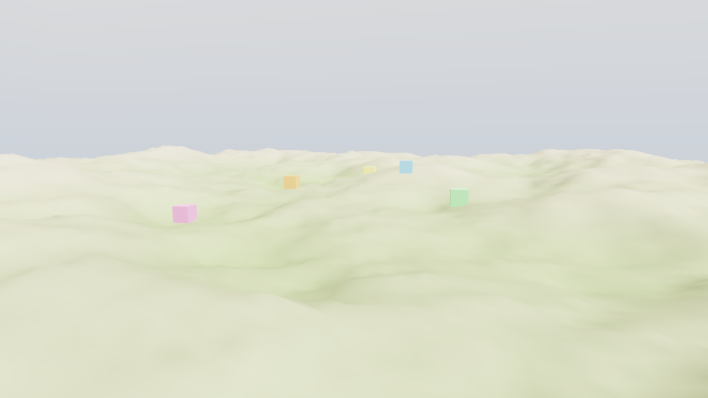
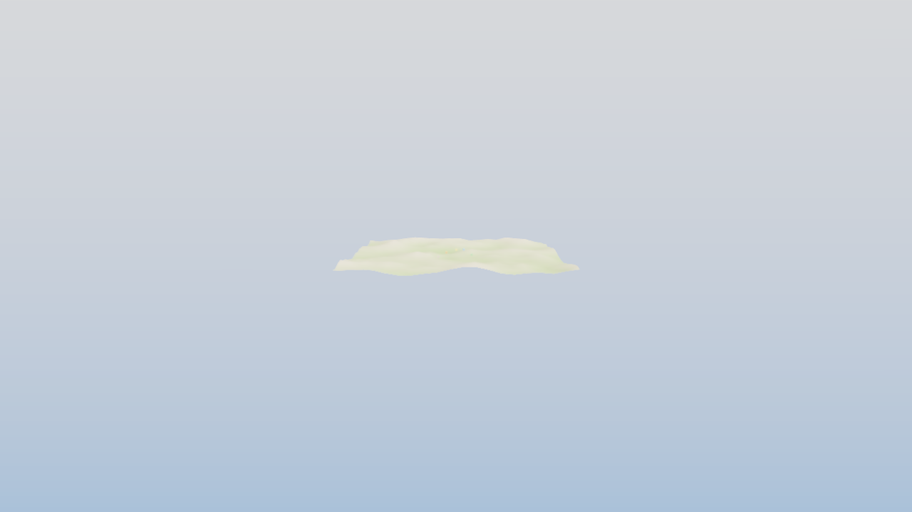

# Tutorial G20 — Terrain + LOD-Integration

> 🇬🇧 **English version:** [docs/en/tutorials/g20_terrain_lod.md](../../en/tutorials/g20_terrain_lod.md)

**Ziel:** die FuhGLCore-Terrain/LOD-Funktionen F38/F41 im G9-Szenengraphen und im
`fillFrame()`-Pfad des G3-Renderers nutzen. `scene::TerrainComponent` (in `scene/component.hpp`)
besitzt ein `fuhgl::render::LodMesh`, das `terrainLods()` baut — mehrere Gitter-Auflösungen einer
Heightmap mit screen-space-Umschaltabständen (`LodMesh::defaultDistances`, über
`customDistances` überschreibbar). `fill()` hängt einen Draw-Item an, dessen `lod`-Zeiger
gesetzt ist, sodass der G3-Renderer pro Frame das Level aus der Kamera-Distanz auflöst
(`resolveLodMesh`; `SceneView::lodEnabled = false` erzwingt Level 0) und in
`SceneView::lastLodLevel` meldet. `heightAt(x, z)` platziert Objekte auf dem Terrain
(bilinearer CPU-Heightmap-Sample). Der Terrain-Node trägt außerdem seine Bounding-Sphere-AABB
zum Frustum-Culling bei (`Node::computeAabb`).

## Verwendung

```cpp
scene::Node& tn = scene.root().createChild("terrain");
scene::TerrainComponent& tc = tn.attach<scene::TerrainComponent>();
tc.levels = 4;                    // LOD-Level (1 = normales Mesh)
tc.seed = 11u;                    // prozedurale Heightmap
tc.customDistances = {60, 150, 300}; // optional: Standard-Umschaltabstände überschreiben
if (!tc.create(160, 160, 160.f, 160.f, 12.f)) /* Fehler */; // Gitter, sizeX/Z, heightScale — braucht GL

// Objekte auf dem Terrain platzieren:
node.translation = {x, tc.heightAt(x, z) + 0.8f, z};

// pro Frame (unverändert): fillFrame -> Renderer löst das LOD-Level auf
int level = frame.view.lastLodLevel; // nach renderer.render(...)
```

Jedes andere Mesh kann ebenfalls LOD nutzen: `MeshEntry::lod` auf einen `LodMesh*` setzen —
der Draw-Item trägt ihn durch `fillFrame()` (`DrawItem::lod`).

## Demo + Ergebnis

`examples/terrain_screenshot` — 160×160-Heightmap-Terrain (4 LOD-Level, Umschaltabstände
60/150/300) mit fünf Kisten, platziert via `heightAt()`, gerendert nah (Kamera-Distanz < 60 →
**LOD-Level 0**) und fern (Distanz ≈ 436 → **LOD-Level 3**):

```bash
cmake --build build --target fuhglgraphics_terrain_screenshot
FUHGL_BACKEND=surfaceless ./build/examples/fuhglgraphics_terrain_screenshot \
    --prefix g20 --width 1280 --height 720 --frames 16
# terrain_screenshot: wrote g20_near.png (lastLodLevel=0)
# terrain_screenshot: wrote g20_far.png  (lastLodLevel=3)
```

Nahe Kamera, LOD-Level 0 (Kisten auf dem Terrain):



Ferne Kamera, LOD-Level 3 (gröbstes Gitter — dasselbe Terrain, weniger Dreiecke):



## Tests

- `tests/test_terrain_lod.cpp` (Unit): `LodMesh::selectLevel` (Grenzen, Clamping),
  `defaultDistances` (aufsteigend, Formel), `resolveLodMesh` (nah/fern/deaktiviert/kein LOD),
  `TerrainComponent::heightAt` auf einer manuellen Heightmap (Mitte/Ecken/geclampt) und der
  `fillFrame()`-Pfad: das Terrain-Draw-Item trägt `lod`, materialIds/castShadow/skins bleiben
  parallel, die World-AABB des Nodes deckt das Terrain ab.
- `tests/gl_smoke_terrain.cpp` (Label `gl_context`, skippt mit 77): erstellt ein 4-Level-Terrain,
  rendert nah (lastLodLevel == 0), fern (lastLodLevel > 0) und mit `lodEnabled = false`
  (lastLodLevel == -1); Frames nicht dunkel, kein GL-Fehler.
- CI: `docs-screenshots` rendert `docs/images/ci/g20_terrain_{near,far}.png`.
