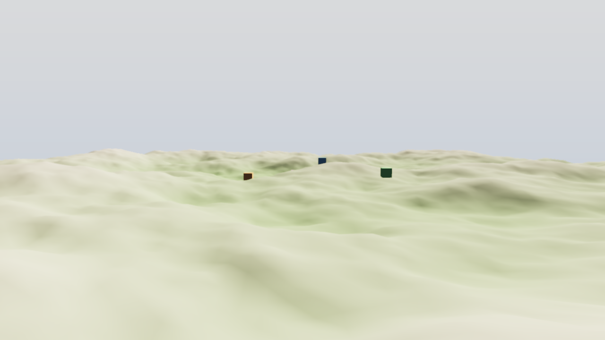
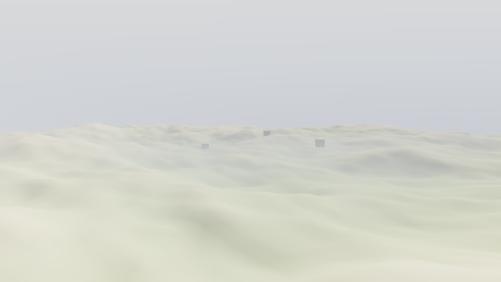

# Tutorial G21 — Volumetrischer Nebel / Wolken

> 🇬🇧 **English version:** [docs/en/tutorials/g21_volumetric_fog.md](../../en/tutorials/g21_volumetric_fog.md)

**Ziel:** ein rayge-marchter volumetrischer Nebel-/Wolken-Pass in der G3-HDR-Kette.
`render/volumetric.hpp` enthält die reinen (GL-freien) Zwillinge der Shader-Mathematik —
deterministisches 3D-Value-Noise/fBm (`volumetricHash`/`volumetricNoise`/`volumetricFbm`), die
Höhen-Falloff-Dichte (`volumetricDensity`), die Henyey–Greenstein-Phasefunktion
(`henyeyGreenstein`) und einen CPU-Referenz-Raymarcher (`volumetricMarch`) — der Pass ist also
ohne GL unit-testbar. Die GPU-Seite ist der "volumetric"-Post-Pass (`kVolumetricFrag`): nach den
Partikeln, vor Bloom (hdrP → hdrV → hdrB) wird pro Pixel der Sichtstrahl aus der G-Buffer-Tiefe
rekonstruiert (Sky-Pixel marchen bis `volumetricMaxDist`), in `volumetricSteps` Schritten durch
das Noise-Volumen gemarcht und Transmittanz `T` sowie Single Scattering (Sonne mit HG-Phase +
Sky-Ambient) akkumuliert. Ausgabe: `hdr * T + inscatter`. Schalter: `Effect::VolumetricFog`,
Parameter in `EffectParams` und am `DeferredRenderer`.

## Verwendung

```cpp
scene.root().effects.enable(fuhglgraphics::render::Effect::VolumetricFog);
// pro Frame, nach frame.effects.applyTo(renderer) (oder direkt am Renderer):
renderer.volumetricDensity = 0.018f;      // Dichte auf Bodenhöhe pro Welteinheit
renderer.volumetricCloudiness = 0.7f;     // 0 = homogener Nebel, 1 = wolkig
renderer.volumetricHeightFalloff = 10.f;  // Skalenhöhe
renderer.volumetricNoiseScale = 7.f;      // Welteinheiten pro Noise-Zelle
renderer.volumetricAnisotropy = 0.5f;     // Henyey–Greenstein g (Vorwärtsstreuung)
renderer.volumetricMaxDist = 140.f;       // March-Ende für Sky-Pixel
renderer.volumetricSteps = 32;            // March-Schritte (max 64)
renderer.volumetricStrength = 1.f;
renderer.volumetricTime += dt * 0.35f;    // Wolken-Drift
```

Sonnenrichtung/-farbe kommen vom ersten Directional Light des Frames, der Ambient-Term aus
den Sky-Farben des Renderers. Der Pass foggt auch den Himmel selbst.

## Demo + Ergebnis

`examples/volumetric_screenshot` — Terrain (G20-TerrainComponent) mit Kisten, gerendert mit
volumetrischem Nebel aus / an (Dichte 0.018) / dicht (0.06):

```bash
cmake --build build --target fuhglgraphics_volumetric_screenshot
FUHGL_BACKEND=surfaceless ./build/examples/fuhglgraphics_volumetric_screenshot \
    --prefix g21 --width 1280 --height 720 --frames 16
```

Nebel aus (analytischer Distanznebel abgeschaltet, damit nur der G21-Nebel sichtbar ist):



Nebel an — fernes Terrain versinkt in der Dunstschicht, Himmel inklusive:



Dichter Nebel (Dichte 0.06) — geringe Sichtweite, Kisten halb verschluckt:


## Tests

- `tests/test_volumetric.cpp` (Unit): Effekt-Registry („volumetric fog“, Anzahl 20, ab GL 3.3
  unterstützt); Hash-Determinismus + Seed-Sensitivität, Noise/fBm in [0,1] und Stetigkeit;
  Dichte-Höhen-Falloff (stimmt mit exp(-y/h) überein, unterhalb des Bodens geclampt,
  Cloudiness-Schranken); Henyey–Greenstein (isotrop bei g=0, Vorwärtspeak); CPU-Raymarcher
  (T in (0,1], fällt mit der Dichte, Dichte 0 → Identität, analytisch T = exp(-d·tMax)).
- `tests/gl_smoke_volumetric.cpp` (Label `gl_context`, skippt mit 77): rendert eine Szene mit
  Pass aus vs. an (Dichte 0.06) — Frames unterscheiden sich messbar, Nebel-an nicht dunkel,
  kein GL-Fehler.
- CI: `docs-screenshots` rendert `docs/images/ci/g21_volumetric_{off,on,dense}.png`.
