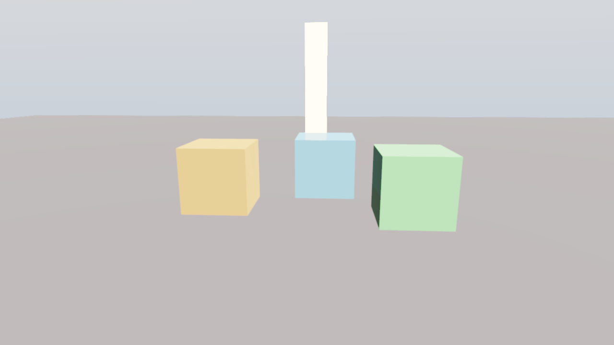
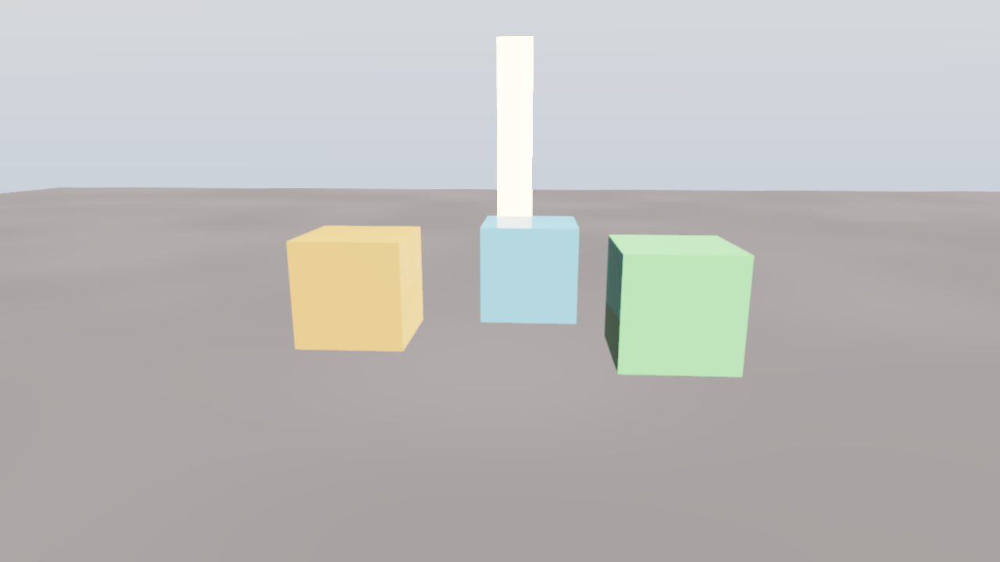
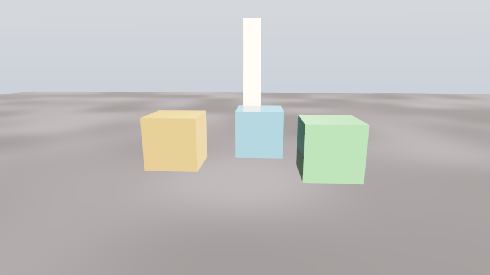

# Tutorial G22 — Wetness / Regen auf PBR-Materialien

> 🇬🇧 **English version:** [docs/en/tutorials/g22_wetness.md](../../en/tutorials/g22_wetness.md)

**Ziel:** regen-nasse Oberflächen im G3-Lighting-Pass. Mit `Effect::Wetness` moduliert der
Lighting-Shader (`kLightFragWetness`-Block, in `kLightFragTail` vor `shade()` angewendet) die
PBR-Eingaben pro Pixel: nach oben zeigende Flächen (`N.y`) bekommen einen glänzenden
Wasserfilm — Roughness wird Richtung 0.06 gemischt — und die Albedo dunkelt bei voller Nässe um
~35 % ab; eine Noise-**Pfützen-Maske** über der Welt-xz verstärkt Senken (`wetnessPuddle`:
0 = flacher Film überall, 1 = nur Pfützen-Stellen). Darüber addiert `wetnessAmount` die
SSR-Stärke (nasser Boden reflektiert). Reine CPU-Zwillinge der Formeln liegen in
`render/wetness.hpp` (`wetnessPuddleMask`, `wetnessFactor`, `wetnessRoughness`,
`wetnessAlbedoScale`) und sind unit-getestet. Für Regen-*Decals* (Spritzer, Tropfen) nutzt man
darauf aufbauend den vorhandenen G8-Decal-Pass.

## Verwendung

```cpp
scene.root().effects.enable(fuhglgraphics::render::Effect::Wetness);
scene.root().effects.enable(fuhglgraphics::render::Effect::Ssr); // nasse Reflexionen
// pro Frame nach frame.effects.applyTo(renderer):
renderer.wetnessAmount = 0.9f;      // 0..1 Regenmenge
renderer.wetnessPuddle = 0.7f;      // Stärke der Pfützen-Maske
renderer.wetnessNoiseScale = 3.5f;  // Welteinheiten pro Noise-Zelle
// Animation: wetnessAmount 0 -> 1 rampen, wenn es zu regnen beginnt
```

## Demo + Ergebnis

`examples/wetness_screenshot` — Platz (Asphalt-Boden, drei Kisten, eine emissive Säule als
SSR-Ziel), gerendert trocken / nass (amount 0.9, puddle 0.3) / pfützig (amount 1, puddle 1):

```bash
cmake --build build --target fuhglgraphics_wetness_screenshot
FUHGL_BACKEND=surfaceless ./build/examples/fuhglgraphics_wetness_screenshot \
    --prefix g22 --width 1280 --height 720 --frames 16
```

Trockener Asphalt (Roughness 0.85 — kaum Reflexion):



Nass — dunklerer Boden, glänzender Film, die Säule spiegelt sich im Boden (SSR-Boost):



Pfützig — voller Regen, Pfützen-Maske konzentriert in Senken:



## Tests

- `tests/test_wetness.cpp` (Unit): Effekt-Registry („wetness“, Anzahl 21, ab GL 3.3);
  Hash/Noise-Determinismus + Wertebereiche; Pfützen-Maske (flach bei Stärke 0, variabel bei 1,
  in [0,1]); Wetness-Faktor (0 bei Seitenfläche, = amount bei flacher Oben-Fläche, geclampt);
  Roughness monoton gegen 0.06; Albedo-Skalierung in [0.65, 1].
- `tests/gl_smoke_wetness.cpp` (Label `gl_context`, skippt mit 77): Platz mit SSR an, trocken
  vs. nass (amount 1, puddle 0.8) — Frames unterscheiden sich messbar, Nass-Frame nicht dunkel,
  kein GL-Fehler.
- CI: `docs-screenshots` rendert `docs/images/ci/g22_wetness_{dry,wet,puddles}.png`.
