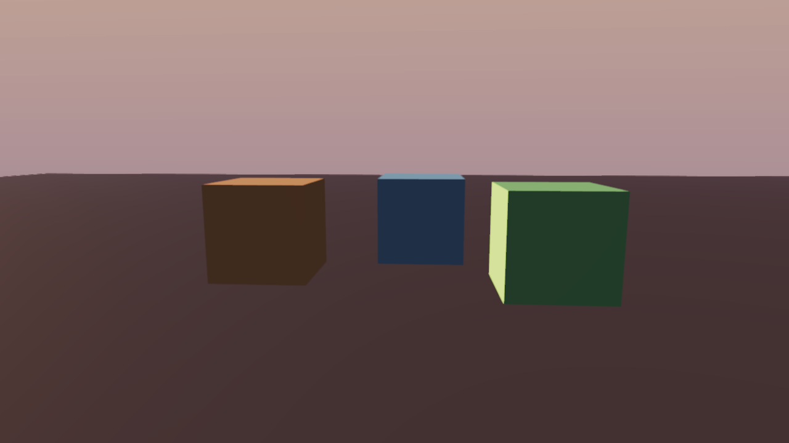
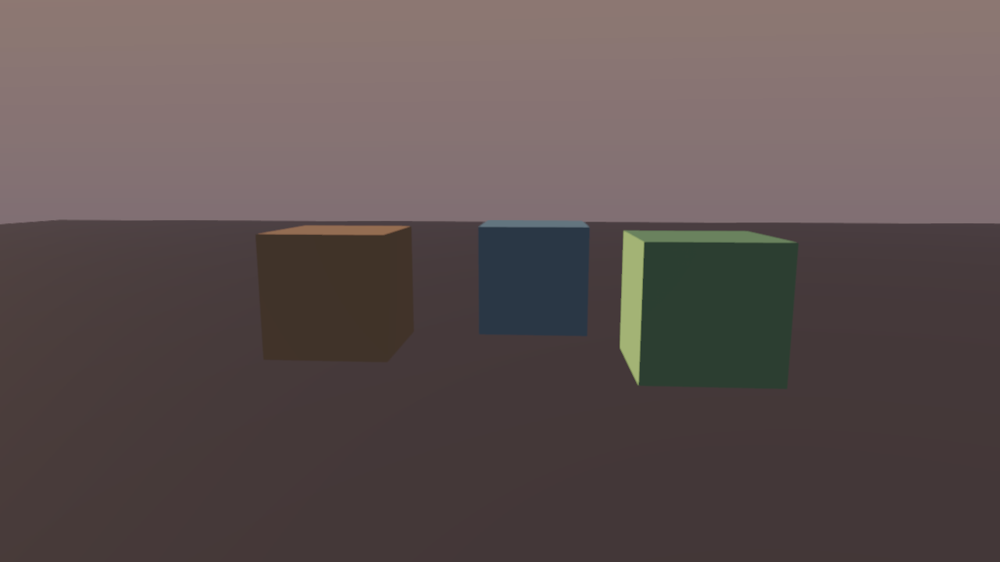
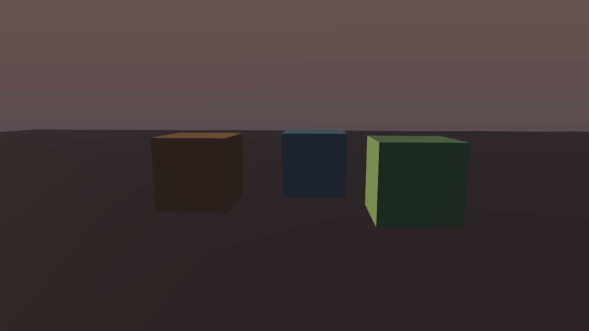
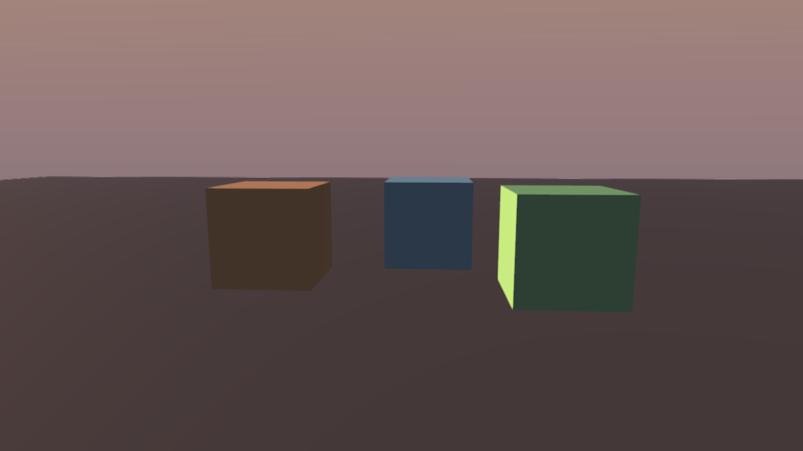

# Tutorial G23 — Tonemapping-Operatoren + einstellbarer Bloom-Threshold

> 🇬🇧 **English version:** [docs/en/tutorials/g23_tonemap.md](../../en/tutorials/g23_tonemap.md)

**Ziel:** wählbare Tonemapping-Operatoren im G3-Final-Pass. `render/tonemap.hpp` definiert
`render::TonemapOperator` — **ACES** (Default, bisheriges Verhalten), **Reinhard**, **Uncharted2**
(Hable, Weißpunkt 11.2) und **linear** — plus reine CPU-Zwillinge (`tonemapAces/Reinhard/
Uncharted2/Linear`, `tonemapApply`), die unit-getestet sind. Der Shader (`uOperator` in
`kTonemapFrag`) wählt die Kurve pro Frame; Gamma (1/2.2) wird danach angewendet wie bisher.
Pro Frame über `renderer.tonemapOperator` oder pro Szene über `EffectParams::tonemapOperator`
(mit G19 serialisiert). Der **Bloom-Threshold** aus G17 (`bloomThreshold`,
`EffectParams::bloomThreshold`) ist ebenfalls pro Frame einstellbar — höher = nur die
hellsten HDR-Pixel (Lampenkern, Sonnenscheibe) bloomen.

## Verwendung

```cpp
// pro Frame:
renderer.tonemapOperator = fuhglgraphics::render::TonemapOperator::Uncharted2;
renderer.bloomThreshold = 4.0f;  // G17: nur Pixel über HDR 4 bloomen
// oder pro Szenen-Node (in fillFrame gemerged, von G19 serialisiert):
node.effects.params.tonemapOperator = 2; // 0=aces 1=reinhard 2=uncharted2 3=linear
// CPU-Zwilling (z. B. für Thumbnails/Tests):
vec3 ldr = fuhglgraphics::render::tonemapApply(op, hdr * exposure);
```

## Demo + Ergebnis

`examples/tonemap_screenshot` — Dämmerungs-Platz mit drei HDR-Lampen (emissiv 9/5/1.5) und
tiefer Sonne, mit jedem Operator gerendert, plus ein ACES-Shot mit Bloom an und
`bloomThreshold = 4`:

```bash
cmake --build build --target fuhglgraphics_tonemap_screenshot
FUHGL_BACKEND=surfaceless ./build/examples/fuhglgraphics_tonemap_screenshot \
    --prefix g23 --width 1280 --height 720 --frames 16
```

ACES (Default, filmische Schulter):



Reinhard (weicherer Rolloff):



Uncharted2 (knackige Highlights, dunklere Mitten):



Linear (einfaches Clamp — ausgebrannte Lampenkerne, zum Vergleich):



ACES + Bloom mit `bloomThreshold = 4` — nur Lampenkerne/Sonnenscheibe über HDR 4 halogenieren:


## Tests

- `tests/test_tonemap.cpp` (Unit): Enum/Name-Round-Trip (Anzahl 4, Unbekannt abgelehnt); jeder
  Operator: Schwarz bleibt schwarz, Negative geclampt, monoton in [0,1] über 0..20 HDR, große
  Werte geclampt; Reinhard exakt bei x=1 (0.5); Linear identisch unter 1; RGB-Überladung.
- `tests/gl_smoke_tonemap.cpp` (Label `gl_context`, skippt mit 77): HDR-Szene mit allen vier
  Operatoren gerendert — jedes Frames-Paar unterscheidet sich messbar, keines zu dunkel, kein
  GL-Fehler.
- CI: `docs-screenshots` rendert `docs/images/ci/g23_tonemap_{aces,reinhard,uncharted2,linear,bloomthr4}.png`.
