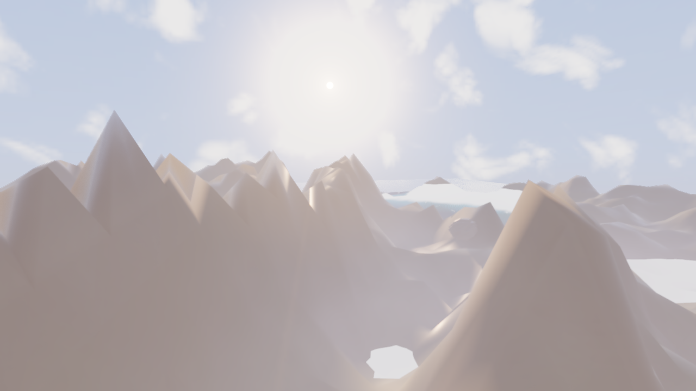
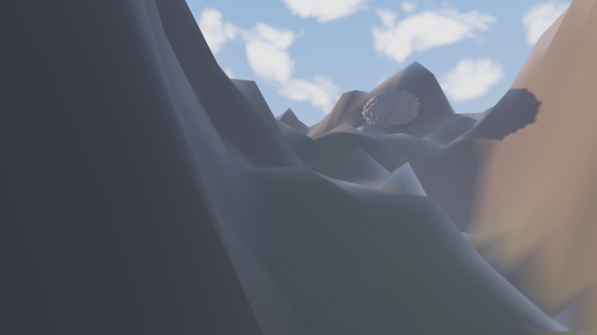

# Tutorial G24 — Prozedurales Noise-Modul (CPU)

> 🇬🇧 **English version:** [docs/en/tutorials/g24_procedural_noise.md](../../en/tutorials/g24_procedural_noise.md)

**Ziel:** eine geseedete, deterministische Noise-Quelle für alles Prozedurale in der Engine —
`procedural::Noise` in `include/fuhglgraphics/procedural/noise.hpp`. Header-only-Werttyp
(wie `fuhgl::math::Noise`): kein GL, keine Allokation, kein I/O, und derselbe Seed liefert
auf jeder Plattform dieselben Werte. Perlin delegiert an `fuhgl::math::Noise` (Improved
Perlin); Value- und Simplex-Noise nutzen eine eigene splitmix32-geseedete Permutation.

## API

```cpp
#include <fuhglgraphics/procedural/noise.hpp>

fuhglgraphics::procedural::Noise noise(20240817u);   // Seed

// Basis-Noises
float v = noise.value2(x, y);            // [0, 1]  (value3 für 3D)
float p = noise.perlin2(x, y);           // ~[-1, 1] (perlin3 für 3D)
float s = noise.simplex2(x, y);          // ~[-1, 1] (simplex3 für 3D, Gustavson)

// Fraktale über wählbarer Basis (amplituden-normalisiert)
using B = fuhglgraphics::procedural::Noise::Base;    // Value | Perlin | Simplex
float f = noise.fbm2(x, y, 6, B::Perlin);            // ~[-1, 1]  (fbm3 für 3D)
float r = noise.ridged2(x, y, 6, B::Perlin);         // [0, 1], scharfe Grate — Berge
float t = noise.turbulence3(x, y, z, 5, B::Simplex); // [0, 1], wolkig — Wolken

// Domain-Warp: p + strength * fBm(p), fBm(p + Offset), ...
fuhgl::math::Vec2  wp2 = noise.warp2(x, y, 0.9f, 2);
fuhgl::math::Vec3  wp3 = noise.warp3(x, y, z, 0.6f, 2);

// Convenience-Höhenfeld fürs Terrain in [0, 1]
float h = noise.height2(x, y, 6);        // Ridged-fBm
```

## Anwendung: Terrain-Höhenfeld carven

`scene::TerrainComponent` hält eine CPU-Kopie der Heightmap (`heights`, normalisiert [0, 1],
zeilenweise). Überschreiben und `rebuildLod()` aufrufen — `heightAt()` passt dann wieder:

```cpp
scene::TerrainComponent& tc = tn.attach<scene::TerrainComponent>();
tc.create(200, 200, 260.f, 260.f, 34.f);              // braucht GL-Kontext
for (int j = 0; j < tc.gridH; ++j)
    for (int i = 0; i < tc.gridW; ++i) {
        const float x = (float(i) / (tc.gridW - 1) - 0.5f) * tc.sizeX;
        const float z = (float(j) / (tc.gridH - 1) - 0.5f) * tc.sizeZ;
        const auto wp = noise.warp2(x * 0.011f, z * 0.011f, 0.9f, 2);  // mäandernde Grate
        float h = 0.85f * noise.ridged2(wp.x, wp.y, 6, B::Perlin)
                + 0.15f * noise.fbm2(x * 0.045f, z * 0.045f, 4, B::Simplex);
        tc.heights[j * tc.gridW + i] = h;
    }
tc.rebuildLod();                                     // LOD-Meshes neu bauen — braucht GL
```

Dieselbe `Noise`-Instanz kann Sky-Cubemap (Turbulenz-Wolken), Volumenfelder für G25
Marching Cubes, Jitter für G26/G27/G28 und SDF-Formen für G29 treiben — ein Seed, eine Welt.

## Demo + Ergebnis

`examples/noise_screenshot` — Terrain aus domain-gewarptem Ridged-fBm + ausgeschnittenem
Seebecken, G13-Gerstner-Wassersee, Wolken-Sky-Cubemap derselben `Noise` + IBL davon,
warme tiefe Sonne mit CSM-Schatten + God Rays, SSAO + volumetrischer Nebel + Wetness + Bloom,
TAA + Upscale + ACES:

```bash
cmake --build build --target fuhglgraphics_noise_screenshot
FUHGL_BACKEND=surfaceless ./build/examples/fuhglgraphics_noise_screenshot \
    --prefix g24_noise --width 1280 --height 720 --frames 16
```

Weitwinkel (See, Gratberge, Wolken, Sonne mit God Rays, Dunst):



Grat-Nahaufnahme mit Wetness-Pfützen (G22) über dem Noise-Terrain:



## Tests

- `tests/test_procedural_noise.cpp` (Unit): Determinismus pro Seed, Value-Noise-Bereich
  [0, 1] + exakte Gitterwerte an Integer-Koordinaten, Perlin/Simplex-Bereich und ~Mittelwert
  0 über 4000 Samples, Improved-Perlin = 0 an Integer-Gitterpunkten, fBm/Ridged/Turbulence-
  Bereiche, Stetigkeit (|Δ| < 0.05 für ε = 1e-3), Warp-Schranken.
- CI: `docs-screenshots` rendert `docs/images/ci/g24_noise_{wide,ridge}.png`; der
  perceptual diff vergleicht sie mit den eingecheckten Referenzen oben.
