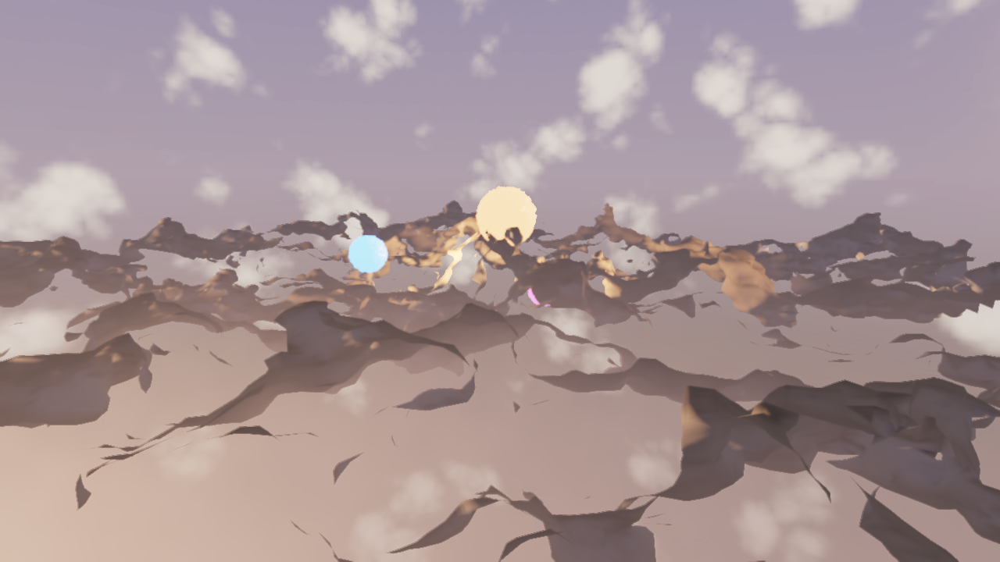
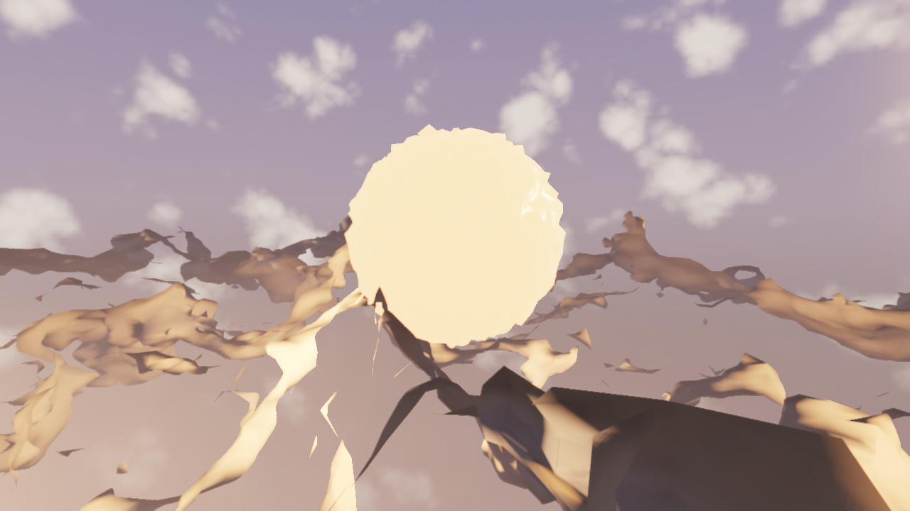

# Tutorial G25 — Marching Cubes (Voxel → Mesh)

> 🇬🇧 **English version:** [docs/en/tutorials/g25_marching_cubes.md](../../en/tutorials/g25_marching_cubes.md)

**Ziel:** aus einem gesampelten 3D-Skalarfeld eine glatte Dreiecksoberfläche extrahieren —
der klassische Marching-Cubes-Algorithmus (Lorensen & Cline 1987). In
`procedural/marching_cubes.hpp`: `VolumeGrid` + `sampleField()` sampeln ein beliebiges
`std::function<float(Vec3)>`-Feld; `marchingCubes()` polygonisiert es zu einem wasserdichten
indexierten `fuhgl::render::MeshData`; `marchingCubesChunked()` macht dasselbe für große Volumen
in naht-exakten Chunks. Einsatz: Höhlen-/zerstörbares Terrain, Metaballs und (in G29)
SDF-Fraktale.

## Anwendung

```cpp
#include <fuhglgraphics/procedural/marching_cubes.hpp>
#include <fuhglgraphics/procedural/noise.hpp>

fuhglgraphics::procedural::Noise noise(90210u);

// 1) Feld in ein Volumen-Grid sampeln (Welt-Box [vMin, vMax], VN^3 Gitterpunkte)
const fuhgl::math::Vec3 vMin{-70, -6, -70}, vMax{70, 44, 70};
const auto vol = fuhglgraphics::procedural::sampleField(
    [&](const fuhgl::math::Vec3& p) {
        const float h = 20.f * noise.height2(p.x * 0.018f, p.z * 0.018f, 6) + 4.f;
        const float cave = 7.f * noise.fbm3(p.x * 0.055f, p.y * 0.075f, p.z * 0.055f, 4,
                                            fuhglgraphics::procedural::Noise::Base::Simplex);
        return (h - p.y) + cave;        // < 0 innerhalb des Gesteins
    },
    vMin, vMax, 112, 112, 112);

// 2) polygonisieren (gechunkt: ein MeshData pro Chunk, Nähte exakt)
const auto chunks = fuhglgraphics::procedural::marchingCubesChunked(vol, 0.f, 4, 1, 4);

// 3) hochladen + anhängen: ein Mesh pro Chunk, alle als MeshEntries eines Knotens
fuhgl::render::Mesh mesh;
mesh.setMeshData(chunks[0]);            // braucht GL-Kontext
auto& entry = node.attach<scene::MeshComponent>().addMesh(&mesh);
entry.albedo = {0.46f, 0.43f, 0.38f};
entry.roughness = 0.95f;
```

Details: ein Gitterpunkt ist „innen“, wenn `Wert < Isolevel`; geschnittene Kanten werden linear
interpoliert, Normalen kommen aus zentralen Differenzen des Grids (pro Kante interpoliert), und
Vertices werden pro Gitterkante verschweißt — das Mesh ist also geschlossen (manifold), wo die
Oberfläche den Volumenrand nicht berührt. `MeshData` nutzt das Standard-Layout 11 Floats/Vertex
(pos, normal, color, uv), daher reichen `Mesh::setMeshData()` + `MeshComponent`.

## Demo + Ergebnis

`examples/marching_cubes_screenshot` — ein 112³-G24-Noise-Volumen mit fBm-Höhlen, zu 16 Chunks
polygonisiert (~115k Dreiecke), emissive Kristall-Blobs (Bloom), Dämmerungs-Sky-Cubemap + IBL,
Sonne mit CSM-Schatten + God Rays, SSAO, volumetrischer Nebel, TAA + Upscale + ACES:

```bash
cmake --build build --target fuhglgraphics_marching_cubes_screenshot
FUHGL_BACKEND=surfaceless ./build/examples/fuhglgraphics_marching_cubes_screenshot \
    --prefix g25_marching_cubes --width 1280 --height 720 --frames 16
# marching_cubes_screenshot: 16 chunks, 115096 triangles
```

Höhlen-Terrain in der Dämmerung mit leuchtenden Kristallen:



Kristall-Nahaufnahme mit Bloom + God Rays:



## Tests

- `tests/test_procedural_mc.cpp` (Unit): `sampleField`-Werte/Positionen, leere + degenerierte
  Volumen, Kugel-Feld → geschlossenes maniffeliges Mesh (jede Kante von genau 2 Dreiecken
  geteilt, Euler-Charakteristik V−E+F = 2, Normalen nach außen, Vertices auf der Schale),
  Ebenen-Feld → alle Vertices auf der Ebene, konsistente Normalen, exakte Dreieckzahl 2·(N−1)²,
  gechunkt == ungechunkt (Dreieckzahl), G24-Noise-Blob → geschlossenes Manifold.
- `tests/gl_smoke_procedural.cpp` (Label `gl_context`, skip mit 77): Noise-Metaball-Blob wird
  gerendert — Center-Pixel beleuchtet und verschieden vom Mesh-losen Frame.
- CI: `docs-screenshots` rendert `docs/images/ci/g25_marching_cubes_{cave,blob}.png`.
