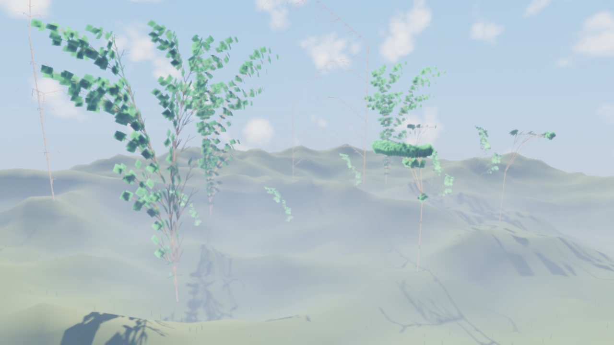
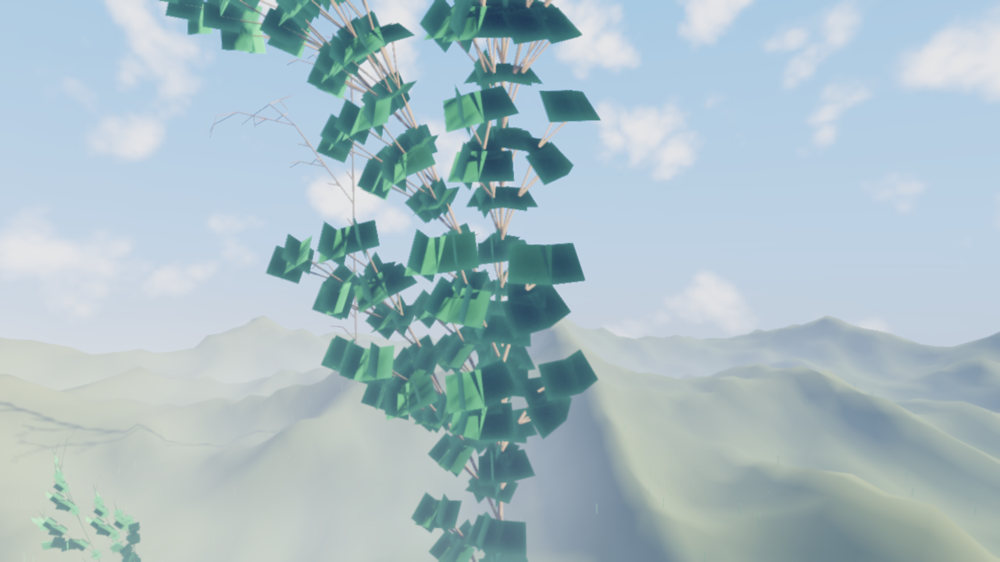

# Tutorial G26 — L-Systeme (Lindenmayer) → Mesh

> 🇬🇧 **English version:** [docs/en/tutorials/g26_lsystem.md](../../en/tutorials/g26_lsystem.md)

**Ziel:** Pflanzen per regelbasiertem String-Rewriting als Mesh wachsen lassen — L-Systeme
(`procedural::LSystem` in `procedural/lsystem.hpp`). `derive()` ersetzt das Axiom `iterations`
mal mit den Produktionsregeln; `generate()` interpretiert den String mit einer 3D-Turtle und
erzeugt ein `fuhgl::render::MeshData` (verjüngte Zylinder für Äste, gekreuzte Blatt-Quads).

## Anwendung

```cpp
#include <fuhglgraphics/procedural/lsystem.hpp>

// Preset: verzweigter Baum (Varianten 0..2), Barnsley-artiger Farn, Busch
fuhglgraphics::procedural::LSystem tree = fuhglgraphics::procedural::LSystem::makeTree(0);

// oder individuell: Axiom + Regeln + Turtle-Parameter
fuhglgraphics::procedural::LSystem custom;
custom.axiom = "F";
custom.rules = {{'F', "FF+[+&F-FL]-[-&F+FL]"}};  // L = Blatt-Quad an der Spitze
custom.iterations = 4;
custom.angleDeg = 22.5f;   // Drehwinkel für + - & ^ \ |
custom.step = 0.9f;        // Segmentlänge von F/f
custom.radius0 = 0.11f;    // Stamm-Radius
custom.radiusTaper = 0.7f; // pro [ -Tiefe
custom.sides = 6;          // Zylinder-Seiten
custom.leaves = true;

const std::string code = tree.derive();              // deterministisches Rewriting
const fuhgl::render::MeshData md = tree.generate({0.30f, 0.20f, 0.12f},   // Stammfarbe
                                                 {0.14f, 0.45f, 0.16f});  // Blattfarbe

// hochladen + auf dem Terrain platzieren (braucht GL-Kontext)
fuhgl::render::Mesh mesh;
mesh.setMeshData(md);
scene::Node& n = scene.root().createChild("tree0");
n.translation = {x, tc.heightAt(x, z), z};
n.attach<scene::MeshComponent>().addMesh(&mesh);
```

Turtle-Symbole: `F` vorwärts zeichnen (Zylinder, Radius verjüngt sich mit `[`-Tiefe), `f` bewegen,
`+`/`-` rollen um die Richtung, `&`/`^` nicken, `\`/`|` gieren, `[`/`]` Frame pushen/poppen
(neuer Ast), `L` zwei gekreuzte Blatt-Quads. Unbekannte Symbole werden ignoriert.

> Die Turtle startet mit Richtung +Y (oben), und reines Rollen (`+`/`-`) ändert die
> Zeichenrichtung nie — eine Regel nur mit `+`/`-` zeichnet jedes Segment senkrecht nach oben
> und sieht aus wie ein Stock. Roll mit Nicken (`&`/`^`) oder Gieren (`\\`/`|`) kombinieren
> für echte 3D-Äste, z. B. `FF+[+&F-FL]-[-&F+FL]`: das Roll setzt das Azimut des Astes, `&`
> kippt ihn vom Stamm weg.

## Demo + Ergebnis

`examples/lsystem_screenshot` — 9 L-System-Bäume (3 Varianten, rotiert/skaliert) + 5 Farne auf
einem G24-Noise-Terrain, 3000 instanzierte Grashalme per `Instancing::heightFn` auf den Boden
gesnappt, Mittagssonne mit CSM-Schatten + God Rays, Tages-Sky-Cubemap + IBL, SSAO, volumetrischer
Nebel, TAA + Upscale + ACES:

```bash
cmake --build build --target fuhglgraphics_lsystem_screenshot
FUHGL_BACKEND=surfaceless ./build/examples/fuhglgraphics_lsystem_screenshot \
    --prefix g26_lsystem --width 1280 --height 720 --frames 16
```

Wald-Übersicht:



Baum-Nahaufnahme (Stamm, Äste, Blatt-Quads):



## Tests

- `tests/test_procedural_lsystem.cpp` (Unit): `derive()` exakte Strings + Determinismus,
  unbekannte Symbole werden durchgereicht, Presets liefern balancierte Klammern und vernünftige
  Größen, `generate()`-Güte (indexiert, endlich, Einheitsnormalen, wächst nach oben, bounded),
  Presets unterscheiden sich, Stamm-/Blatt-Vertexfarben vorhanden.
- CI: `docs-screenshots` rendert `docs/images/ci/g26_lsystem_{forest,tree}.png`.
