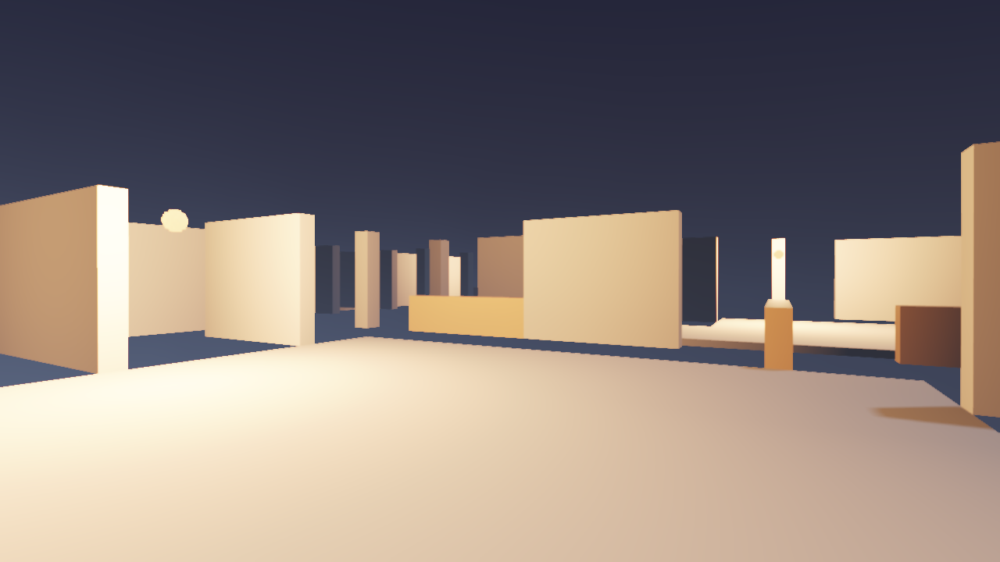
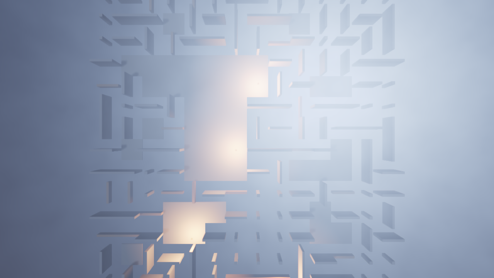

# Tutorial G27 — Wave Function Collapse (gekachelt)

> 🇬🇧 **English version:** [docs/en/tutorials/g27_wfc.md](../../en/tutorials/g27_wfc.md)

**Ziel:** kohärente Tile-Layouts (Dungeons, Städte, Stationen) per Wave Function Collapse
generieren: `procedural::Wfc` in `procedural/wfc.hpp`. Man definiert Tiles mit Edge-Tags
(„Sockets") und Gewichten; der Solver kollabiert jede Gitterzelle auf ein Tile + Rotation, sodass
alle benachbarten Tags passen — Min-Entropie-Auswahl, Constraint-Propagation, geseedetes
Backtracking. Deterministisch pro Seed; reine CPU. Die Platzierungen werden als G9-Szenen-Knoten
instanziiert.

## Anwendung

```cpp
#include <fuhglgraphics/procedural/wfc.hpp>

// Tile-Tags in zyklischer Richtung: E(+x), S(+z), W(-x), N(-z); "o" = offen, "w" = Wand
fuhglgraphics::procedural::Wfc wfc(14, 14, /*borderTag=*/"w");   // Rand ringt in Wänden ein
for (const auto& t : fuhglgraphics::procedural::Wfc::makeDungeonTiles()) wfc.addTile(t);
// makeDungeonTiles(): floor(oooo), wallH(w o w o), wallV(o w o w), wallCap(w o o o),
//                     corner(w w o o), doorH/doorV (gleiche Sockets wie Wandbänder), pillar(wwww)

const auto cells = wfc.solve(/*seed=*/777u);   // zeilenweise, cells[x + width*z] = {tile, rot}

// Instanziieren: alle Zellen einer (Tile, Rot)-Klasse in ein MeshData mergen, ein Knoten pro Klasse
for (int z = 0; z < wfc.height(); ++z)
    for (int x = 0; x < wfc.width(); ++x) {
        const auto& c = cells[x + wfc.width() * z];
        if (c.tile < 0) continue;                       // nach Backtracking ungelöst
        const float wx = (x - (wfc.width() - 1) * 0.5f) * CELL;
        const float wz = (z - (wfc.height() - 1) * 0.5f) * CELL;
        const auto m = fuhgl::math::translate({wx, 0, wz}) *
                       fuhgl::math::rotateY(-c.rot * fuhgl::math::kPi * 0.5f);
        appendTransformed(mergedMesh[c.tile * 4 + c.rot], tileMesh[c.tile], m);
    }
```

Eigene Tiles: `WfcTile{name, weight, {tagE, tagS, tagW, tagN}}`. Rotation um `rot*90°` bildet
`wfcRotatedTags(rot)[d] = tags[(d + rot) mod 4]`; zwei Zellen sind kompatibel, wenn die
berührenden Tags gleich sind (`Wfc::compatible`). Der Gitterrand wirkt als fester Tag, daher
ummauert `"w"` die Map automatisch.

## Demo + Ergebnis

`examples/wfc_screenshot` — ein 14×14-Dungeon, gelöst per WFC (Seed 777: 44 Boden, 131 Wand,
21 Tür-Zellen), instanziiert als pro-(Tile,Rotation) gemergte Knoten, mit Fackeln (emissive
Flammen + Punktlichter + Bloom), Wear-Decals auf dem Boden (G8), schwachem Richtungslicht mit
CSM-Schatten, SSAO, volumetrischem Nebel, TAA + Upscale + ACES:

```bash
cmake --build build --target fuhglgraphics_wfc_screenshot
FUHGL_BACKEND=surfaceless ./build/examples/fuhglgraphics_wfc_screenshot \
    --prefix g27_wfc --width 1280 --height 720 --frames 16 --seed 777
# wfc_screenshot: 14x14 solved (seed 777): floor=44 wall=131 door=21 unsolved=0
```

Innenansicht mit fackelbeleuchteter Tür (Bloom + Nebel + Schatten):



Draufsicht auf das gelöste Layout:



## Tests

- `tests/test_procedural_wfc.cpp` (Unit): Rotations-Tag-Mapping, Kompatibilität, Güte der
  vollen Lösung (alle Zellen kollabiert, alle Nachbarschafts-Tags passen inkl. Rand),
  Determinismus pro Seed, Dungeon-Struktur (geschlossener Wandring, offener Boden innen),
  Widerspruch → Backtracking terminiert mit ungelösten Zellen.
- CI: `docs-screenshots` rendert `docs/images/ci/g27_wfc_{dungeon,overview}.png`.
