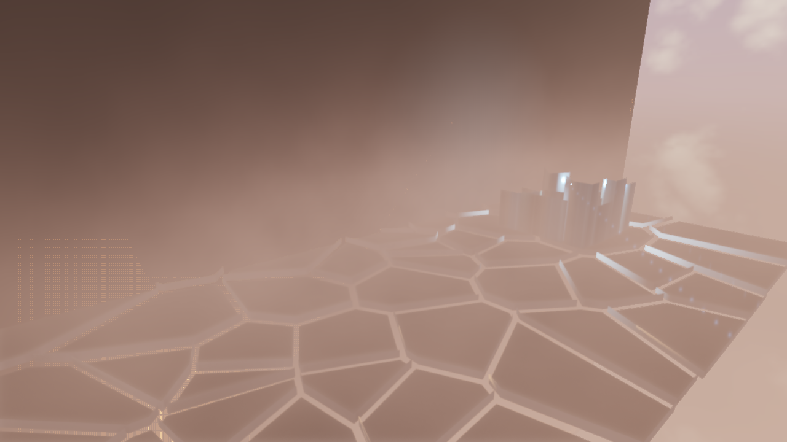
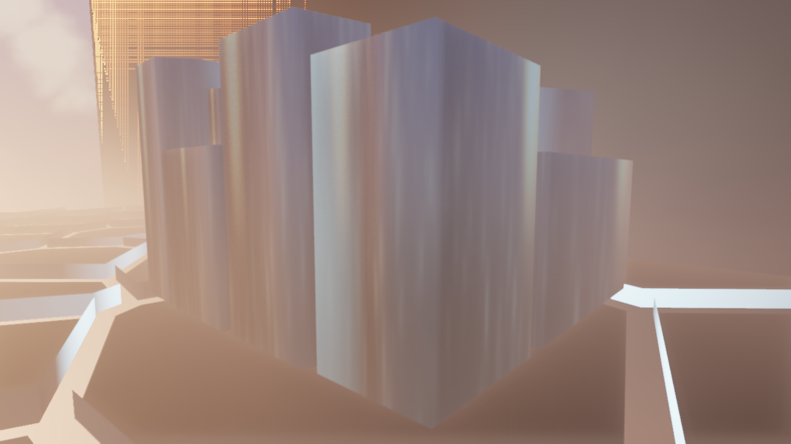

# Tutorial G28 — Voronoi-Diagramme + Extrusion

> 🇬🇧 **English version:** [docs/en/tutorials/g28_voronoi.md](../../en/tutorials/g28_voronoi.md)

**Ziel:** ein Rechteck per `procedural::Voronoi2D` in `procedural/voronoi.hpp` um geseedete Punkte
in Zellen aufteilen — konvexe Zellen-Polygone (Halbebenen-Schnitt gegen die Mittelsenkrechten),
Nachbarschaftskanten, F1/F2-Distanzfelder — und die Zellen per `procedural::extrudeCells` in
Prismen-Meshes extrudieren. Ideal für gerissene Bodenplatten, zersplittertes Glas, Stadtblöcke,
Zellstrukturen oder Kristallsplitter. Deterministisch pro Seed; reine CPU.

## Anwendung

```cpp
#include <fuhglgraphics/procedural/voronoi.hpp>

// 70 geseedete Punkte in [-30, 30]^2 -> 70 konvexe Zellen (CCW, auf das Rechteck geclippt)
fuhglgraphics::procedural::Voronoi2D v =
    fuhglgraphics::procedural::voronoi2d(70, {-30.f, -30.f}, {30.f, 30.f}, 2468u);

// F1/F2-Distanzfelder an einem Punkt (F2-F1 = Abstand zur nächsten Zellgrenze)
float f1, f2;
fuhglgraphics::procedural::voronoiDistances(v, {3.5f, -2.0f}, f1, f2);

// jede Zelle zu einem Prisma extrudieren -> ein MeshData (11 Floats/Vertex, bereit für Mesh::setMeshData)
fuhgl::render::MeshData plates = fuhglgraphics::procedural::extrudeCells(
    v, /*y0=*/-0.15f, /*y1=*/0.30f,
    /*gap=*/0.055f,          // jedes Polygon zum Zentroid schrumpfen -> Risse zwischen den Platten
    /*heightJitter=*/0.12f,   // pro Zelle variierende Oberkantenhöhe (jitterSeed=11)
    /*jitterSeed=*/11u,
    /*color=*/{0.52f, 0.50f, 0.46f}, /*colorJitter=*/0.18f);   // Vertexfarbe pro Zelle

// Nachbarschaft: v.edges enthält die Paare von Seed-Indizes, die eine Zellkante teilen
```

`voronoi2d(n, min, max, seed)` platziert `n` Punkte per geseedetem RNG und clippt jede Zelle gegen
die Mittelsenkrechte jedes Punktepaars (O(n²), unproblematisch bis einige hundert Punkte). Jede Zelle
ist konvex, CCW und innerhalb von `[min, max]`; Randzellen werden auf das Rechteck geclippt.
`extrudeCells` baut pro Zelle Boden + Top-Fan + Seitenquads, das Ergebnis ist pro Plattengruppe ein
geschlossenes Manifold-Mesh.

## Demo + Ergebnis

`examples/voronoi_screenshot` — ein **zerbrochener Plaza**: 70 Voronoi-Zellen als Steinplatten mit
Lücken (`gap=0.055`) extrudiert, über einer emissiven Unterlage, sodass die Risse orange glühen
(Bloom); daneben ein Kristallsplitter-Cluster (16 Zellen, `heightJitter=4.2`, metallisch) mit
Punktlicht. Sonnenuntergangs-Sky-Cubemap (G24-Turbulenzwolken) + IBL, Sonne mit CSM-Schatten +
Godrays, SSAO, volumetrischer Nebel, Bloom, TAA + Upscale + ACES:

```bash
cmake --build build --target fuhglgraphics_voronoi_screenshot
FUHGL_BACKEND=surfaceless ./build/examples/fuhglgraphics_voronoi_screenshot \
    --prefix g28_voronoi --width 1280 --height 720 --frames 16
# voronoi_screenshot: plaza 70 cells -> 1288 tris
# voronoi_screenshot: wrote g28_voronoi_shattered.png
# voronoi_screenshot: wrote g28_voronoi_crystals.png
```

Weitwinkel über den zerbrochenen Plaza mit glühenden Rissen und tiefstehender Sonne (Godrays + Nebel + Schatten):



Nahaufnahme des Kristallsplitter-Clusters (Punktlicht + Bloom):



## Tests

- `tests/test_procedural_voronoi.cpp` (Unit): Zellenzahl = Punktzahl, Zellen konvex + CCW +
  innerhalb der Bounds, jeder Punkt in seiner eigenen Zelle, jede Zellkante gleich weit zu ihren
  beiden Seeds entfernt, Nachbarschaft symmetrisch und konsistent mit geteilten Kanten,
  F1/F2-Korrektheit + F2-F1-Randfeld, Manifoldheit der Extrusion (jede ungerichtete Kante von
  genau 2 Dreiecken geteilt) und Vertexzahl, Verhalten von gap/height/color-Jitter,
  Determinismus pro Seed.
- CI: `docs-screenshots` rendert `docs/images/ci/g28_voronoi_{shattered,crystals}.png`.
