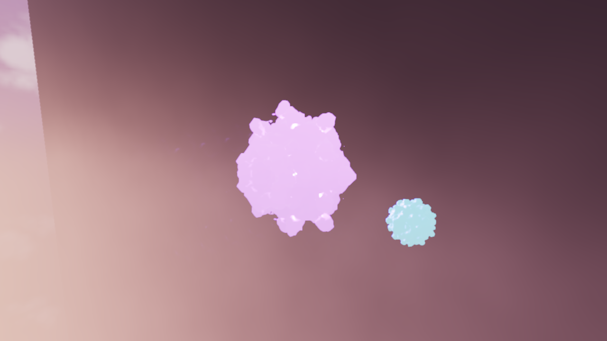
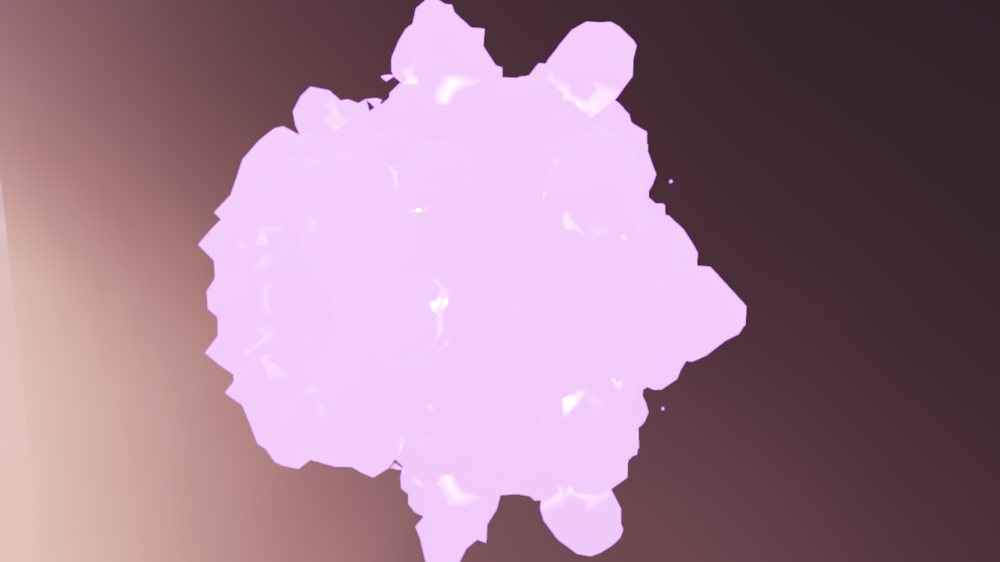

# Tutorial G29 — SDF / 3D-Fraktale (Mandelbulb)

> 🇬🇧 **English version:** [docs/en/tutorials/g29_mandelbulb.md](../../en/tutorials/g29_mandelbulb.md)

**Ziel:** 3D-Fraktale modellieren und signierte Distanzfelder (SDF) kombinieren, dann per
Marching Cubes meshen. `procedural::sdf` (`procedural/sdf.hpp`) bietet Primitive (sphere, box,
roundedBox, plane, cylinder), `smoothMin` zum Blending und `mandelbulb` (klassischer Power-8-
Distance-Estimator). `procedural::meshFromSdf(field, min, max, res)` sampelt jedes SDF über
eine Box und polygonisiert es mit den G25-Marching-Cubes — innen negativ, Isolevel 0.

## Anwendung

```cpp
#include <fuhglgraphics/procedural/sdf.hpp>

using fuhglgraphics::procedural::sdf::mandelbulb;
using fuhglgraphics::procedural::sdf::smoothMin;
using fuhglgraphics::procedural::sdf::sphere;

// Mandelbulb mit 56^3 Samples meshen (~22k Dreiecke)
const fuhgl::render::MeshData bulb = fuhglgraphics::procedural::meshFromSdf(
    [](const fuhgl::math::Vec3& p) { return mandelbulb(p, 8.f, 10); },
    {-1.4f, -1.4f, -1.4f}, {1.4f, 1.4f, 1.4f}, 56);

// kombinieren: Bulb + zwei Satelliten-Kugeln per smoothMin geblendet
const auto combo = [](const fuhgl::math::Vec3& p) {
    float d = mandelbulb(p, 8.f, 10);
    d = smoothMin(d, sphere(p - fuhgl::math::Vec3{1.1f, 0.f, 0.f}, 0.35f), 0.3f);
    d = smoothMin(d, sphere(p - fuhgl::math::Vec3{-0.9f, 0.4f, 0.3f}, 0.28f), 0.3f);
    return d;
};

// hochladen + rendern (braucht GL-Kontext)
fuhgl::render::Mesh mesh;
mesh.setMeshData(bulb);
auto& e = node.attach<scene::MeshComponent>().addMesh(&mesh);
e.emissive = {1.6f, 0.55f, 2.6f};   // HDR-emissiv -> Bloom greift
e.metallic = 0.3f;
e.roughness = 0.3f;
```

## Demo + Ergebnis

`examples/mandelbulb_screenshot` — Mandelbulb (56³ Samples) ×5 skaliert als schwebende emissive
Skulptur + 3 Satelliten-Bulbs, violettes Kern-Punktlicht (Bloom), warme tiefe Sonne mit
CSM-Schatten + God Rays, Dämmerungs-Sky-Cubemap + IBL, SSAO, volumetrischer Nebel,
TAA + Upscale + ACES:

```bash
cmake --build build --target fuhglgraphics_mandelbulb_screenshot
FUHGL_BACKEND=surfaceless ./build/examples/fuhglgraphics_mandelbulb_screenshot \
    --prefix g29_mandelbulb --width 1280 --height 720 --frames 16
# mandelbulb_screenshot: main bulb 22548 tris
```

Weitwinkel (Skulptur + Satelliten, God Rays, Nebel):



Nahaufnahme der Fraktal-Oberfläche mit Bloom:



## Tests

- `tests/test_procedural_sdf.cpp` (Unit): Vorzeichen/Werte der Primitive innen/auf/außerhalb,
  smoothMin-Eigenschaften, Mandelbulb-DE-Sanity (Ursprung ≈ 0, entfernter Punkt groß, endlich),
  Kugel-SDF → geschlossenes Manifold-Mesh auf korrekter Schalen-Radius (jede Kante von 2
  Dreiecken geteilt), Mandelbulb-Mesh bounded/endliche/indiziert.
- CI: `docs-screenshots` rendert `docs/images/ci/g29_mandelbulb_{wide,closeup}.png`.
