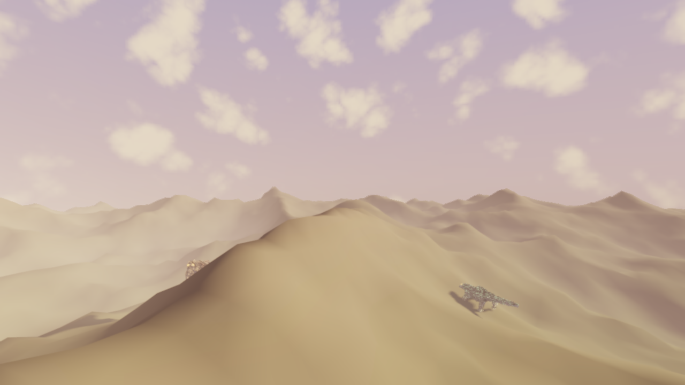
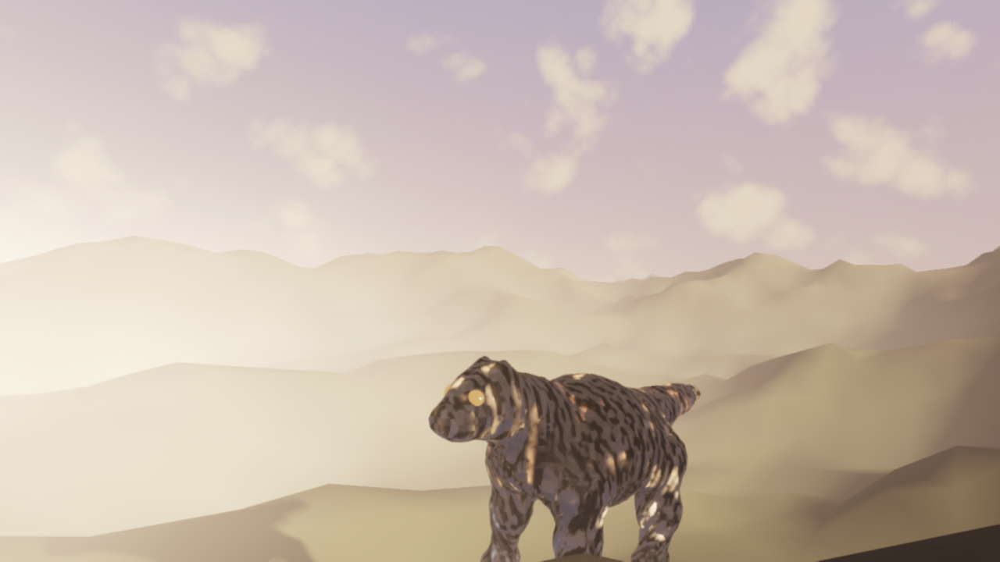
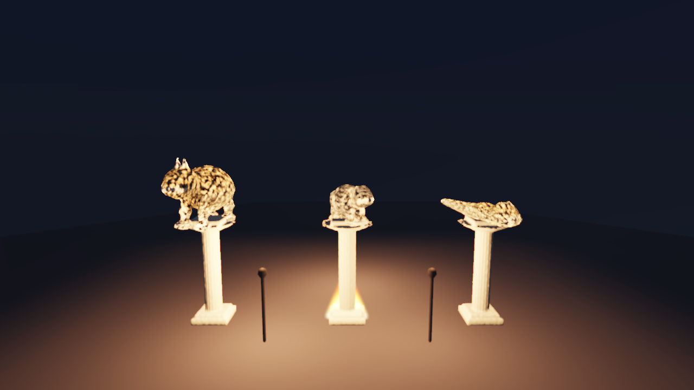
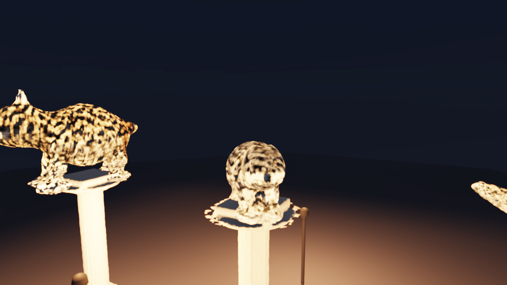

# Tutorial G30 — Prozedurale Kreaturen (Skelett + SDF → Mesh + gebakte Haut)

> 🇬🇧 **English version:** [docs/en/tutorials/g30_creature.md](../../en/tutorials/g30_creature.md)

**Ziel:** komplette 3D-Kreaturen (Vierbeiner, Reptilien) prozedural generieren mit
`procedural/creature.hpp`. Pipeline: ein `Skeleton`-Graph (Knoten = Position/Radius/`BodyPart`)
wird in Welt-Raum-SDF-Primitive gebacken (ein Ellipsoid pro Knoten + eine verjüngte Kapsel pro
Eltern-Link, je mit Broadphase-AABB — lineare, cache-freundliche Auswertung). `creatureSdf()`
verbindet sie per G29 `sdf::smoothMin` (organische Muskel-/Hautübergänge) und moduliert das
Feld mit G24-Simplex-fBm (Schuppen/Rippen/Falten direkt in der Geometrie). `meshCreature()`
mesht das Feld per G25 Marching Cubes, berechnet analytische Normalen aus dem SDF-Gradienten
(Finite Differences), pro Vertex die Krümmung (SDF-Laplace) in den Vertex-Color-Kanal und eine
nahtlose zylindrische UV-Abwicklung. `bakeCreatureMaps()` backt Albedo- + Tangenten-Normal-Maps
aus 3D-Objektraum-Noise (Worley-Schuppenzellen, Streifen, Bauch). Reine CPU, deterministisch.

> Hinweis zur „Shader-Texturierung": FuhGLCore ist eine gepinnte externe Abhängigkeit, der
> Lighting-Shader kann also nicht um einen Triplanar-Pfad erweitert werden. Stattdessen werden
> die Maps auf der CPU aus 3D-Objektraum-Noise am rekonstruierten Oberflächenpunkt jedes Texels
> gebacken (nahtlos in u), und der G-Buffer-Pass multipliziert den Vertex-Color bereits in die
> Albedo (`albedo = uAlbedo * vColor [* Map]`) —dadurch dunkeln Falten automatisch ab und Kanten
> werden heller.

## Anwendung

```cpp
#include <fuhglgraphics/procedural/creature.hpp>

using namespace fuhglgraphics::procedural;

// Preset-Skelette: hündischer Vierbeiner / echsenartiges Reptil
Skeleton skel = makeQuadruped();          // oder makeReptile()

CreatureParams pr;
pr.seed = 21u;
pr.smoothK = 0.22f;                       // smooth-min-Blendenradius
pr.detailAmp = 0.02f;                     // Geometrie-Noise (Falten), Amplitude
pr.detailFreq = 6.f;
pr.scaleFreq = 5.5f;                      // gebachte Schuppenzellen-Frequenz
pr.bodyColor = {0.48f, 0.38f, 0.24f};     // Palette: Körper / Bauch / Akzent (Streifen)
pr.bellyColor = {0.78f, 0.70f, 0.55f};
pr.accentColor = {0.30f, 0.16f, 0.10f};

// Mesh: Marching Cubes + Gradienten-Normalen + Krümmung im Farbkanal + zylindrische UVs
const CreatureMesh cm = meshCreature(skel, pr, /*Auflösung=*/80, {1.f, 1.f, 1.f});
// cm.mesh: Farbkanal = Krümmungs-Shading (konkave Falten dunkler), uv = zylindrische Abwicklung

// Albedo + Normal-Maps backen (RGBA8, size x size), nahtlos in u
const CreatureMaps maps = bakeCreatureMaps(skel, pr, 256);

// hochladen + platzieren (braucht GL-Kontext)
fuhgl::render::Mesh mesh;
mesh.setMeshData(cm.mesh);
fuhgl::Texture albedoTex(fuhgl::Texture::Target::Tex2D), normalTex(fuhgl::Texture::Target::Tex2D);
albedoTex.bind();
albedoTex.setImage2D(0, fuhgl::gl::GL_RGBA8, maps.size, maps.size, fuhgl::gl::GL_RGBA,
                     fuhgl::gl::GL_UNSIGNED_BYTE, maps.albedo.data());
albedoTex.generateMipmap();                       // nötig für LINEAR_MIPMAP_LINEAR
albedoTex.setParameteri(fuhgl::gl::GL_TEXTURE_MIN_FILTER, fuhgl::gl::GL_LINEAR_MIPMAP_LINEAR);
albedoTex.setParameteri(fuhgl::gl::GL_TEXTURE_MAG_FILTER, fuhgl::gl::GL_LINEAR);
albedoTex.setParameteri(fuhgl::gl::GL_TEXTURE_WRAP_S, fuhgl::gl::GL_REPEAT);   // nahtlos in u
albedoTex.setParameteri(fuhgl::gl::GL_TEXTURE_WRAP_T, fuhgl::gl::GL_CLAMP_TO_EDGE);
// ... ebenso normalTex mit maps.normal ...

auto& e = node.attach<scene::MeshComponent>().addMesh(&mesh);
e.albedo = {1.f, 1.f, 1.f};        // Vertex-Color (Krümmung) * gebakte Albedo-Map
e.albedoTexture = &albedoTex;
e.normalMap = &normalTex;
e.roughness = pr.roughness;
```

Eigene Skelette: `skel.addNode(name, parent, offset, radius, ellipsoid, BodyPart, blend)` —
Eltern vor Kindern; Körperachse = +Z (Kopf nach vorn), oben = +Y. `BodyPart`-Werte:
`Torso, Neck, Head, Jaw, LegUpper, LegLower, Foot, Tail, Horn, Fin`.

## Demo + Ergebnis

`examples/creature_screenshot` — ein Vierbeiner und ein Reptil auf einem G24-Noise-Terrain, je
mit gebakten Schuppen-/Streifen-/Bauch-Maps + Normal-Map, Krümmungs-Vertex-Colors, bernsteinfarbene
Augen (Bloom), Abendsonne mit CSM-Schatten + Godrays, Sky-Cubemap + IBL, SSAO, volumetrischer
Nebel, Bloom, TAA + Upscale + ACES:

```bash
cmake --build build --target fuhglgraphics_creature_screenshot
FUHGL_BACKEND=surfaceless ./build/examples/fuhglgraphics_creature_screenshot \
    --prefix g30_creature --width 1280 --height 720 --frames 16
# creature_screenshot: mesh 16792 tris, maps 256x256
# creature_screenshot: mesh 17792 tris, maps 256x256
```

Weitwinkel — beide Kreaturen in der Ebene bei Dämmerung:



Nahaufnahme der Flanke des Vierbeiners — Schuppenzellen, Streifen und krümmungsgedunkelte Falten
zwischen Gliedmaßen und Torso:



## G32 Showcase — Kreaturen auf korinthischen Säulen, fackelbeleuchtet

Die G32-Pipeline (`procedural/creaturegen.hpp`, Design-Dokument:
[docs/CREATURE_GENERATION.md](../../CREATURE_GENERATION.md)) erweitert G30: die allometrische
`deriveBlueprint()` bildet ökologische Eingaben (Körpermasse, Fortbewegung, Ernährung, Klima)
auf gekoppelte Proportionen ab (Knochenradius ~ M^0.36, Augenposition Jäger vs. Beute,
Klima-Regeln für Fett/Fell), `buildBlueprintSkeleton()` ergänzt bilaterale Symmetrie +
Mikro-Asymmetrie, `anatomySdf()` schichtet Knochen/Muskel/Haut (+ Schwerkraft-Sag),
`extractSurface()` liefert Krümmungs- und Material-Masken, `bakeMaterial()` backt das
Gray-Scott-Turing-Muster + Countershading UV-frei, und `solveTwoBoneIk()` /
`creatureGaitPose()` treiben die Lokomotion. `examples/creature_showcase` rendert drei
verschiedene G32-Kreaturen nebeneinander auf prozeduralen korinthischen Säulen in einer
stockdunklen Halle, beleuchtet nur von flackernden Fackel-Punktlichtern mit G35-Flammpartikeln:

```bash
cmake --build build --target fuhglgraphics_creature_showcase
FUHGL_BACKEND=surfaceless ./build/examples/fuhglgraphics_creature_showcase \
    --prefix g32_creature_showcase --width 1280 --height 720 --frames 16
```

Weitwinkel — gehörnter Herbivore, Carnivore mit Frontalaugen und gestreifte Serpentine auf ihren Säulen:



Nahaufnahme des Carnivoren im Profil — Turing-Flecken und Countershading im Fackellicht:



- CI: `docs-screenshots` rendert `docs/images/ci/g32_creature_showcase_{wide,closeup}.png`,
  per PSNR gegen die eingecheckten Referenzen oben gegated.

## Tests

- `tests/test_procedural_creature.cpp` (Unit): Skeleton-finalize (Welt-Positionen akkumulieren,
  Prim-Anzahl, Bounds), `creatureSdf` Vorzeichen innen/außen + Determinismus + Stetigkeit entlang
  einer Gliedmaßen-Linie + Noise-Modulation durch `detailAmp` begrenzt, `meshCreature`
  (indexiertes Mesh, Einheits-Gradientennormalen, uv in [0,1], Krümmungsvariation,
  Determinismus), Krümmungsvorzeichen (Zweikugel-Hantel: der smin-Hals ist dunkler als der
  konvexe Pol), `bakeCreatureMaps` (Größen, Alpha, Determinismus, Muservariation), Presets
  verschieden.
- `tests/gl_smoke_procedural.cpp` (gl_context): lädt einen `meshCreature`-Vierbeiner hoch und
  prüft, dass sich das Center-Pixel ändert.
- CI: `docs-screenshots` rendert `docs/images/ci/g30_creature_{wide,closeup}.png`.
