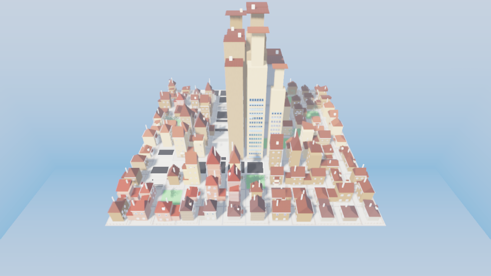

# Tutorial G31 — World-Generator-Hilfsfunktion (Landschaft oder Stadt)

> 🇬🇧 **English version:** [docs/en/tutorials/g31_worldgen.md](../../en/tutorials/g31_worldgen.md)

**Ziel:** mit einem Funktionsaufruf eine komplette prozedurale **Landschaft** oder **Stadt**
generieren: `procedural::generateWorld(params)` in `procedural/worldgen.hpp`. Ein Parameter-Sruct
(`WorldGenParams`) wählt den Modus; das Ergebnis (`GeneratedWorld`) sind reine CPU-Daten —
Höhenfeld, WFC-Platzierungen, `MeshData`, platzierte Meshes — die man an eine `scene::Scene`
hängt. Deterministisch pro Seed, kein GL für die Generierung nötig.

## Anwendung

```cpp
#include <fuhglgraphics/procedural/worldgen.hpp>

using fuhglgraphics::procedural::WorldGenParams;
using fuhglgraphics::procedural::generateWorld;

WorldGenParams p;
p.mode = WorldGenParams::Mode::Landscape;   // oder Mode::City
p.seed = 777;
const auto world = generateWorld(p);
```

## Modus Landschaft

```cpp
WorldGenParams p;
p.mode = WorldGenParams::Mode::Landscape;
p.seed = 777;
p.worldSize = 200.f;        // X/Z-Ausdehnung in Welt-Einheiten (Zentrum im Ursprung)
p.terrainGrid = 129;        // Auflösung der Heightmap
p.terrainHeight = 14.f;     // Höhenskalierung (Heightmap selbst ist in [0,1])
p.noiseScale = 0.045f;      // Noise-Skalierung pro Welt-Einheit
p.warpStrength = 0.8f;      // optionaler Domain-Warp (0 = aus)
p.heightExponent = 0.8f;    // Kontrast-Shaping pow(h, exponent); <1 -> ausgeprägtere Gipfel
p.waterLevel = 0.30f;       // >0: Seebecken unterhalb dieses normalisierten Pegels
p.lakeCarve = 0.18f;         // Beckentiefe unterhalb des Pegels
p.treeCount = 140;          // verstreute L-System-Bäume
p.bushCount = 160;          // verstreute L-System-Büsche
p.grassBlades = 4000;       // Hinweis fürs App: instanziertes Gras via Instancing::heightFn
p.treeMinDist = 6.f;

const auto w = generateWorld(p);
w.heightmap;                // gridW*gridH floats, zeilenweise (x + gridW*z), [0,1]
w.heightAt(x, z);           // bilineare Welt-Höhe (Sample * heightScale, geclampt)
w.waterLevelWorld;          // Pegel in Welt-Einheiten (hier WaterComponent platzieren)
w.trees;                    // PlacedMesh: Mesh (L-System-Baum) + position/rotY/scale/tint
w.bushes;                   // PlacedMesh: Büsche, gleiche Platzierungsregeln
```

Das Höhenfeld ist G24 ridged fBm (Simplex-Basis) mit Island-Falloff am Rand und optionalem
Seebecken unterhalb von `waterLevel`. Bäume sind G26-L-Systeme per Rejection-Sampling: sie stehen
auf dem Terrain (`heightAt`), meiden den See und halten `treeMinDist` ein.

An die Szene hängen (Heightmap → Grid-`MeshData`, Bäume → je ein Knoten):

```cpp
scene::Scene scene;
// terrain: MeshData aus w.heightmap bauen (pos/normal/color/uv pro Vertex) ...
scene.root().createChild("terrain").attach<scene::MeshComponent>().addMesh(terrainMesh);
for (size_t i = 0; i < w.trees.size(); ++i) {
    auto& n = scene.root().createChild("tree" + std::to_string(i));
    n.translation = w.trees[i].position;
    n.rotation = fuhgl::math::fromAxisAngle(w.trees[i].rotY, {0, 1, 0});
    n.scale = {w.trees[i].scale, w.trees[i].scale, w.trees[i].scale};
    auto& e = n.attach<scene::MeshComponent>().addMesh(treeMeshes[i]); // Mesh::setMeshData(...)
    e.albedo = w.trees[i].tint;
}
```

 siehe `examples/worldgen_screenshot/main.cpp` für eine komplette, lauffähige Version.

## Modus Stadt

```cpp
WorldGenParams p;
p.mode = WorldGenParams::Mode::City;
p.seed = 777;
p.cityGrid = 12;            // WFC-Zellen pro Seite
p.cellSize = 8.f;           // Welt-Größe einer Zelle
p.buildingHeight = 7.f;     // Basis-Wandhöhe (pro Stil skaliert, pro Block gejittert)
p.houseFootprint = 0.62f;   // Haus-Grundfläche als Anteil der Zelle
p.houseStyle = HouseStyle::Town; // Village | Town | Highrise — Architekturstil
p.blocksPerDistrict = 28;   // >0: Voronoi-Stadtteilplatten unter der Stadt
p.parkBushesPerPlaza = 3;   // Büsche pro Plaza (Park)
```

const auto w = generateWorld(p);
w.cells;                    // cityW*cityH WfcCell {tile, rot}, zeilenweise
w.tiles;                    // Tile-Set (w.cells[].tile indexiert hinein)
w.cityGround;               // MeshData-Basisplatte (Oberkante bei y = 0)
w.roads;                    // gemergte Platten: Bürgersteig + dunkler Asphalt (Straßen), Beton-Lots, Park-Rasen
w.districts;                // Voronoi-Platten (leer bei blocksPerDistrict == 0)
w.buildings;                // ein prozedurales Haus pro Nicht-Park-"block"-Zelle, drei Mesh-Teile:
                            // mesh = Wände (hier Brick-POM-Satz anhängen), detailMesh = Tür/Fenster/
                            // Kamin/Erker ( reine Vertex-Farben), roofMesh = Dach
                            // (roofType: 0 = Satteldach, 1 = Schleppdach, 2 = flach);
                            // Stile: Village (Erker + Kamin), Town (Fenster pro Etage),
                            // Highrise (Fensterraster + Rücksprung + Flachdach)
w.bushes;                   // Park-Grün auf Plaza-Zellen
```

Das Layout ist ein G27-WFC-Solve über `makeCityTiles()` — Edge-Tags `"r"` (Straße), `"s"`
(Grundstück/Bürgersteig, zugleich Rand-Tag) und `"p"` (Plaza); Tile-Namen `block`, `plaza`,
`streetH`, `streetV`, `cross`, `tE`, `endE`, Rotationen übernimmt der Solver. Straßen-/Plaza-Zellen
werden zu gemergten Road-Slabs, `block`-Zellen zu Gebäude-Boxen mit pro Block gejitterter Höhe/Farbe.

## HouseGenerator-Klasse (variantenreiche Häuser)

Für volle Kontrolle über einzelne Häuser `procedural::HouseGenerator` in
`procedural/house.hpp` direkt nutzen — `generateWorld` verwendet sie intern für die Stadtblöcke:

```cpp
fuhglgraphics::procedural::HouseGenerator gen;
auto p = fuhglgraphics::procedural::HouseGenerator::randomParams(
    fuhglgraphics::procedural::HouseStyle::Village, /*cellSize=*/8.f, /*seed=*/123u);
const auto house = gen.generate(p);
// house.walls    -> Fassade (hier Brick-POM-Satz anhängen)
// house.details  -> Tür/Fenster/Kamin/Erker/Gauben/Fachwerk (reine Vertex-Farben)
// house.roof     -> Dachkörper; house.spec.roofType = Gable | Shed | Hipped | Flat
// house.spec     -> welche Varianten gezogen wurden (hasBay, hasDormers, hasAnnex, hasPorch, ...)
```

Varianten: Dachformen Satteldach, Schleppdach, Walmdach, Flachdach; Features Erker, Dachgauben,
Anbau, Vordach, Kamin, Fachwerk; der Stil Highrise ergänzt Fensterraster + Rücksprung + Flachdach.
Deterministisch pro Seed; Unit-Tests in `tests/test_procedural_house.cpp`.

## Screenshot-Demo

`examples/worldgen_screenshot` rendert beide Modi headless zu PNG (CI rendert
`docs/images/ci/g31_worldgen_{landscape,city,city_street}.png`, per optipng komprimiert;
eingecheckte Referenzen in [docs/images/](../../images/g31_worldgen_city.png)):

```bash
cmake --build build --target fuhglgraphics_worldgen_screenshot
FUHGL_BACKEND=surfaceless ./build/examples/fuhglgraphics_worldgen_screenshot \
    --prefix g31_worldgen --width 1280 --height 720 --frames 16 --seed 777
# schreibt g31_worldgen_landscape.png, g31_worldgen_city.png, g31_worldgen_city_street.png
```





## Tests

- `tests/test_procedural_worldgen.cpp` (Unit): Heightmap-Größe/Wertebereich/Rand/See, `heightAt`
  Sampling + Clamping, Baum-Platzierungsregeln (auf dem Terrain, nicht im See, Mindestabstand),
  WFC-Layout-Gültigkeit inkl. Rand-Tags, Block→Gebäude-Mapping, Determinismus pro Seed, Modus-Wahl.

## Hinweise

- Gleicher Seed → identische Welt auf jeder Plattform (die Generatoren sind die geseedeten
  G24-G28-Module).
- Generierung ist reine CPU; nur `Mesh::setMeshData` braucht einen GL-Kontext.
- Volle Kontrolle über das Stadt-Tile-Set: eigene Tiles direkt an `procedural::Wfc` übergeben
  (siehe [G27](g27_wfc.md)); `makeCityTiles()` ist nur das fertige Set von `generateWorld`.
