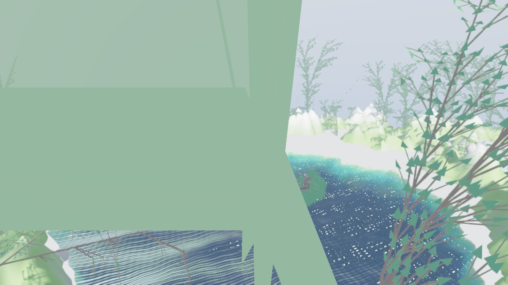
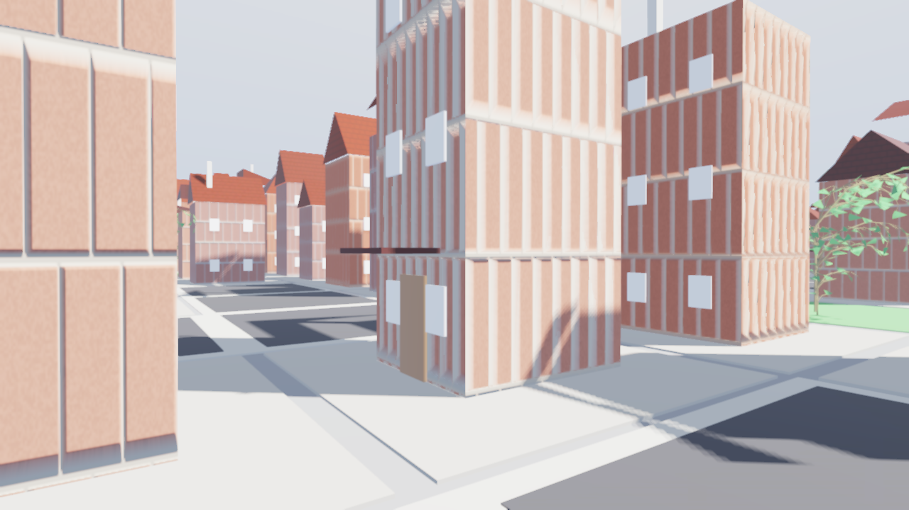
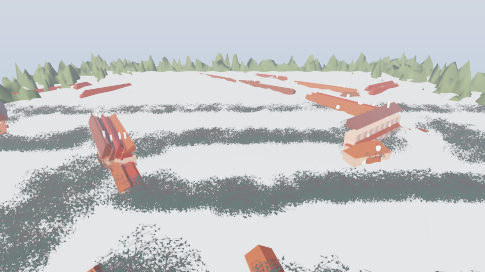
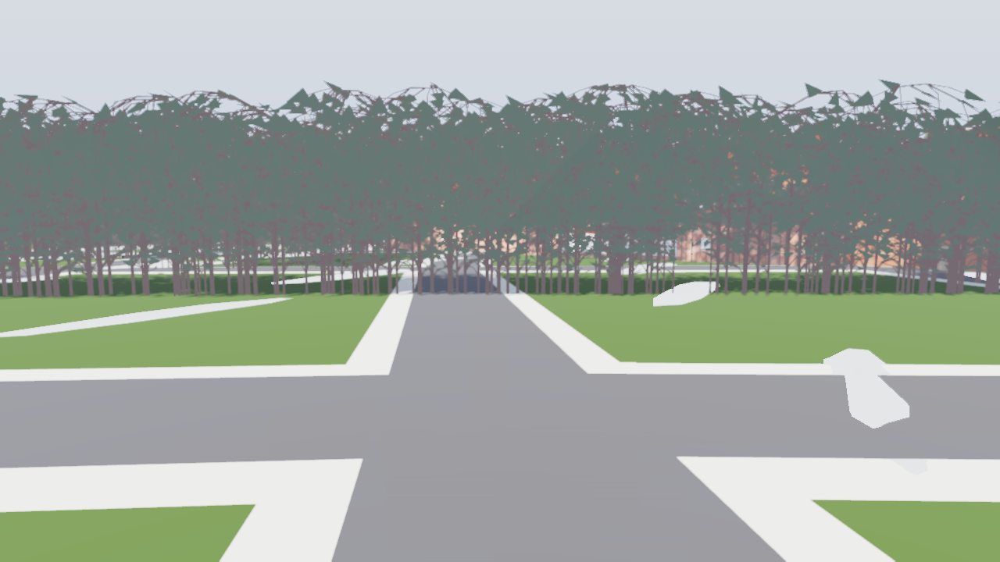

# Tutorial G31 — World-Generator-Hilfsfunktion (Landschaft oder Stadt)

> 🇬🇧 **English version:** [docs/en/tutorials/g31_worldgen.md](../../en/tutorials/g31_worldgen.md)

**Ziel:** mit einem Funktionsaufruf eine komplette prozedurale **Landschaft** oder **Stadt**
generieren: `procedural::generateWorld(params)` in `procedural/worldgen.hpp`. Ein Parameter-Sruct
(`WorldGenParams`) wählt den Modus; das Ergebnis (`GeneratedWorld`) sind reine CPU-Daten —
Höhenfeld, WFC-Platzierungen, `MeshData`, platzierte Meshes — die man an eine `scene::Scene`
hängt. Deterministisch pro Seed, kein GL für die Generierung nötig.

## Anwendung

```cpp
#include <fuhglgraphics/procedural/worldgen.hpp>

using fuhglgraphics::procedural::WorldGenParams;
using fuhglgraphics::procedural::generateWorld;

WorldGenParams p;
p.mode = WorldGenParams::Mode::Landscape;   // oder Mode::City
p.seed = 777;
const auto world = generateWorld(p);
```

## Modus Landschaft

```cpp
WorldGenParams p;
p.mode = WorldGenParams::Mode::Landscape;
p.seed = 777;
p.worldSize = 200.f;        // X/Z-Ausdehnung in Welt-Einheiten (Zentrum im Ursprung)
p.terrainGrid = 129;        // Auflösung der Heightmap
p.terrainHeight = 34.f;     // Höhenskalierung (Heightmap selbst ist in [0,1])
p.noiseScale = 0.045f;      // Noise-Skalierung pro Welt-Einheit
p.octaves = 6;              // fBm-Oktaven der Flachland-Schicht
p.warpStrength = 0.6f;      // Domain-Warp des Noise-Inputs (0 = aus)
p.heightExponent = 0.85f;   // Kontrast-Shaping pow(h, exponent); <1 -> ausgeprägtere Gipfel
p.waterLevel = 0.30f;       // >0: Wasser/See auf diesem normalisierten Pegel
p.lakeRadius = 55.f;        // >0: runder Seebecken-Radius um das Zentrum
p.lakeCarve = 0.18f;         // Beckentiefe unterhalb des Pegels
p.erosionDroplets = 4000;   // hydraulische Erosion: Tropfen-Partikelsim (0 = aus)
p.thermalPasses = 4;        // thermische Erosion: Durchläufe (0 = aus)
p.talus = 0.09f;             // Talus-Schwelle (normalisierter Höhenabfall pro Zelle)
p.treeCount = 130;          // verstreute L-System-Bäume (Poisson-Disk, grasgewichtet)
p.bushCount = 180;          // verstreute Büsche
p.rockCount = 60;           // verstreute Felsen (Splatmap-Felsmaske)
p.grassBlades = 6000;       // Hinweis fürs App: instanziertes Gras via Instancing::heightFn
p.treeMinDist = 6.f;        // Poisson-Disk-Mindestabstand

const auto w = generateWorld(p);
w.heightmap;                // gridW*gridH floats, zeilenweise (x + gridW*z), [0,1]
w.heightAt(x, z);           // bilineare Welt-Höhe (Sample * heightScale, geclampt)
w.waterLevelWorld;          // Pegel in Welt-Einheiten (hier WaterComponent platzieren)
w.splatmap;                 // gridW*gridH RGBA-Gewichte: R Gras, G Fels, B Sand, A Schnee
w.flowmap;                  // gridW*gridH float [0,1]: hydraulische Flussakkumulation (Flussbetten)
w.trees;                    // PlacedMesh: Mesh (L-System-Baum) + position/rotY/scale/tint
w.bushes;                   // PlacedMesh: Büsche, gleiche Platzierungsregeln
w.rocks;                    // PlacedMesh: Kugel-Felsen auf steilen/Fels-Splatmap-Bereichen
```

### Landschafts-Pipeline (was `generateLandscape` macht)

1. **Makro-Relief** — eine Heightmap aus kombinierten Schichten: Domain-Warping des Noise-Inputs
   (`warpStrength`), eine sehr niederfrequente *Continentalness*-Simplex-Maske, die Flachland
   (fBm) vs. Gebirgszüge (*ridged* Multifraktal, scharfe Grate) wählt, Kontrast-Shaping
   `pow(h, heightExponent)`, das runde `lakeRadius`-Becken und ein Island-Falloff am Rand.
2. **Erosion** — `erosionDroplets` virtuelle Regentropfen laufen bergab über die Heightmap, nehmen
   Sediment auf und lagern es ab (hydraulische Erosion frisst Täler/Flussbetten und füllt die
   `flowmap`), danach relaxieren `thermalPasses` jeden Hang steiler als der `talus`-Winkel zu
   Geröllhalden (thermische Erosion).
3. **Splatmap** — pro Zelle: G Fels aus der Welt-Steigung (Band relativ zur steilsten vorhandenen
   Steigung, damit Klippen bei jeder heightScale/Auflösung Fels bekommen), A Schnee aus der Höhe
   (`smoothstep(0.58, 0.8, h)`), B Sand nahe dem Pegel plus `flowmap`-Flussbetten, R Gras als Rest.
   `splatmap` als RGBA-Textur hochladen und als Terrain-Splatmap verwenden.
4. **Meshing & LOD** — Grid-`MeshData` aus `heightmap` bauen (uv = Grid-uv, damit die Splatmap 1:1
   auf die Zellen mappt). Für große Welten stattdessen `scene::TerrainComponent`: kapselt dieselbe
   Heightmap in einem `LodMesh` (F38/F41 quadtree-artiges LOD mit bildschirmraum-basierten
   Umschaltdistanzen) — `w.heightmap` in `TerrainComponent::heights` kopieren und `rebuildLod()`
   rufen; Triplanar-Mapping für steile Klippen liegt im Terrain-Shader (shader-seitig).
5. **Scattering** — Poisson-Disk-Sampling (Dart-Throwing mit Spatial Hash, garantierter
   `treeMinDist`), gewichtet mit der Splatmap: Bäume/Büsche auf Gras über dem Pegel, Felsen auf
   der Felsmaske. Gras selbst ist app-seitig GPU-Instancing (`Node::instancing`) mit einer
   `heightFn`, die Halme auf `heightAt` snappt und unter Wasser / auf Fels-Schnee-Sand-Texeln
   versteckt (Dichte-Maske).

An die Szene hängen (Terrain-Grid-Mesh mit Splatmap als Albedo-Textur oder `TerrainComponent` +
Splatmap-Shader; Bäume/Büsche/Felsen → je ein Knoten; Gras → ein instanzierter Knoten):

```cpp
scene::Scene scene;
scene::Node& tn = scene.root().createChild("terrain");
fuhgl::render::Mesh terrainMesh;
terrainMesh.setMeshData(terrainMeshData(w)); // Grid aus w.heightmap, uv = Grid-uv
auto& te = tn.attach<scene::MeshComponent>().addMesh(&terrainMesh);
te.albedoTexture = &splatmapTexture;         // RGBA: R Gras / G Fels / B Sand / A Schnee
for (size_t i = 0; i < w.trees.size(); ++i) {
    auto& n = scene.root().createChild("tree" + std::to_string(i));
    n.translation = w.trees[i].position;
    n.rotation = fuhgl::math::fromAxisAngle(w.trees[i].rotY, {0, 1, 0});
    n.scale = {w.trees[i].scale, w.trees[i].scale, w.trees[i].scale};
    auto& e = n.attach<scene::MeshComponent>().addMesh(treeMeshes[i]); // Mesh::setMeshData(...)
    e.albedo = w.trees[i].tint;
}
```

 siehe `examples/worldgen_screenshot/main.cpp` für eine komplette, lauffähige Version.

## Modus Stadt

```cpp
WorldGenParams p;
p.mode = WorldGenParams::Mode::City;
p.seed = 777;
p.cityGrid = 12;            // WFC-Zellen pro Seite
p.cellSize = 8.f;           // Welt-Größe einer Zelle
p.buildingHeight = 7.f;     // Basis-Wandhöhe (pro Stil skaliert, pro Block gejittert)
p.houseFootprint = 0.62f;   // Haus-Grundfläche als Anteil der Zelle
p.houseStyle = HouseStyle::Town; // Village | Town | Highrise — Architekturstil
p.blocksPerDistrict = 28;   // >0: Voronoi-Stadtteilplatten unter der Stadt
p.parkBushesPerPlaza = 3;   // Büsche pro Plaza (Park)
```

const auto w = generateWorld(p);
w.cells;                    // cityW*cityH WfcCell {tile, rot}, zeilenweise
w.tiles;                    // Tile-Set (w.cells[].tile indexiert hinein)
w.cityGround;               // MeshData-Basisplatte (Oberkante bei y = 0)
w.roads;                    // gemergte Platten: Bürgersteig + dunkler Asphalt (Straßen), Beton-Lots, Park-Rasen
w.districts;                // Voronoi-Platten (leer bei blocksPerDistrict == 0)
w.buildings;                // ein prozedurales Haus pro Nicht-Park-"block"-Zelle, drei Mesh-Teile:
                            // mesh = Wände (hier Brick-POM-Satz anhängen), detailMesh = Tür/Fenster/
                            // Kamin/Erker ( reine Vertex-Farben), roofMesh = Dach
                            // (roofType: 0 = Satteldach, 1 = Schleppdach, 2 = flach);
                            // Stile: Village (Erker + Kamin), Town (Fenster pro Etage),
                            // Highrise (Fensterraster + Rücksprung + Flachdach)
w.bushes;                   // Park-Grün auf Plaza-Zellen
```

Das Layout ist ein G27-WFC-Solve über `makeCityTiles()` — Edge-Tags `"r"` (Straße), `"s"`
(Grundstück/Bürgersteig, zugleich Rand-Tag) und `"p"` (Plaza); Tile-Namen `block`, `plaza`,
`streetH`, `streetV`, `cross`, `tE`, `endE`, Rotationen übernimmt der Solver. Straßen-/Plaza-Zellen
werden zu gemergten Road-Slabs, `block`-Zellen zu Gebäude-Boxen mit pro Block gejitterter Höhe/Farbe.

## HouseGenerator-Klasse (variantenreiche Häuser)

Für volle Kontrolle über einzelne Häuser `procedural::HouseGenerator` in
`procedural/house.hpp` direkt nutzen — `generateWorld` verwendet sie intern für die Stadtblöcke:

```cpp
fuhglgraphics::procedural::HouseGenerator gen;
auto p = fuhglgraphics::procedural::HouseGenerator::randomParams(
    fuhglgraphics::procedural::HouseStyle::Village, /*cellSize=*/8.f, /*seed=*/123u);
const auto house = gen.generate(p);
// house.walls    -> Fassade (hier Brick-POM-Satz anhängen)
// house.details  -> Tür/Fenster/Kamin/Erker/Gauben/Fachwerk (reine Vertex-Farben)
// house.roof     -> Dachkörper; house.spec.roofType = Gable | Shed | Hipped | Flat
// house.spec     -> welche Varianten gezogen wurden (hasBay, hasDormers, hasAnnex, hasPorch, ...)
```

Varianten: Dachformen Satteldach, Schleppdach, Walmdach, Flachdach; Features Erker, Dachgauben,
Anbau, Vordach, Kamin, Fachwerk; der Stil Highrise ergänzt Fensterraster + Rücksprung + Flachdach.
Deterministisch pro Seed; Unit-Tests in `tests/test_procedural_house.cpp`.

## Pipeline-Stadtgenerator (Terrain -> Straßen -> Grundstücke -> Häuser)

`procedural::generateCityWorld(CityGenParams)` in `procedural/citygen.hpp` implementiert die
 volle Pipeline als getrennte, unit-testbare Stufen:

1. **Terrain & Zonen**: fBm-Höhenkarte mit abgeflachtem Stadt-Plateau und See unterhalb von
   `waterLevel`; Zonen-Gitter `density` (Zentrum -> Hochhäuser, Rand -> Dorf) und `wealth`
   aus unabhängigen Noise-Layern (`CityWorld::heightAt/densityAt/wealthAt`).
2. **Straßennetz**: noise-gewarptes Straßengitter als planarer Graph (`RoadGraph`: Knoten =
   Kreuzungen, Kanten = Abschnitte); Knoten im Wasser werden verworfen. Als Bürgersteig-+
   Asphalt-Quads in `CityWorld::roadMesh` gerendert.
3. **Parzellierung**: jede überlebende Gitterzelle ist ein Block-Polygon, rekursiv per OBB
   gesplittet (Half-Plane-Split entlang der längsten PCA-Achse, eigenes `clipHalfPlane`/
   `computeObb`); `earClip` trianguliert die Grundstücks-Platten (`lotMesh`). Rand-nahe Lots
   bekommen Straßenzugang, innenliegende werden Parks.
4. **Gebäude**: pro zugänglichem Lot ein `HouseGenerator`-Haus, Stil aus der Dichte-Zone
   (Village/Town/Highrise); Park-Lots bekommen Büsche.

Keine externe Polygon-Bibliothek nötig (Ear-Clipping, Half-Plane-Clip und OBB/PCA sind in
`citygen.cpp` selbst implementiert). Performance-Hinweise app-seitig: statische Stadt-Geometrie
in wenige Meshes mergen (wie die Demo), Fassaden-POM nur auf den Wänden, für wiederholte Module
LOD/Instancing nutzen. Unit-Tests: `tests/test_procedural_citygen.cpp`.

```cpp
procedural::CityGenParams p;
p.seed = 777;
const auto city = procedural::generateCityWorld(p);
// city.heightmap -> TerrainComponent, city.roadMesh/city.lotMesh -> Nodes,
// city.houses -> PlacedMesh-Liste (Wände POM + Details + Dach)
```

## Screenshot-Demo

`examples/worldgen_screenshot` rendert alle Modi headless zu PNG. Die CI rendert und
PSNR-gated `docs/images/ci/g31_worldgen_{landscape,city,city_street}.png` (per optipng
komprimiert; eingecheckte Referenzen in [docs/images/](../../images/g31_worldgen_city.png)).
Die Pipeline-Shots (`--mode pipeline`, ~6500 Häuser) sind unter headless llvmpipe flaky, werden
also manuell gerendert und nur als Referenzen eingecheckt, nicht CI-gated:

```bash
cmake --build build --target fuhglgraphics_worldgen_screenshot
FUHGL_BACKEND=surfaceless ./build/examples/fuhglgraphics_worldgen_screenshot \
    --prefix g31_worldgen --width 1280 --height 720 --frames 16 --seed 777 --mode both
FUHGL_BACKEND=surfaceless ./build/examples/fuhglgraphics_worldgen_screenshot \
    --prefix g31 --width 1280 --height 720 --frames 16 --seed 777 --mode pipeline
# schreibt g31_worldgen_{landscape,city,city_street}.png und g31_pipeline{,_street}.png
```







## Tests

- `tests/test_procedural_worldgen.cpp` (Unit): Heightmap-Größe/Wertebereich/Rand/See, `heightAt`
  Sampling + Clamping, Erosion (Tropfen senken die Gipfel, flowmap bleibt in [0,1]), Splatmap-Kanäle
  (Gras/Fels/Sand/Schnee vorhanden und im Wertebereich), Poisson-Scatter (Mindestabstand, Felsen
  auf der Felsmaske, Determinismus pro Seed), Baum-Platzierungsregeln (auf dem Terrain, nicht im
  See, Mindestabstand), WFC-Layout-Gültigkeit inkl. Rand-Tags, Block→Gebäude-Mapping, Modus-Wahl.

## Hinweise

- Gleicher Seed → identische Welt auf jeder Plattform (die Generatoren sind die geseedeten
  G24-G28-Module).
- Generierung ist reine CPU; nur `Mesh::setMeshData` braucht einen GL-Kontext.
- Volle Kontrolle über das Stadt-Tile-Set: eigene Tiles direkt an `procedural::Wfc` übergeben
  (siehe [G27](g27_wfc.md)); `makeCityTiles()` ist nur das fertige Set von `generateWorld`.
