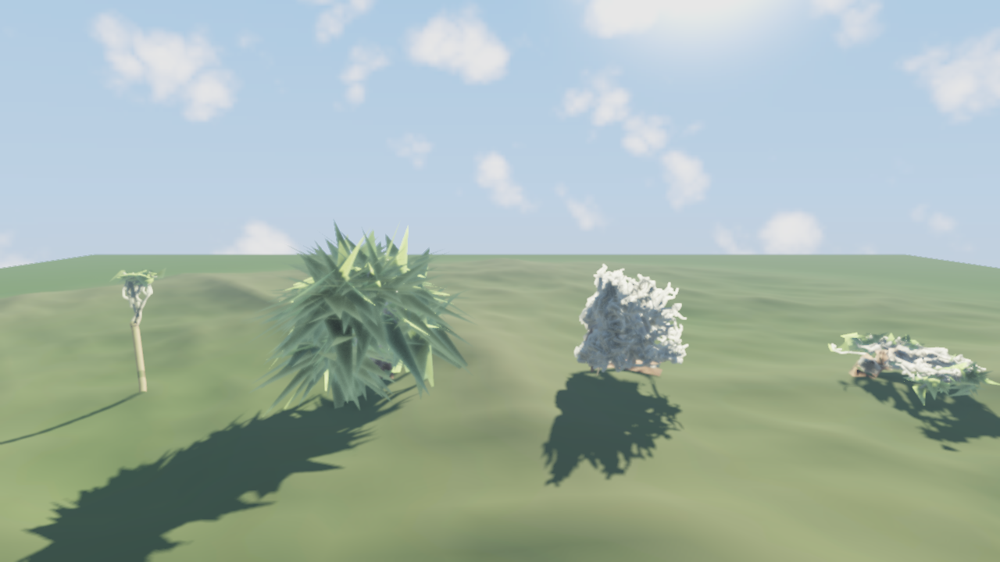
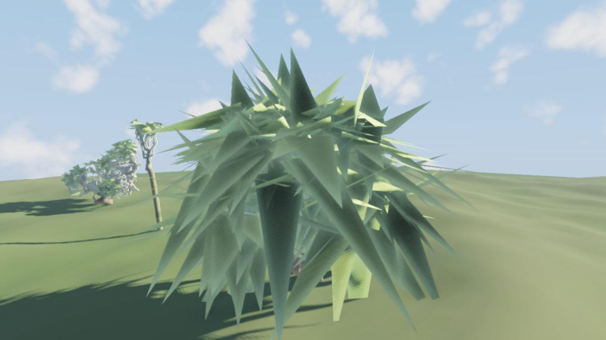

# Tutorial G37 — ökophysiologischer Vegetations-Generator

> 🇬🇧 **English version:** [docs/en/tutorials/g37_vegetation.md](../../en/tutorials/g37_vegetation.md)

**Ziel:** biologisch stimmige Pflanzen aus *Umwelt-Parametern* wachsen lassen — denselben
`temperature`/`humidity`-Werten, die der G31-Weltgenerator pro Terrainzelle berechnet, plus
Wind-Exposition und Bestandesdichte. `procedural::VegetationGenerator`
(`procedural/vegetation.hpp`) lässt das Skelett per Space Colonization Algorithm zu
Licht-Attraktoren wachsen, wendet Klima-zu-Geometrie-Regeln an, dimensioniert die Ast-Radien
per Da-Vinci-Pipe-Model und bäckt Blatt-/Rinden-Tints in die Vertex-Farben. Design-Doku:
[docs/VEGETATION_GENERATION.md](../../VEGETATION_GENERATION.md).

## Verwendung

```cpp
#include <fuhglgraphics/procedural/vegetation.hpp>

using namespace fuhglgraphics::procedural;

// 1. Umgebung — derselbe Parameterraum wie die G31-Klimakarten von Terrain/Gebäuden
EcoEnvironment eco;
eco.temperature   = 0.85f;            // [0,1]: 0 kalt/schneereich .. 1 warm/frostfrei
eco.humidity      = 0.90f;            // [0,1]: 0 trocken .. 1 sehr nass (Tropen)
eco.windExposure  = 0.2f;             // [0,1]: 0 geschützt .. 1 Küste/Gipfel
eco.windDir       = {1.f, 0.f, 0.f};  // Richtung, in die der Wind weht
eco.standDensity  = 0.1f;             // [0,1]: 0 Einzelbaum .. 1 dichter Wald
eco.season        = 0.f;              // [0,1]: 0 Sommer .. 1 Spätherbst (Blattfarben)
eco.seed          = 42u;

// 2. generieren (pure CPU, deterministisch pro Seed)
VegetationGenerator gen;
VegetationParams p = VegetationGenerator::randomParams(eco, eco.seed);
p.scale = 1.2f;
const VegetationMesh plant = gen.generate(p);
// plant.branches / plant.leaves: MeshData (11 Floats/Vertex; uv.x = Alter/Radius,
// uv.y = Wetterseiten-Faktor, Vertex-Farben = gebackene Tints); plant.material = Shader-Parameter;
// plant.height, plant.form (die abgeleitete GrowthForm: Blatt-Morphologie, Krone, Hängen, ...)

// 3. hochladen + platzieren (braucht GL-Kontext); Blätter als eigener Eintrag bekommen
//    G33-SSS-Durchleuchtung
fuhgl::render::Mesh branchMesh, leafMesh;
branchMesh.setMeshData(plant.branches);
leafMesh.setMeshData(plant.leaves);
scene::Node& n = scene.root().createChild("tree");
n.translation = {x, terrain.heightAt(x, z), z};
scene::MeshEntry& be = n.attach<scene::MeshComponent>().addMesh(&branchMesh);
be.roughness = 0.9f;
scene::MeshEntry& le = n.attach<scene::MeshComponent>().addMesh(&leafMesh);
le.roughness = 0.75f;
le.subsurface = plant.material.sss;   // dünne Blätter leuchten bei Gegenlicht (Effect::Subsurface)
```

## Was die Umgebung ändert

| Eingabe | Effekt |
|---|---|
| `standDensity` → 1 | Licht-Attraktoren konzentrieren sich oben → hoher gerader Stamm, untere Äste self-prunen, kleine Krone oben (Regenwald); bei 0 → breite ausladende Krone (alte Eiche) |
| `humidity` > 0.72 | riesige dünne Blätter mit Träufelspitzen (Regen läuft ab) |
| `humidity` < 0.28 | kleine dicke wachsartige Blätter; < 0.12 warm → Dornen / Sukkulente (dicker Stamm, keine Blätter) |
| `temperature` < 0.32 | Nadelbaum, kegelförmige Krone, hängende Äste (Schnee rutscht ab) |
| `windExposure` → 1 | konstanter Wind-Vektor auf die Wachstumsrichtung, max. Höhe −55%, krummer „Windflüchter“ / flacher Bodendecker |
| `season` → 1 (oder sehr trocken) | Chlorophyll-Rampe im Blatt-Tint: grün → gelb → orange → rotbraun |

Die Space-Colonization-Stufe (`spaceColonization`) und das Pipe-Model (`applyPipeModel`,
R² = Σ rᵢ² pro Gabelung) sind auch einzeln nutzbar — mit einer `GrowthForm` aus
`deriveGrowthForm(eco)`.

## Demo + Ergebnis

`examples/vegetation_showcase` — sechs Pflanzen aus sechs Umgebungen nebeneinander auf einem
G24-Noise-Terrain (Wiesen-Eiche, dichter Wald, Tropenbaum mit Träufelspitzen, Wüsten-Sukkulente,
Küsten-Windflüchter, Herbstbaum), tiefstehende Sonne, CSM-Schatten, Sky-Cubemap + IBL und
`Effect::Subsurface`, damit die Blätter im Gegenlicht leuchten:

```bash
cmake --build build --target fuhglgraphics_vegetation_showcase
FUHGL_BACKEND=surfaceless ./build/examples/fuhglgraphics_vegetation_showcase \
    --prefix docs/images/g37_vegetation --width 1280 --height 720 --frames 16
# -> docs/images/g37_vegetation_wide.png, g37_vegetation_driptip_closeup.png
```

Unit-Tests: `tests/test_procedural_vegetation.cpp` (Klima→Geometrie-Regeltabelle, Konkurrenz
offen vs. dicht, Pipe-Model-Identität, Wind-Lean, Determinismus, Mesh-Gültigkeit).




