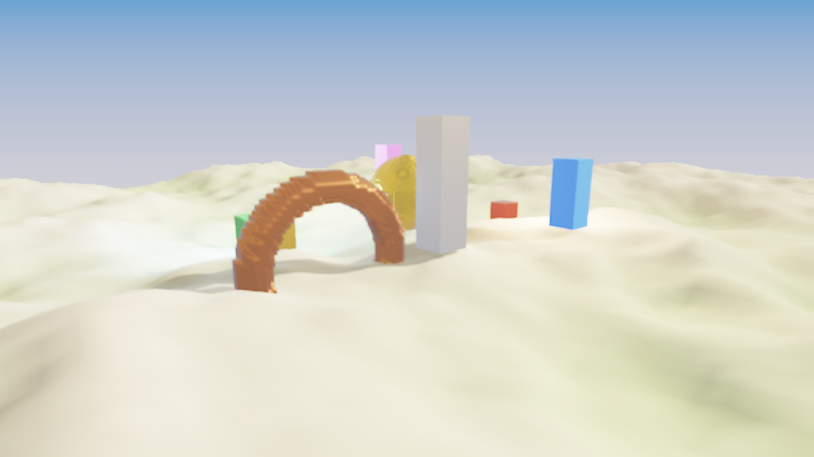
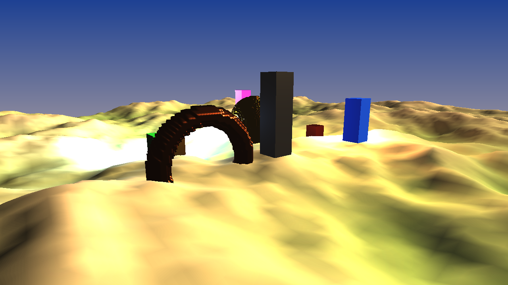

# Tutorial G3 — Deferred-Renderer (`fuhglgraphics::render::DeferredRenderer`)

> 🇬🇧 **English version:** [docs/en/tutorials/g3_deferred_renderer.md](../../en/tutorials/g3_deferred_renderer.md)

**Ziel:** eine Szene mit dem neuen G3-Deferred-Renderer rendern — erweiterter G-Buffer
(Albedo+Normal, Metallic/Roughness/AO, HDR-Emissive, Motion-Vectors, Material-ID), PBR-Lighting
über die FuhGLCore-Lights/Shadows/IBL und der Post-Chain TAA → FSR1-artiges Upscaling →
ACES-Tonemapping.

## Code

```cpp
#include <fuhglgraphics/graphics.hpp>
#include <fuhgl/fuhgl.hpp>
#include <fuhgl/render.hpp>

// 1) aktueller GL >= 3.3 Kontext (fuhgl::Window; headless: FUHGL_BACKEND=surfaceless)
fuhgl::Window window;
window.create("demo", 1280, 720);

// 2) der Renderer: Ausgabeziel + optional MSAA am G-Buffer
fuhglgraphics::render::DeferredRenderer renderer;
renderer.create(1280, 720, /*msaaSamples=*/0);
renderer.enableCsmShadows(2048, 4);        // Schatten (FuhGLCore CascadeShadowMap)
renderer.setShadowSceneBounds({0, 4, 0}, 55.f);
renderer.setRenderScale(0.75f);            // intern 75% rendern, FSR1-artig hochskalieren
renderer.setEffectEnabled(fuhglgraphics::render::Effect::Taa, true);     // default an
renderer.setEffectEnabled(fuhglgraphics::render::Effect::Tonemap, true); // default an

// 3) die Szene (flache FuhGLCore-SceneView — der G9-Szenengraph kommt später)
fuhgl::render::SceneView scene;
scene.camera = &camera;                    // fuhgl::Camera, z.B. FirstPersonCamera
scene.width = 1280; scene.height = 720; scene.aspect = 1280.f / 720.f;
scene.items.push_back({&mesh, &material, model});          // fuhgl::render::DrawItem
scene.lights.push_back(fuhgl::render::Light::directional({-0.85f, -0.55f, -0.45f},
                                                          {1.f, 0.82f, 0.58f}, 3.4f));
scene.env = &environment;                  // optional IBL (fuhgl::render::Environment)

// 4) pro Frame — materialIds (optional, parallel zu scene.items) landen im G-Buffer
//    (MaterialId-Attachment, wird später von G8-Decals genutzt)
std::vector<std::uint32_t> materialIds = {1, 2, 3};
renderer.render(scene, &materialIds);

// 5) Ergebnis: renderer.output() ist das LDR-Bild; der erweiterte G-Buffer ist einsehbar:
//    texAlbedo() texNormal() texPbr() texEmissive() texMotion() texMaterialId() texDepth()
//    und hdrTexture() ist das beleuchtete HDR-Bild vor der Post-Chain.
```

Effekte werden pro Enum geschaltet (mit Capability-Gating — nicht unterstützte Effekte werden
mit Warnung abgelehnt): `render::Effect::{Taa, Upscale, Tonemap, Msaa, Shadows, CsmShadows, Ibl}` —
`renderer.setEffectEnabled(...)`, `renderer.effectEnabled(...)`, `renderer.setAllEffects(...)`.

## Ergebnis

Headless (surfaceless EGL) mit dem Tool in `examples/screenshot` gerendert — volle Qualität
(CSM-Schatten, IBL, TAA, ACES-Tonemapping):


Dieselbe Szene mit 60% interner Auflösung, hochskaliert über den FSR1-artigen EASU+RCAS-Pass
(`--scale 0.6`):



Und mit ausgeschalteter Post-Chain (`--no-taa --no-tonemap --no-shadows --no-ibl`) — rohes
HDR-Clamp, sichtbares Aliasing, keine Schatten — zum Vergleich:



Nachbauen: `cmake --build build --target fuhglgraphics_screenshot`, dann
`FUHGL_BACKEND=surfaceless ./build/examples/fuhglgraphics_screenshot --out shot.png --width 1280 --height 720 --frames 24`
(Exit-Code 2, wenn kein headless GL verfügbar ist).
