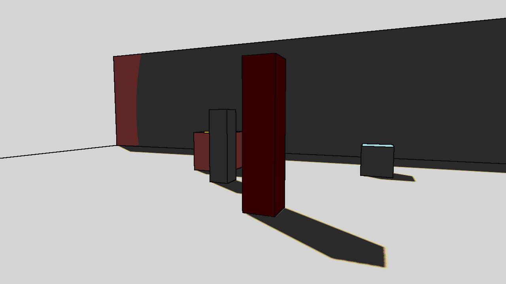
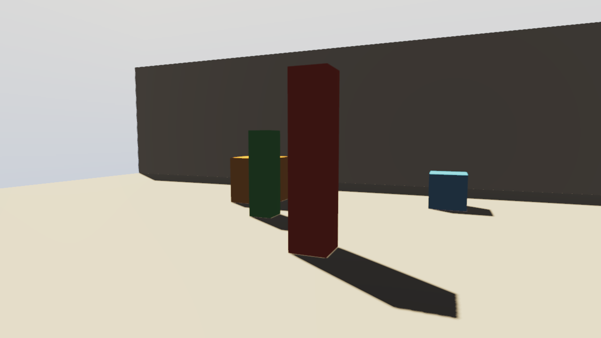
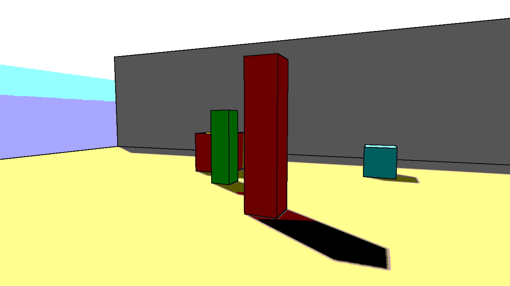

# Tutorial G40 — Eigene Post-Passes + Comic-Look (`DeferredRenderer::PostPass`, `Effect::ComicLook`)

> 🇬🇧 **English version:** [docs/en/tutorials/g40_custom_post_passes.md](../../en/tutorials/g40_custom_post_passes.md)

**Ziel:** die Post-Kette des G3-Deferred-Renderers erweiterbar machen — eigene Render-Passes
zur Laufzeit registrieren (z.B. einen Comic-/Cel-Look ganz am Ende des Frames) und die
Ergebnisse früherer Render-Stages (G-Buffer, HDR-Kette, …) als Pass-Inputs wiederverwenden.

## Aufbau der Post-Kette

`DeferredRenderer` baut in `createInternal()` einen `fuhgl::render::RenderGraph` auf:

```
gbuffer -> ssao/hbao -> lighting -> gi -> ssr -> water -> particles -> volumetric
        -> bloom -> flare -> taa -> upscale -> ca -> dof -> tonemap -> [eigene Passes] -> comic -> present
```

- Jedes Zwischenergebnis ist eine **benannte Graph-Ressource** (`gAlbedo` … `gDepth`,
  `hdr`, `hdrG` … `hdrF`, `taa`, `up`, `ca`, `dof`, `ldr`, `comic`) — eine Textur, die man
  als Input eines beliebigen Passes deklarieren oder von außen über
  `postGraph().texture("hdr")` / die typisierten Accessors (`hdrTexture()`, `texNormal()`,
  `texSsao()`, …) auslesen kann.
- Die Ausführungsreihenfolge folgt aus den Ressourcen-Abhängigkeiten (Topological Sort).
- `tonemap` schreibt die LDR-Ressource `"ldr"`; eigene Passes hängen dahinter; der
  eingebaute `"comic"`-Pass läuft nach den eigenen Passes; ein finaler Pass ohne Output
  (`"present"`) kopiert das Kettenende in `output()`. (Dieses `ldr`+`present`-Split ist es,
  das „Pass ganz am Ende anhängen" ermöglicht — ein no-output-Pass ohne deklarierte
  Abhängigkeiten würde wegen der LIFO-Tie-Break-Regel des Order-Resolvers *vor* dem Tonemap
  laufen.)

## Code

### 1) Der eingebaute Comic-Look (eine Zeile)

```cpp
renderer.setEffectEnabled(fuhglgraphics::render::Effect::ComicLook, true);
renderer.comicLevels         = 6.f;    // Posterisierungsstufen
renderer.comicEdgeStrength  = 1.4f;   // Stärke der Ink-Kanten
renderer.comicEdgeThreshold = 0.06f;  // Kanten-Schwellenwert
renderer.comicSaturation    = 1.35f;   // Cel-Sättigungs-Boost
renderer.comicInkColor      = {0.04f, 0.03f, 0.05f};
// oder pro Szene über scene::EffectParams (wird mit der Szene serialisiert, G19):
//   scene.root().effects.enable(render::Effect::ComicLook);
//   scene.root().effects.params.comicLevels = 6.f;
```

Der Pass läuft zuletzt (nach den eigenen Passes): Er posterisiert das tonemappte LDR-Bild
und zeichnet Ink-Outlines über eine Sobel-artige Kantenantwort auf G-Buffer-Normal +
-Tiefe (Silhouetten und geometrische Kanten); Inputs sind `"@chain"`, `gNormal`, `gDepth`.

### 2) Ein eigener Post-Pass

```cpp
fuhgl::render::Material tintMat;                 // eigenes Fullscreen-Material
// ... kFsVert-ähnlichen Vertex-Shader + Fragment-Shader kompilieren (uSrc auf Unit 0) ...

fuhglgraphics::render::DeferredRenderer::PostPass tint;
tint.name   = "tint";
tint.inputs = {"@chain"};                        // Output des vorherigen Passes in der Kette
tint.output = "tintOut";                         // owned Output-Ressource (Pflicht, eindeutig)
tint.fn     = [&](fuhgl::render::RenderGraph::PassContext&) {
    // Inputs sind vor fn bereits auf Units 0..n-1 gebunden ("@chain" zur Laufzeit aufgelöst) —
    // nur noch Uniforms setzen und das Fullscreen-Dreieck zeichnen:
    renderer.drawFs(tintMat, [&](fuhgl::Program& p) {
        p.setUniform(p.uniformLocation("uSrc"), 0);
    });
};
renderer.addPostPass(tint);                      // baut den Graphen neu, wenn schon create() lief
// pro Frame:
renderer.setPostPassEnabled("tint", true);       // Runtime-Toggle, kein Rebuild
```

Regeln:

- `inputs` werden vor `fn` auf die Texture-Units `0..n-1` gebunden; der Platzhalter
  `"@chain"` löst sich auf den Output des vorherigen **aktivierten** Passes auf (`"ldr"`
  beim ersten), d.h. das Deaktivieren eines Passes mitten in der Kette fällt automatisch
  auf den Vorgänger durch — keine Stale-Reads. Jeder andere Ressourcenname (`"gNormal"`,
  `"hdrB"`, `"taa"`, …) funktioniert direkt.
- `output` ist Pflicht und eindeutig; `atOutputSize` (Default true) wählt Output-Auflösung
  vs. interne Render-Scale-Auflösung, `outputFormat` defaultet auf `GL_RGBA16F`.
- `addPostPass`/`removePostPass` sind strukturell: nach `create()` bauen sie alle
  GL-Ressourcen neu (derselbe Pfad wie `resize()`); `setPostPassEnabled` schaltet nur
  `RenderGraph::setPassEnabled` zur Laufzeit.
- Eigene Passes laufen **vor** dem eingebauten `comic`-Pass; `Effect::ComicLook` abschalten,
  damit der eigene Pass der letzte ist.

### 3) Stage-Ergebnisse außerhalb des Graphen lesen

```cpp
renderer.render(scene, &materialIds);
const fuhgl::Texture* hdr = renderer.postGraph().texture("hdr"); // beleuchtetes HDR vor der Post-Kette
// typisierte Accessors: texAlbedo() texNormal() texPbr() texEmissive() texMotion()
//                       texMaterialId() texDepth() hdrTexture() texSsao() reflectionTexture()
```

Owned Ressourcen werden bei `create()`/`resize()`/Pass-Änderungen neu angelegt — die
Textur-Referenz pro Frame frisch holen, nie über ein Resize hinweg cachen.

## Ergebnis

Headless (surfaceless EGL) gerendert mit `examples/comic_screenshot`
(`fuhglgraphics_comic_screenshot --out … [--no-comic] [--levels 6] [--edge 1.4]`;
der CI-Job `docs-screenshots` rendert diese nach `docs/images/`):

| Comic-Look an | aus (plain PBR) | stärker (Levels 3, Edge 2.0) |
| --- | --- | --- |
|  |  |  |

## Tests

- `tests/test_postpass.cpp` — Registry-Unit-Tests (ohne GL): Add/Remove/Duplikate,
  Runtime-Toggle, `Effect::ComicLook` Name/Capability-Mapping.
- `tests/gl_smoke_comic.cpp` — headless GL: Comic an vs. aus muss das Frame stark ändern
  und Ink-Pixel erzeugen; ein eigener `addPostPass`-Pass muss das Frame einfärben, und das
  Deaktivieren muss exakt das Basis-Frame wiederherstellen (`@chain`-Fallback).
