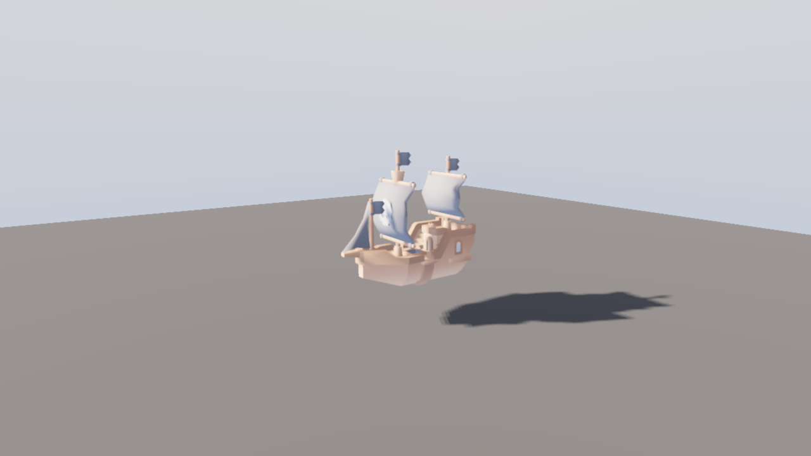
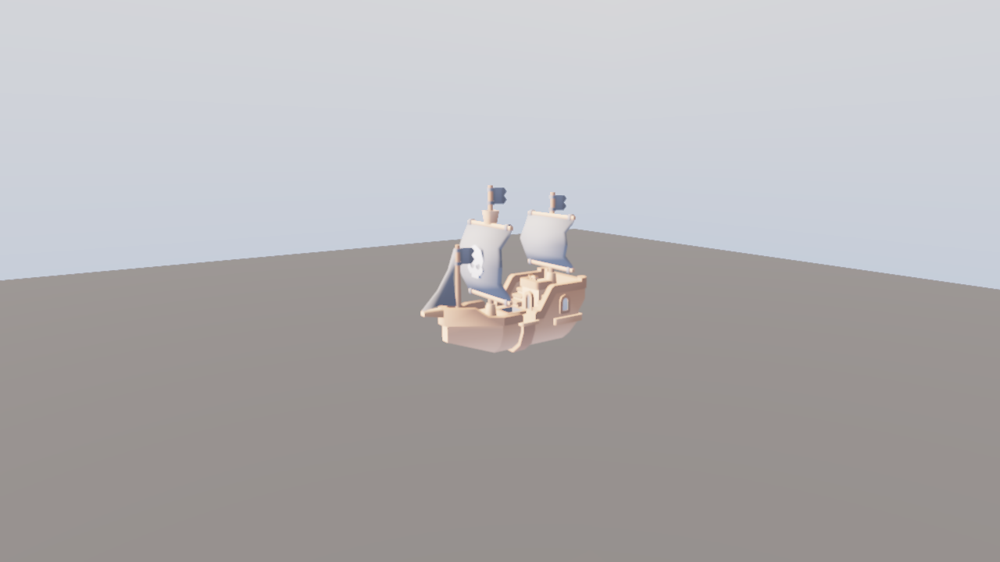
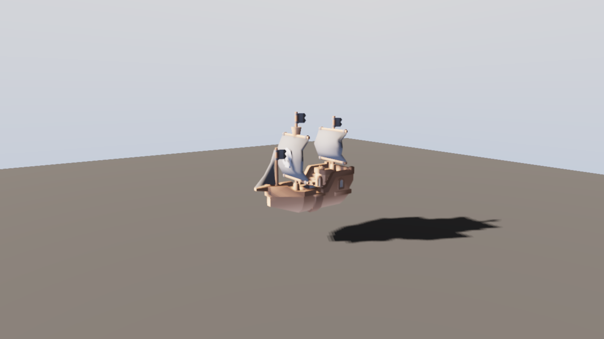
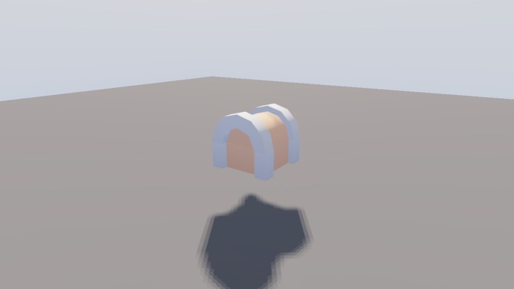

# Tutorial G4 — glTF-2.0-Loader (`fuhglgraphics::io`)

> 🇬🇧 **English version:** [docs/en/tutorials/g4_gltf_loader.md](../../en/tutorials/g4_gltf_loader.md)

**Ziel:** ein glTF-2.0-Modell (.gltf JSON oder .glb binär) laden und über den
G9-Szenengraphen mit dem G3-Deferred-Renderer rendern — inklusive Texturen.

## Was implementiert ist

- `io::loadGltf(path, asset, &err)` — reines CPU-Parsing, kein GL-Kontext nötig. Eigener
  minimaler JSON-Parser + Base64 (`io/json.hpp`, kein nlohmann). Unterstützt: Puffer
  (externe `.bin`, eingebettete base64-`data:`-URIs, GLB-BIN-Chunk), bufferViews +
  Accessoren (alle Komponententypen 5120–5126, normalisiert, gestrides, sparse),
  Mesh-Primitive (Modus TRIANGLES / TRIANGLE_STRIP / TRIANGLE_FAN; Attribute POSITION,
  NORMAL, TEXCOORD_0, COLOR_0 + Indizes → FuhGLCore `render::MeshData`, 11 Floats/Vertex),
  Materialien über `KHR_materials_pbrMetallicRoughness` (baseColor-/Emissive-/Metallic-/
  Roughness-Faktoren, baseColor- + Normal-Texturen, alphaMode, doubleSided), Bilder
  (externe Dateien oder GLB-eingebettet; PNG/JPEG via Qt `QImage` zu RGBA8 dekodiert bei
  `WITH_QT=ON`, sonst mit Log übersprungen und das Material fällt auf seine Farb-Faktoren
  zurück), Sampler, Nodes (TRS; `matrix` wird zu TRS dekomponiert), Scenes.
  Mit Log übersprungen: Skins, Animationen, Morph Targets, Draco/meshopt, Punkte/Linien.
- `io::instantiateGltf(asset, scene, gpu, parent)` — braucht einen aktuellen GL-Kontext.
  Bildet die Default-Scene auf den G9-Szenengraphen ab: ein `scene::Node` pro glTF-Node
  (TRS und Kinder erhalten), jeder Mesh-Node bekommt eine `MeshComponent` mit einer
  `MeshEntry` pro Primitive (GL-`render::Mesh`, Preset-`render::Material` mit Albedo-/
  Normal-Textur, `castShadow = true`, laufende Material-ID).
- Fehler nach Repo-Konvention: `bool` + Fehlerstring, nie Exceptions.
- Keine Third-Party-Assets im Repo (Anforderung N7) — Tests nutzen generierte Fixtures
  (`tests/gltf_fixture.hpp`); das Demo-Asset wird unten zur Tutorial-Zeit geholt.

## Demo-Asset (CC0)

Das Tutorial/Demo nutzt ein Kenney-Modell (Creative Commons Zero, CC0) aus dem Mirror
[`shorepine/kenney`](https://github.com/shorepine/kenney), gepinnt auf Commit
`3694c6879e487c108f55677be7dd2ca75b07cc3b` (siehe `LICENSE.txt` dort: „Creative Commons
Zero, CC0“):

```bash
git clone --filter=blob:none --no-checkout https://github.com/shorepine/kenney.git /tmp/kenney
git -C /tmp/kenney sparse-checkout set 3d/pirate
git -C /tmp/kenney checkout 3694c6879e487c108f55677be7dd2ca75b07cc3b
# /tmp/kenney/3d/pirate/ship-pirate-medium.glb + chest.glb + Textures/colormap.png
# (externe Bild-URIs lösen relativ zur .glb auf — Textures/ danebenlassen)
```

## Code

```cpp
#include <fuhglgraphics/graphics.hpp>

// 1) parsen (ohne GL)
fuhglgraphics::io::GltfAsset asset;
std::string err;
if (!fuhglgraphics::io::loadGltf("ship-pirate-medium.glb", asset, &err)) {
    std::fprintf(stderr, "loadGltf fehlgeschlagen: %s\n", err.c_str());
    return 1;
}

// 2) in den G9-Szenengraphen instanziieren (aktueller GL >= 3.3 Kontext nötig)
fuhglgraphics::scene::Scene scene;
fuhglgraphics::io::GltfGpuResources gpu;
fuhglgraphics::scene::Node& model = scene.root().createChild("model");
fuhglgraphics::io::instantiateGltf(asset, scene, gpu, &model, &err);
// model.translation / model.scale — Modell passend normalisieren (siehe examples/gltf_demo)

// 3) rendern wie jede G9-Szene
fuhglgraphics::scene::FrameData frame;
scene.fillFrame(frame, nullptr, 1280, 720);
frame.effects.applyTo(renderer);                        // G3 DeferredRenderer
renderer.render(frame.view, &frame.materialIds, &frame.castShadow);
```

## Fertiges Demo-Tool

`examples/gltf_demo` macht alles Obige plus Staging (Bodenplatte, Sonne + Fülllicht,
Gradient-Sky-Cubemap + IBL-Environment, CSM-Schatten, God Rays) und schreibt headless ein
PNG:

```bash
cmake --build build --target fuhglgraphics_gltf_demo   # WITH_QT=ON-Build -> Texturen
FUHGL_BACKEND=surfaceless ./build/examples/fuhglgraphics_gltf_demo \
    --model /tmp/kenney/3d/pirate/ship-pirate-medium.glb \
    --out ship.png --width 1280 --height 720 --frames 24
# Flags: --no-shadows --no-ibl --no-rays --no-sky --no-tex, --azimuth/--elevation/--sun-*
```

## Ergebnis

Headless gerendert (surfaceless EGL, Mesa llvmpipe) mit `examples/gltf_demo` — das
Kenney-Piratenschiff (`ship-pirate-medium.glb`, Colormap-Textur) auf einer Plaza, alle
Effekte an (CSM-Schatten, IBL aus der Gradient-Sky-Cubemap, TAA, ACES-Tonemapping):



Dasselbe Modell ohne Schatten (`--no-shadows`) — die Plaza ist gleichmäßig beleuchtet:



… ohne IBL (`--no-ibl`) — flaches Ambient statt der Environment-Cubemap:



… und ein zweites Modell (`chest.glb`, `--size 1.6 --distance 4.2`) aus der Nähe:



Nachbauen (braucht einen `WITH_QT=ON`-Build fürs Textur-Dekodieren):
`cmake --build build-qt --target fuhglgraphics_gltf_demo`, dann
`FUHGL_BACKEND=surfaceless QT_QPA_PLATFORM=offscreen ./build-qt/examples/fuhglgraphics_gltf_demo --model /tmp/kenney/3d/pirate/ship-pirate-medium.glb --out ship.png --width 1280 --height 720 --frames 24 [--no-shadows] [--no-ibl]`
(Exit-Code 2, wenn kein headless GL verfügbar ist).

## Tests

- `tests/test_io.cpp` (Label `unit`): JSON-Parser, Base64, `loadGltf` auf generierten
  .gltf/.glb-Fixtures (data-URI + BIN-Chunk), Fehlerfälle, Matrix-Node-Dekomposition; mit
  `WITH_QT=ON` zusätzlich PNG-Decode-Roundtrip über `QImage`.
- `tests/gl_smoke_gltf.cpp` (Label `gl_context`, ohne GL Skip mit 77): lädt die Fixture
  .glb, instanziiert, rendert über den G3-Renderer und prüft beleuchtete Pixel, Material-IDs
  pro Item, die Node-Weltmatrix auf den Draw-Items und die Material-Presets.
