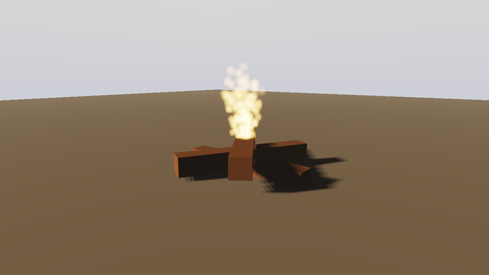
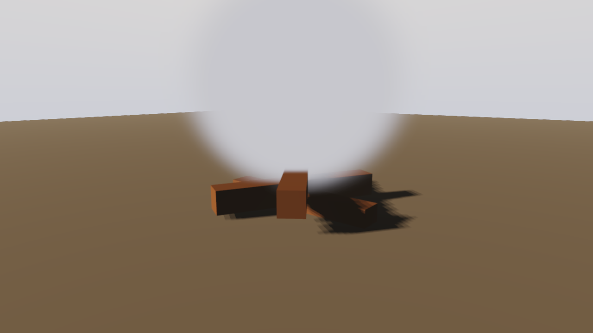
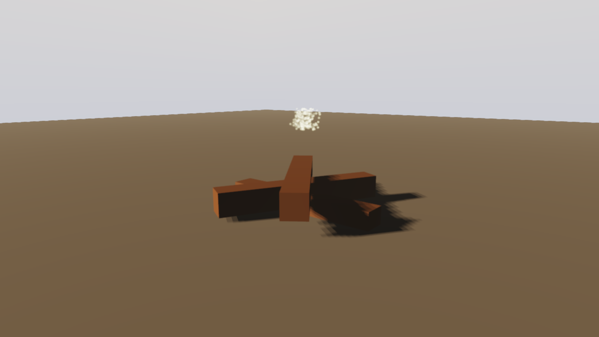
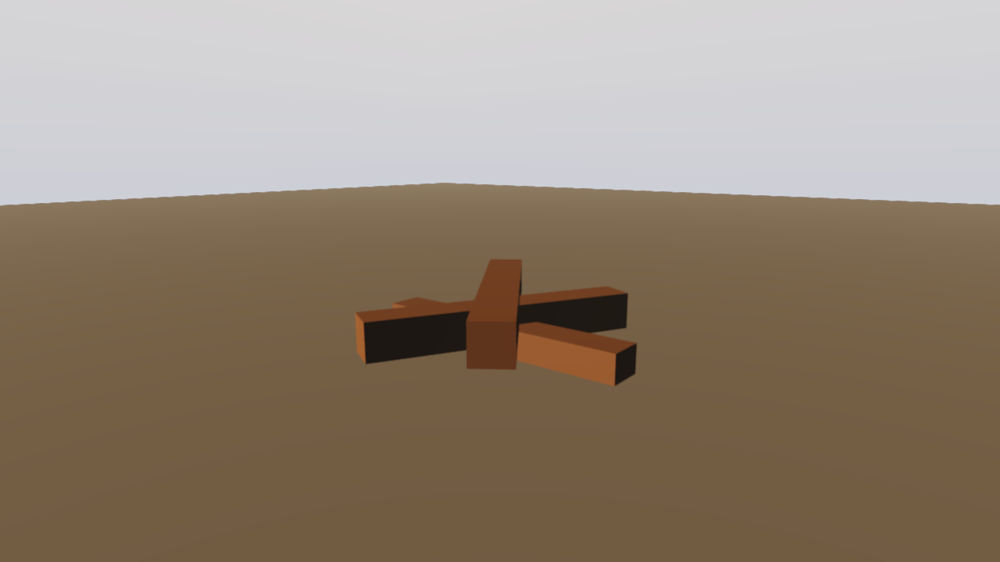

# Tutorial G5 — GPU-Partikel (`fuhglgraphics::particles::ParticleSystem`)

> 🇬🇧 **English version:** [docs/en/tutorials/g5_particles.md](../../en/tutorials/g5_particles.md)

**Ziel:** ein GPU-Partikelsystem nach dem Compute-Pattern von FuhGLCore (wie `GpuCuller`,
F34): Emitter- + Integrate-Compute-Shader über ein SSBO, gerendert als instanzierte
kamera-facing Billboards im „particles"-Post-Pass des G3-Deferred-Renderers — mit
CPU-Fallback auf GL 3.3–4.2.

## Design

- `particles::EmitterConfig` — Position, Richtung, Speed/Spread-Kegel, Rate (Partikel/s),
  Lifetime, Größe + Wachstum, Farbe/Alpha, Gravitation, Wind, Drag, Seed, Blend-Modus
  (additiv für Funken/Feuer, Alpha für Rauch).
- `particles::ParticleSystem` (PIMPL, movable). `create(maxParticles, cfg)` braucht einen
  aktuellen GL-Kontext: ab **GL 4.3** (`system.gpu() == true`) wird ein SSBO mit
  Partikel-Structs gebaut (`vec4 pos+size, vel+life, color+alpha, maxLife+seed`), ein
  Atomic-Counter-Puffer, die Emit/Integrate-Compute-Shader und ein instanziertes
  Billboard-Programm — das SSBO ist zugleich der Divisor-1-Instanzattribut-Puffer
  (Locations 4..7), genau wie beim `GpuCuller`. Auf **GL 3.3–4.2** läuft dieselbe Mathematik
  auf der CPU (`particles::CpuSim`, rein und unit-getestet), lebende Partikel werden pro
  Frame in ein dynamisches VBO gestreamt.
- `update(dt)` emittiert (fraktionaler Raten-Akkumulator) und integriert (Gravitation/Wind/
  Drag/Altering, Größenwachstum). `aliveCount()` ist auf CPU exakt und wird auf GPU aus dem
  atomaren Alive-Counter gelesen.
- Rendering: Der G3-`DeferredRenderer` hat einen neuen **„particles"-Post-Pass** zwischen
  Lighting und TAA (Graph-Resource `hdr` → `hdrP`): eine Kopie des HDR-Bildes, dann die
  Billboards jedes Systems geblendet (ONE,ONE additiv oder SRC_ALPHA) mit radialem Falloff,
  Life-Fade und **Soft-Particle-Depth-Fade** gegen den G-Buffer-Depth (`uSceneDepth`).
  Schalter: `render::Effect::Particles`.

## Code (als G9-Komponente)

```cpp
#include <fuhglgraphics/graphics.hpp>

fuhglgraphics::scene::Scene scene;
auto& em = scene.root().createChild("fire").attach<fuhglgraphics::scene::ParticleEmitterComponent>();
em.config.position = {0.f, 0.35f, 0.f};
em.config.direction = {0.f, 1.f, 0.f};
em.config.speed = 1.6f;  em.config.rate = 350.f;   // Funken/s
em.config.lifetime = 0.9f; em.config.size = 0.07f;
em.config.color = {1.0f, 0.55f, 0.15f};
em.config.blend = fuhglgraphics::particles::BlendMode::Additive;
em.system.create(8192, em.config);          // aktueller GL-Kontext nötig (GPU ab 4.3)

// pro Frame:
scene::FrameData frame;
scene.fillFrame(frame, nullptr, 1280, 720); // sammelt em.system in frame.particleSystems
frame.effects.enable(fuhglgraphics::render::Effect::Particles);
frame.effects.applyTo(renderer);
for (auto& c : scene.root().children())
    if (auto* e = c->find<fuhglgraphics::scene::ParticleEmitterComponent>())
        e->system.update(dt);
renderer.render(frame.view, &frame.materialIds, &frame.castShadow, &frame.particleSystems);
```

## Demo + Ergebnis

`examples/particles_screenshot` baut eine Campfire-Szene (Holzscheite, Sonne, Sky-Cubemap,
CSM-Schatten über das F45-Shadow-Kit, God Rays) mit drei Emittern, wählbar über
`--kind fire|smoke|pollen|all`, und schreibt headless ein PNG:

```bash
cmake --build build --target fuhglgraphics_particles_screenshot
FUHGL_BACKEND=surfaceless ./build/examples/fuhglgraphics_particles_screenshot \
    --out fire.png --kind fire --width 1280 --height 720 --frames 24
```

Headless gerendert (surfaceless EGL, Mesa llvmpipe, GL 4.5 → Compute-Pfad aktiv,
`gpu=1`, ~300 lebende Funken):



Rauchwolke (Alpha-Blend, wachsende Billboards, `--kind smoke`):



Pollen/Staubkörner, die durch die God Rays treiben (`--kind pollen`):



Dieselbe Szene ohne Partikel/Effekte (`--no-particles --no-shadows --no-rays`) zum Vergleich:



## Tests

- `tests/test_particles.cpp` (Label `unit`, ohne GL): `CpuSim` — Emissionsrate +
  fraktionaler Akkumulator, Integration (Gravitation/Wind/Drag/Altering/Größenwachstum),
  Kompaktierung toter Partikel, Determinismus pro Seed.
- `tests/gl_smoke_particles.cpp` (Label `gl_context`, ohne GL >= 3.3 Skip mit 77): legt ein
  System auf dem GL-Kontext an, prüft `gpu()` gegen die GL-Version, simuliert 1 s
  (`aliveCount() > 50`), rendert über den G3-Renderer mit und ohne System und assertet, dass
  die Bildschirmregion des Emitters heller wird + kein GL-Fehler.
