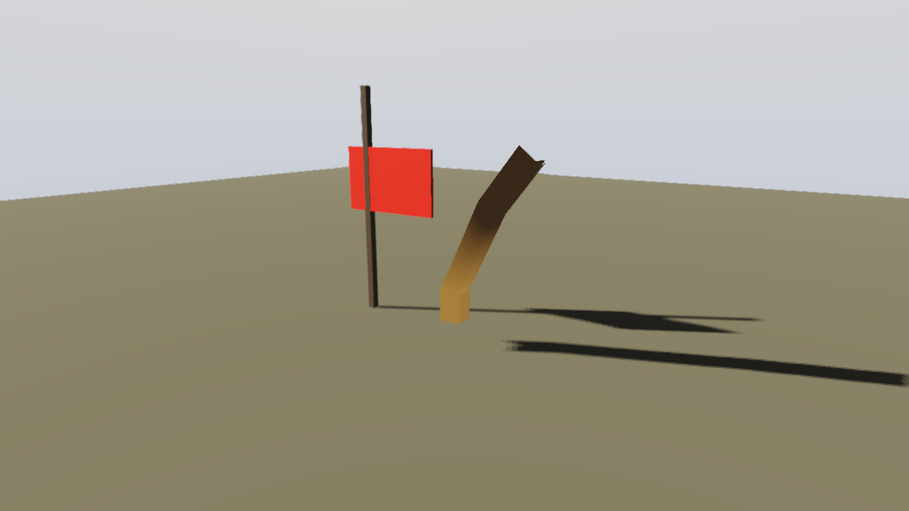
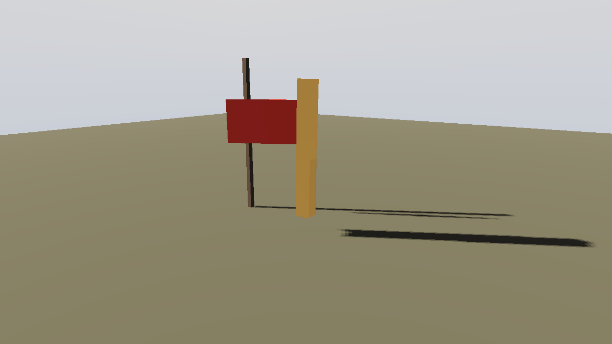
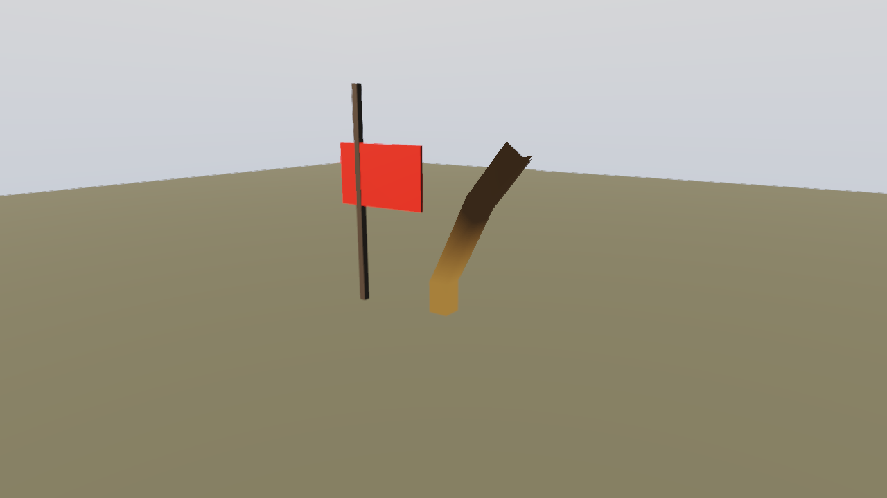

# Tutorial G6 — Animation & Skinning (`fuhglgraphics::anim`)

> 🇬🇧 **English version:** [docs/en/tutorials/g6_animation.md](../../en/tutorials/g6_animation.md)

**Ziel:** Keyframe-Animation von G9-Szenen-Nodes plus skeletisches Skinning —
`anim::AnimationPlayer` (TRS-Clips, Loop-Modi, Slerp) und `anim::Skeleton` + CPU-Skinning
(`skinMeshCpu`) mit der Joint-Matrix-Palette. glTF-Animationen/Skins parst der G4-Loader.

## Design

- `anim::AnimationClip` / `anim::TrsChannel` — Keyframe-Kanäle pro **Knotenname**
  (Zeiten + Translationen/Rotationen/Skalierungen; gesamplet mit Lerp und
  `fuhgl::math::slerp`).
- `anim::AnimationPlayer` — `play(name, LoopMode::Once|Loop|PingPong, speed)`, `update(dt)`,
  `applyTo(scene)` schreibt die gesampelten TRS in die benannten `scene::Node`s (vor
  `Scene::fillFrame()` aufrufen). Reine CPU — unit-testbar. Als G9-Komponente:
  `scene::AnimationComponent` hält einen Player.
- Skelett-Skinning (CPU-Pfad, laut Anforderung „CPU oder GPU" zulässig): `anim::Skeleton`
  hält Joint-Knoten-Indizes + Inverse-Bind-Matrizen; `updatePalette(jointNodePtrs)`
  berechnet pro Frame die Palette `jointWorld * inverseBind`; `skinMeshCpu()` deformiert
  die Bind-Pose-`MeshData` (+ `SkinWeights` aus JOINTS_0/WEIGHTS_0) in ein dynamisches Mesh.
- glTF (G4-Erweiterung): `animations[]` (Channels/Sampler → Clips) und `skins[]` (Joints +
  inverseBindMatrices) werden in `GltfAsset::animations/skins` geparst; `instantiateGltf()`
  füllt `GltfGpuResources::player` (Clips), `skeletons`, `nodePtrs` und `skinnedMeshes`
  (Bind-Pose + Weights pro skinned Primitive).

## Code

```cpp
#include <fuhglgraphics/graphics.hpp>

fuhglgraphics::scene::Scene scene;
auto& joint1 = scene.root().createChild("joint0").createChild("joint1");

fuhglgraphics::anim::AnimationClip bend;
bend.name = "bend"; bend.duration = 1.2f;
fuhglgraphics::anim::TrsChannel ch;
ch.nodeName = "joint1";
ch.times = {0.f, 0.6f, 1.2f};
ch.rotations = {fuhgl::math::Quat{0,0,0,1}, fuhgl::math::fromAxisAngle(-1.05f, {0,0,1}),
                fuhgl::math::Quat{0,0,0,1}};
bend.channels.push_back(ch);

fuhglgraphics::anim::AnimationPlayer player;
player.addClip(bend);
player.play("bend", fuhglgraphics::anim::LoopMode::PingPong);

fuhglgraphics::anim::Skeleton skeleton;
skeleton.jointNodes = {0, 1};
skeleton.inverseBindMatrices = {fuhgl::math::Mat4{}, fuhgl::math::Mat4{}};

// pro Frame:
player.update(dt);
player.applyTo(scene);                       // schreibt TRS in die benannten Nodes
scene::FrameData frame;
scene.fillFrame(frame, nullptr, 1280, 720);
skeleton.updatePalette({&joint0, &joint1}); // Palette = jointWorld * IBM
fuhglgraphics::anim::skinMeshCpu(armBase, armWeights, skeleton.palette, skinned);
armMesh.setMeshData(skinned);                // dynamisches Mesh, vom G3-Pass gerendert
renderer.render(frame.view, &frame.materialIds, &frame.castShadow);
```

## Demo + Ergebnis

`examples/animation_screenshot` baut einen 2-Joint-Roboterarm (geskinnter Box-Streifen,
CPU-Palette), der über einen Pingpong-Clip gebogen wird, plus eine Flagge am Mast, die über
einen geloopten TRS-Kanal winkt — headless über den G3-Renderer (PCSS-Schatten, Sky-Cubemap,
God Rays):

```bash
cmake --build build --target fuhglgraphics_animation_screenshot
FUHGL_BACKEND=surfaceless ./build/examples/fuhglgraphics_animation_screenshot \
    --out bend.png --time 0.55 --width 1280 --height 720 --frames 16
```

Arm mittendrin gebogen (t = 0,55 s), Flagge winkt, PCSS-Schatten auf dem Boden:



 derselbe Clip am Pingpong-Umkehrpunkt (t = 1,2 s) — der Arm ist wieder gerade:



Dieselbe Pose ohne Schatten/Rays (`--no-shadows --no-rays`) zum Vergleich:



## Tests

- `tests/test_anim.cpp` (Label `unit`, ohne GL): Channel-Sampling (Lerp/Slerp/Clamping),
  Player-Loop-Modi (Once/Loop/PingPong), `applyTo`-Knotenmap, `skinMeshCpu` (Identitäts-
  Palette = Bind-Pose; verschobenes Joint bewegt gewichtete Vertices).
- `tests/test_io.cpp`: die generierte glTF-Fixture trägt jetzt auch einen Animations-Clip
  und einen Skin (JOINTS_0/WEIGHTS_0 + inverseBindMatrices) — das Parsen wird assertet.
- `tests/gl_smoke_anim.cpp` (Label `gl_context`, ohne GL Skip mit 77): instanziiert die
  Fixture, spielt „spin“, rendert zwei Frames zu t=0/t=1 (Bilder müssen differieren), prüft
  die Pose des animierten Knotens und die CPU-geskinnten Vertex-Positionen.
