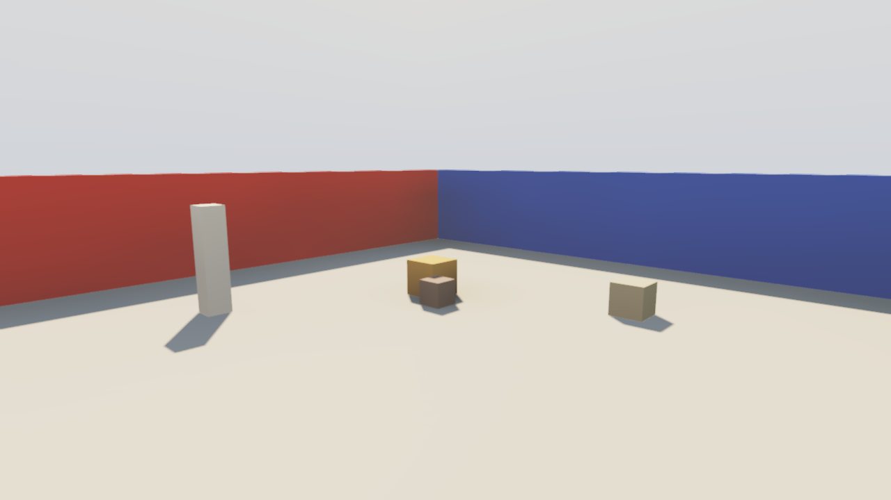
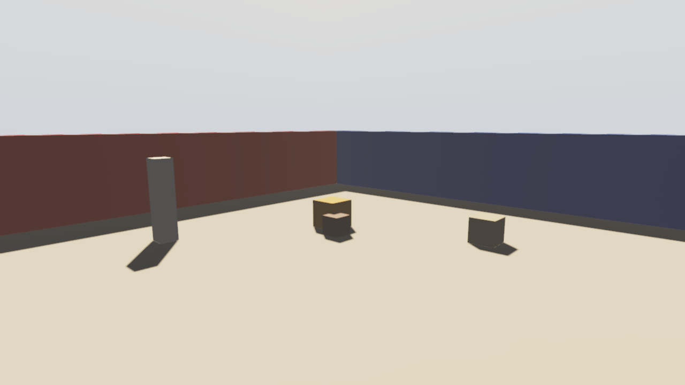
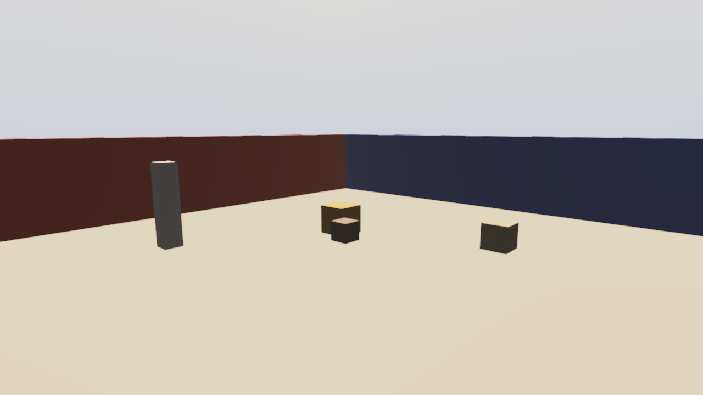

# Tutorial G7 — Light-Probes (SH-Irradiance-GI, `fuhglgraphics::probes`)

> 🇬🇧 **English version:** [docs/en/tutorials/g7_light_probes.md](../../en/tutorials/g7_light_probes.md)

**Ziel:** diffuses indirektes Licht (Color-Bleeding) über ein Gitter aus SH-(L2)-Irradiance-
Light-Probes — auf der CPU gebaked, in der G3-Lighting-Pass per trilinearer Interpolation
gesampelt (GL-3.3-Baseline, 3D-Texturen). Schalter: `render::Effect::LightProbes`.

## Design

- `probes::LightProbeGrid` — regelmäßiges Probe-Gitter über einer AABB (`create(nx, ny,
  nz, min, max)`; die Probes sitzen auf den Gitterknoten, `cell()` = Abstand). Jede Probe
  hält 9 RGB-SH-L2-Koeffizienten (`Sh9`, Reihenfolge Y00, Y1-1, Y10, Y11, Y2-2, Y2-1, Y20,
  Y21, Y22).
- **Bake (CPU, ohne GL):** `bake(BakeInput)` schießt pro Probe eine Fibonacci-Kugel aus
  Strahlen gegen einen World-Space-Triangle-Soup (`ProbeTriangle{a,b,c,albedo,emissive}`).
  Fehlschüsse nehmen `skyRadiance(dir)`; Treffer sammeln einen Bounce —
  `albedo/π * einfallend * cos`, wobei `einfallend` = Emissive + Sky (sichtbarkeitstest) +
  jedes Licht mit Schattenstrahl-Okklusion. Die Samples werden auf SH L2 projiziert
  (`shProject`); `shIrradiance(c, n)` wertet `E(n) = Σ A_l c_lm Y_lm(n)` aus
  (konstante Radiance L ⇒ E = πL — in den Unit-Tests assertiert).
- **GPU (GL 3.3):** `ensureUploaded()` packt die 27 Floats pro Probe in sieben RGBA16F-
  3D-Texturen (Einheiten 17–23); hardware-lineares 3D-Sampling interpoliert die
  Koeffizienten trilinear über das Gitter. Der Renderer lädt lazy beim ersten
  `render(..., lightProbes)` mit aktivem Effekt nach.
- **Lighting-Pass:** mit `Effect::LightProbes` an wird der diffuse Ambient-Anteil ersetzt
  durch `kD * albedo * (E(N)/π) * ao * lightProbeStrength` (IBL behält seinen specularen
  Anteil) — farbige Wände bluten so in schattigen Boden.
- **G9:** `scene::LightProbeComponent` besitzt das Gitter; `Scene::fillFrame()` trägt es
  in `FrameData::lightProbes` ein; `renderer.render(view, &materialIds, &castShadow,
  &particleSystems, frame.lightProbes)`.

## Code

```cpp
#include <fuhglgraphics/graphics.hpp>

fuhglgraphics::scene::Scene scene;
// ... Meshes aufbauen; World-Space-Triangle-Soup fürs Bake mitführen ...
fuhglgraphics::probes::BakeInput bake;
bake.triangles = soup;                                  // probes::ProbeTriangle-Liste
bake.lights = {fuhgl::render::Light::directional(sunDir, sunColor, 3.f)};
bake.skyRadiance = [](const fuhgl::math::Vec3& d) {     // Sky + Sonnenscheibe
    return fuhgl::math::lerp(skyHorizon, skyTop, fuhgl::math::clamp(d.y, 0.f, 1.f));
};

auto& pc = scene.root().createChild("probes").attach<fuhglgraphics::scene::LightProbeComponent>();
pc.grid.create(9, 4, 9, {-11.5f, 0.05f, -11.5f}, {11.5f, 3.8f, 11.5f});
pc.grid.bake(bake);                                     // CPU — kein GL-Kontext nötig

scene.root().effects.enable(fuhglgraphics::render::Effect::LightProbes);
// pro Frame:
fuhglgraphics::scene::FrameData frame;
scene.fillFrame(frame, nullptr, 1280, 720);             // frame.lightProbes = &pc.grid
frame.effects.applyTo(renderer);
renderer.render(frame.view, &frame.materialIds, &frame.castShadow, &frame.particleSystems,
                frame.lightProbes);
```

## Demo + Ergebnis

`examples/probes_screenshot` baut einen Innenhof mit roter, grüner und blauer Wand,
Kisten und einer tiefen warmen Sonne, bakt ein 9×4×9-Probe-Gitter und rendert headless
mit dem G3-Renderer (PCSS-Schatten, Sky-Cubemap, God Rays):

```bash
cmake --build build --target fuhglgraphics_probes_screenshot
FUHGL_BACKEND=surfaceless ./build/examples/fuhglgraphics_probes_screenshot \
    --out probes.png --width 1280 --height 720 --frames 16
```

Mit Light-Probes (`Effect::LightProbes`): der schattige Boden erhält indirektes Licht und
die Wandfarben bluten hinein:



Dieselbe Szene mit `--no-probes` — flaches Ambient, harte schwarze Schatten:



Ohne Schatten und God Rays (`--no-probes --no-shadows --no-rays`) zum Vergleich:



## Tests

- `tests/test_probes.cpp` (Label `unit`, ohne GL): SH-Basis/Projektion/Irradiance
  (konstante Radiance ⇒ E = πL), Ray-Triangle-Schnitt, Gitter-Layout, CPU-Bake — Sky über
  einem Boden (mehr Irradiance von oben), eine geschlossene Box mit einer emissiven roten
  Wand (gerichtetes SH: stark rot zur Wand, dunkel auf der Gegenseite) und eine leere
  geschlossene Box (null).
- `tests/gl_smoke_probes.cpp` (Label `gl_context`, skip mit 77): bakt ein Gitter über einer
  Ecke mit farbigen Wänden, lädt es hoch (3D-Textur-IDs != 0), rendert mit dem Effekt an
  vs. aus — die Frames unterscheiden sich und das Bild wird mit Probes heller; kein GL-Fehler.
