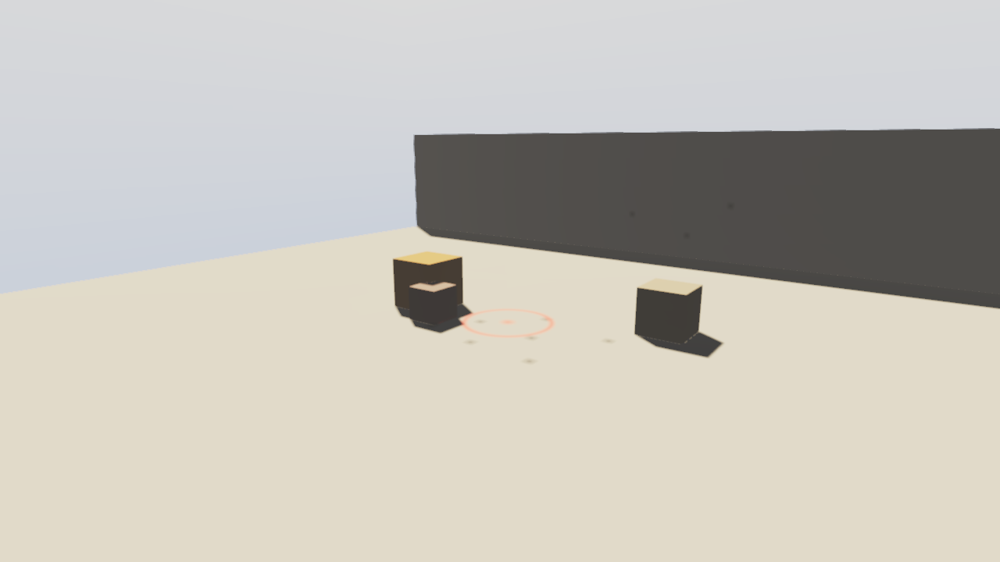
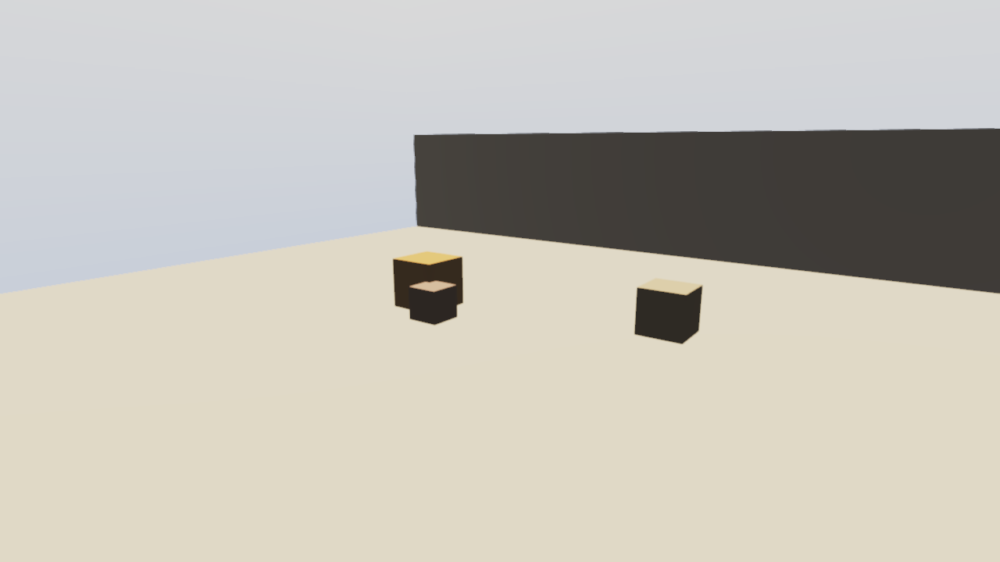

# Tutorial G8 — Deferred-Decals (`fuhglgraphics::render::Decal`)

> 🇬🇧 **English version:** [docs/en/tutorials/g8_decals.md](../../en/tutorials/g8_decals.md)

**Ziel:** projizierte Decals (Kugellöcher, Fußabdrücke, Markierungen), die in den G3-G-Buffer
geschrieben werden — das MaterialId-Attachment (G3/G9) bestimmt, welche Flächen ein Decal
erhält. Schalter: `render::Effect::Decals`.

## Design

- `render::Decal` (Plain Data, `render/decals.hpp`): eine orientierte Box (`world` ×
  Einheitsbox skaliert mit `halfExtents`) mit `albedo` × optionalem `albedoTexture`,
  optionalem `normalMap`, `opacity` und einer `materialIdMask` — das Decal wirkt dort, wo
  `(materialId & mask) != 0` gilt. `render::decalProject()` ist das pure CPU-Pendant der
  Projektion (unit-getestet).
- **Renderer-Pass** (`DeferredRenderer::drawDecals`, läuft zwischen G-Buffer-Geometrie-Pass
  und Lighting-Pass): jede Decal-Box wird mit Depth-Test (Vorderseiten, Depth `LESS`, keine
  Depth-Writes) nur in die Attachments 0 (Albedo) + 1 (Normal) gezeichnet. Der Fragment-
  Shader rekonstruiert die Weltposition aus dem Depth-Attachment, behält Pixel deren Fläche
  in der Box liegt und zur Material-ID-Maske passt, projiziert auf die dominante Flächen-
  achse der Oberflächennormale (decal-lokale UV) und mixt Decal-Albedo/Normal ein.
  Sortiert back-to-front, begrenzt auf `render::kMaxDecals` (16, die fernsten werden mit
  einmaliger Warnung verworfen). Bei MSAA läuft der Pass nach dem Resolve.
- **G9:** `scene::DecalComponent` hält ein `render::Decal`; `fillFrame()` setzt die
  World-Matrix aus dem Node und hängt es in `FrameData::decals`; `&frame.decals` an
  `renderer.render(..., &frame.decals)` übergeben.

## Code

```cpp
#include <fuhglgraphics/graphics.hpp>

fuhglgraphics::scene::Scene scene;
// Boden-Quad mit materialId = 1, Wand mit materialId = 2, ...

auto& node = scene.root().createChild("bulletHole");
node.translation = {-2.f, 0.02f, -1.2f};
auto& dc = node.attach<fuhglgraphics::scene::DecalComponent>();
dc.decal.halfExtents = {0.16f, 0.05f, 0.16f};  // muss die Oberflächenebene umfassen
dc.decal.albedoTexture = &bulletTex;            // RGBA, Alpha = Decal-Deckung
dc.decal.opacity = 0.95f;
dc.decal.materialIdMask = 1u;                   // nur Boden

scene.root().effects.enable(fuhglgraphics::render::Effect::Decals);
// pro Frame:
fuhglgraphics::scene::FrameData frame;
scene.fillFrame(frame, nullptr, 1280, 720);
frame.effects.applyTo(renderer);
renderer.render(frame.view, &frame.materialIds, &frame.castShadow, &frame.particleSystems,
                frame.lightProbes, &frame.decals);
```

## Demo + Ergebnis

`examples/decals_screenshot` baut einen Platz (Boden = Material-ID 1, Rückwand = ID 2,
Kisten = ID 3) mit 8 Kugellöchern auf dem Boden, 3 an der Wand (Maske 2) und einer großen
roten Ring-Markierung, headless gerendert mit dem G3-Renderer (PCSS-Schatten, Sky-Cubemap,
God Rays, Nebel):

```bash
cmake --build build --target fuhglgraphics_decals_screenshot
FUHGL_BACKEND=surfaceless ./build/examples/fuhglgraphics_decals_screenshot \
    --out decals.png --width 1280 --height 720 --frames 16
```

Mit Decals (`Effect::Decals`) — rote Ring-Markierung + Kugellöcher auf Boden und Wand:



Dieselbe Szene mit `--no-decals`:


Ohne Decals/Schatten/Rays (`--no-decals --no-shadows --no-rays`) zum Vergleich:



## Tests

- `tests/test_render.cpp` (Label `unit`, ohne GL): `Effect::Decals` in der Effekt-Registry
  (kEffectCount, effectName) und `render::decalProject` — Box-Containment, dominante-Achsen-
  UV-Mapping (Boden vs. Wand), rotierte/translierte Decal-Boxen.
- `tests/gl_smoke_decals.cpp` (Label `gl_context`, skip mit 77): Boden (ID 1) + Kiste
  (ID 2) mit roter Decal-Box, mit `Effect::Decals` an vs. aus gerendert — die Mitte wird
  nur mit aktivem Effekt rot, und eine Maske auf ID 2 lässt den Boden unverändert; kein
  GL-Fehler.
