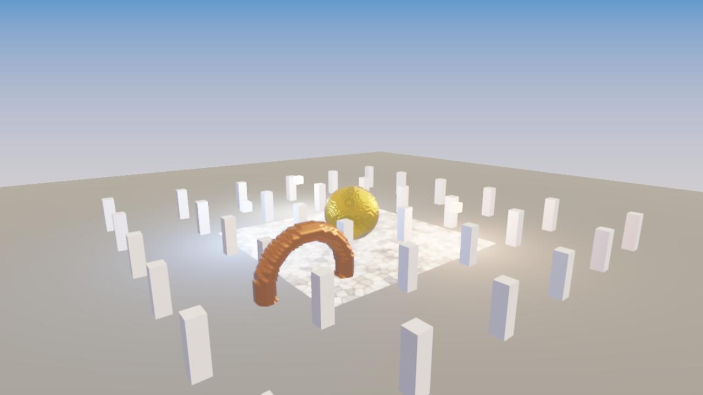
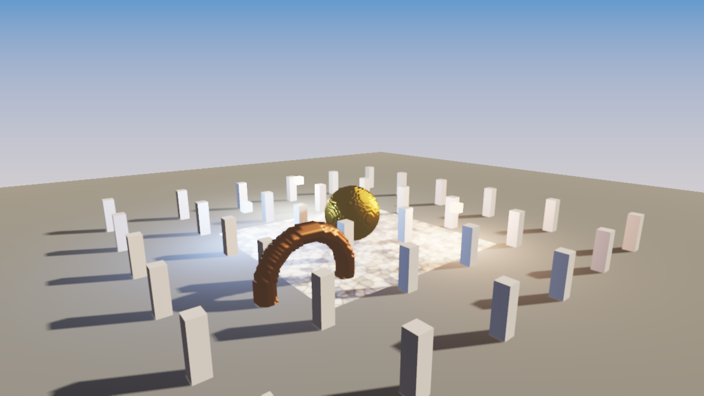
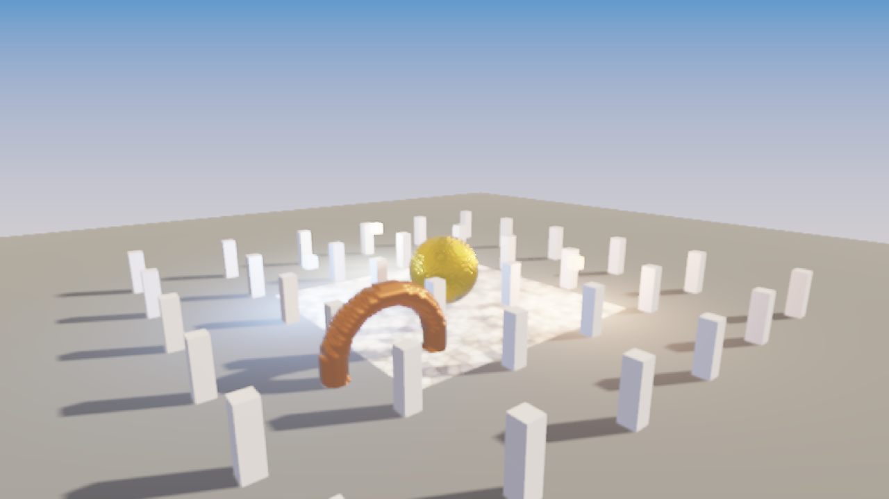
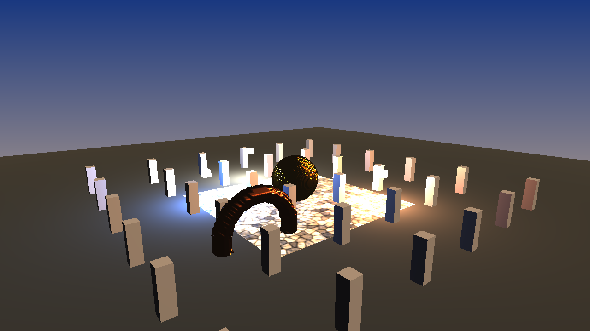
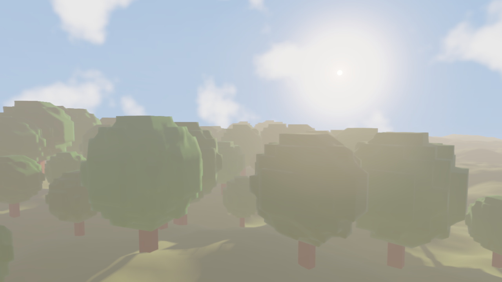
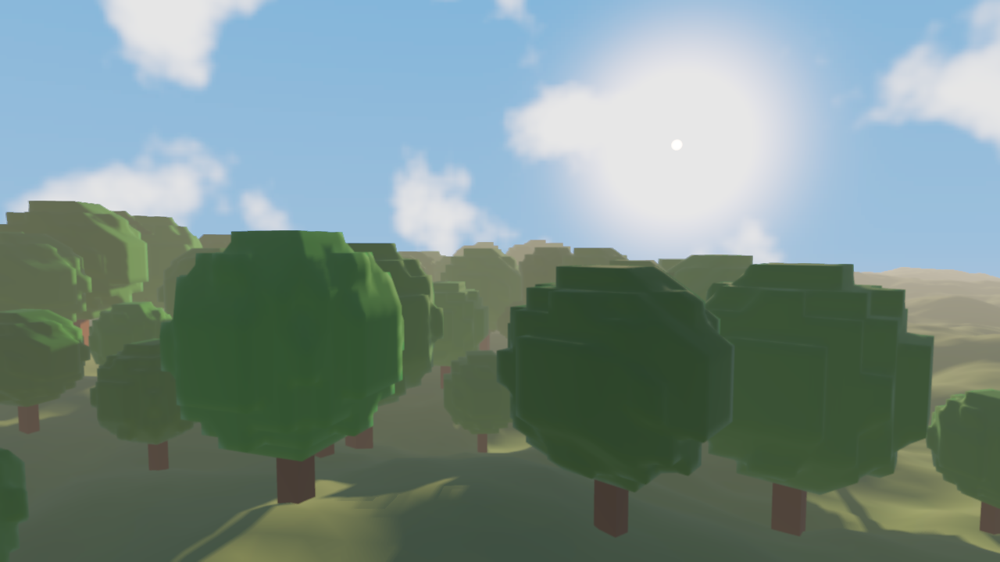

# Tutorial G9 — Szenengraph (`fuhglgraphics::scene::Scene`)

> 🇬🇧 **English version:** [docs/en/tutorials/g9_scene_graph.md](../../en/tutorials/g9_scene_graph.md)

**Ziel:** eine Szene als Graph aus `Node`s aufbauen — mit Komponenten (Mesh/Licht/Kamera),
pro Node eine Effektliste + Parameter, eine Instancing-Eigenschaft pro Node und Texturen
(Albedo + Normalmap) pro Mesh — ein `FrameData` füllen und mit dem G3-Deferred-Renderer rendern.

## Code

```cpp
#include <fuhglgraphics/graphics.hpp>
#include <fuhgl/fuhgl.hpp>
#include <fuhgl/render.hpp>

fuhglgraphics::scene::Scene scene;

// jeder Node trägt eine Effects-Liste + Parameter — pro Frame über alle Nodes gemerged
// (Union der Listen, die Parameter des zuletzt besuchten Nodes gewinnen)
scene.root().effects.enable(fuhglgraphics::render::Effect::Taa);
scene.root().effects.enable(fuhglgraphics::render::Effect::CsmShadows);
scene.root().effects.params.exposure = 1.15f;

// die Kamera kann aus einer CameraComponent kommen (fillFrame mit camera = nullptr)
scene.root().createChild("camera").attach<fuhglgraphics::scene::CameraComponent>().camera = &cam;

// ein Node kann MEHRERE Meshes halten — ein MeshEntry je Mesh mit eigenem localOffset,
// Material-Parametern, Texturen, castShadow-Flag und Material-ID
fuhglgraphics::scene::Node& hero = scene.root().createChild("hero");
auto& mc = hero.attach<fuhglgraphics::scene::MeshComponent>();
auto& sphereEntry = mc.addMesh(&sphere);
sphereEntry.albedo = {0.83f, 0.66f, 0.24f};
sphereEntry.metallic = 1.f; sphereEntry.roughness = 0.22f;
sphereEntry.materialId = 2; sphereEntry.castShadow = true;
auto& torusEntry = mc.addMesh(&torus);
torusEntry.localOffset = fuhgl::math::translate({-6.5f, -1.3f, 4.5f});
torusEntry.normalMap = &normalTex;   // albedoTexture + normalMap pro Mesh-Eintrag

// Instancing als Node-Eigenschaft: ein instanzierter Draw-Call für das ganze Grid
fuhglgraphics::scene::Node& pillars = scene.root().createChild("pillars");
pillars.instancing.enabled = true;
pillars.instancing.count = 36;                          // 6x6
pillars.instancing.layout = fuhglgraphics::scene::InstanceLayout::Grid;
pillars.instancing.extent = {26.f, 0.f, 26.f};
pillars.attach<fuhglgraphics::scene::MeshComponent>().addMesh(&pillar);

// Lichter sind ebenfalls Komponenten — Position/Richtung folgen der Weltmatrix des Nodes
scene.root().createChild("sun").attach<fuhglgraphics::scene::LightComponent>().light =
    fuhgl::render::Light::directional({-0.85f, -0.55f, -0.45f}, {1.f, 0.82f, 0.58f}, 3.4f);

// pro Frame:
fuhglgraphics::scene::FrameData frame;
scene.fillFrame(frame, /*camera=*/nullptr, 1280, 720);  // Weltmatrizen + AABBs + Frustum-Culling
frame.effects.applyTo(renderer);                        // gemergte Effekte -> G3-Deferred-Renderer
renderer.render(frame.view, &frame.materialIds, &frame.castShadow);
```

`Scene::fillFrame()` traversiert den Graph (Frustum-Culling gegen die World-AABBs), hängt
Draw-Items und Lichter an, füllt die parallelen Vektoren `materialIds` / `castShadow` und mergt
alle Node-`Effects`. Komponenten sind eine polymorphe Liste: `node.attach<T>(args...)`,
`node.find<T>()`, `node.findAll<T>()`, `node.detach(component)`.

## Ergebnis

Headless (surfaceless EGL) mit dem Tool in `examples/scene_screenshot` gerendert — die
Demo-Szene als Graph (texturierte Plaza mit Normalmap, Hero-Node mit zwei Meshes, 6×6
instanziertes Pfeiler-Grid, Lampen- + Sonnenlicht-Nodes) mit allen Effekten an
(CSM-Schatten, IBL, TAA, ACES-Tonemapping):


Die Effektliste pro Node treibt den Renderer pro Frame — dieselbe Szene ohne Schatten:



… ohne IBL (flache Ambiente statt Umgebungs-Cubemap):



… bei 60% interner Auflösung gerendert und per FSR1-artigem EASU+RCAS hochskaliert
(`--scale 0.6`):



… und mit allen Effekten aus (`--no-taa --no-tonemap --no-upscale --no-shadows --no-ibl`) —
rohes Clamp, sichtbares Aliasing, keine Schatten — zum Vergleich:



Nachbauen: `cmake --build build --target fuhglgraphics_scene_screenshot`, dann
`FUHGL_BACKEND=surfaceless ./build/examples/fuhglgraphics_scene_screenshot --out shot.png --width 1280 --height 720 --frames 24 [--no-shadows] ...`
(Rückgabecode 2, wenn kein headless GL verfügbar ist).

## Landschaft mit Wolkenhimmel, Sonne, Nebel und God Rays

`examples/landscape_screenshot` baut eine größere G9-Landschaft: Heightmap-Terrain mit
~170 Baum-Nodes (jeder hält **zwei Mesh-Einträge** — Stamm + Krone), eine prozedurale
fBm-**Wolken-Skybox-Cubemap** (`renderer.setSkyCubemap`, wird auch als IBL-Environment
gebaked), eine tief stehende warme Sonne (Sonnenscheibe aus dem Directional-Light),
Distanznebel und **God Rays** (`renderer.godRays`, per Occlusion gegen den G-Buffer-Depth
im Tonemap-Pass getestet):



Dieselbe Szene ohne God Rays (`--no-rays`) — die Lichtstrahlen zur Sonne verschwinden:



Nachbauen: `cmake --build build --target fuhglgraphics_landscape_screenshot`, dann
`FUHGL_BACKEND=surfaceless ./build/examples/fuhglgraphics_landscape_screenshot --out shot.png --width 1280 --height 720 --frames 24 [--no-rays] [--no-fog] [--no-clouds] [--no-shadows] [--no-ibl]`.
