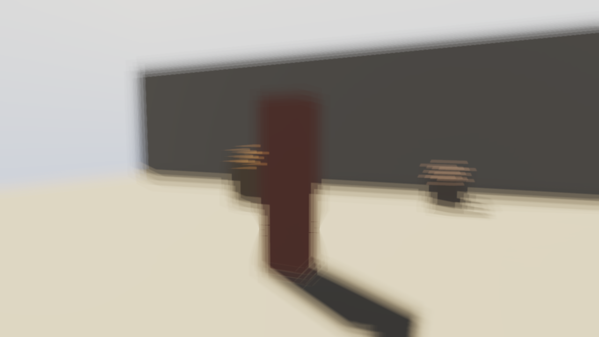
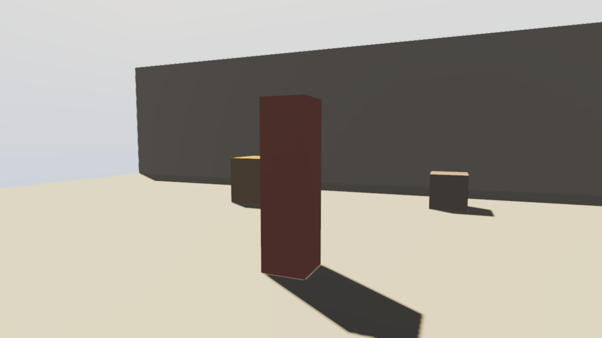
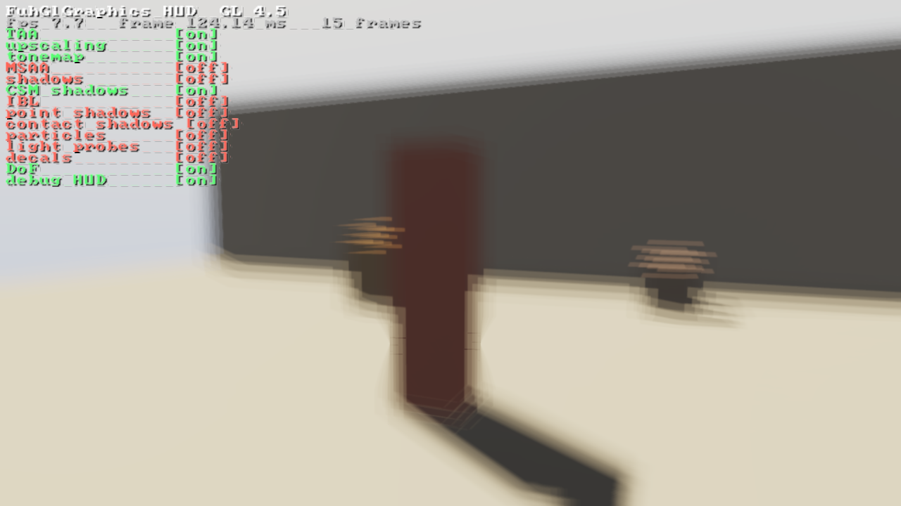

# Tutorial G10 — Quick upgrades: DoF bokeh, debug HUD, CI screenshot diff

> 🇩🇪 **Deutsche Version:** [docs/de/tutorials/g10_upgrades.md](../../de/tutorials/g10_upgrades.md)

**Goal:** the "smaller quickly-visible upgrades" of roadmap item 7 that were still open
(MSAA wiring, CSM penumbra hardening and FSR1-style temporal upscaling already landed with
G3/#4): **depth of field with a hexagonal bokeh kernel** (`Effect::Dof`), a **mini debug
HUD** on FuhGLCore's TextRenderer (`Effect::DebugHud`), and a **perceptual screenshot diff
in CI**.

## DoF bokeh (`Effect::Dof`)

A new post-graph pass `dof` runs between the upscale and the tonemap (on the upscaled HDR
image at output resolution): the circle of confusion comes from the linearized G-buffer
depth (`coc = clamp(|viewDepth - focusDist| * strength, 0, maxCoC)`), and a hexagonal
bokeh gather (6 taps on the full CoC ring + 6 half-radius taps offset by 30°) averages the
neighbors weighted by their own CoC. When the effect is off the pass is a plain copy.
Parameters: `EffectParams::dofFocusDist / dofStrength / dofMaxCoC` (applied per frame by
`Effects::applyTo`).

```cpp
scene.root().effects.enable(fuhglgraphics::render::Effect::Dof);
scene.root().effects.params.dofFocusDist = 9.f;  // focus the far background
scene.root().effects.params.dofStrength = 14.f;  // CoC per unit of focus error
scene.root().effects.params.dofMaxCoC = 26.f;    // max blur radius in pixels
```

## Debug HUD (`Effect::DebugHud`)

`render::DebugHud` (`render/debug_hud.hpp`, PIMPL over FuhGLCore's `TextRenderer` with its
embedded 8x8 font — no external font files) draws a panel top-left: GL version, smoothed
fps + frame milliseconds, and one `[on]`/`[off]` line per `render::Effect`.
`DeferredRenderer::render()` draws it after the post graph into `output()` when
`Effect::DebugHud` is enabled; `renderer.hud().fps()` / `renderer.lastFrameMs()` expose
the values for custom UIs.

## CI screenshot diff

`docs/screenshot_diff.py` (pure Python 3 — zlib + struct, no PIL) compares every PNG the
`docs-screenshots` job renders into `docs/images/ci/` against the checked-in reference in
`docs/images/` and fails the job below a PSNR threshold:

```bash
python3 docs/screenshot_diff.py docs/images docs/images/ci --min-psnr 28
```

## Demo + result

`examples/dof_screenshot` — near red pillar in the foreground, crates/wall behind, focus on
the background (PCSS shadows, sky cubemap, god rays):

```bash
cmake --build build --target fuhglgraphics_dof_screenshot
FUHGL_BACKEND=surfaceless ./build/examples/fuhglgraphics_dof_screenshot \
    --out dof.png --width 1280 --height 720 --frames 16 --focus 9
```

DoF on — the near pillar is blurred with a bokeh falloff, background stays sharp:



Same scene with `--no-dof`:



With `--hud` — the debug panel (fps, frame ms, effect toggles) top-left:



## Tests

- `tests/test_render.cpp` (unit): effect registry now kEffectCount = 14 with
  `Effect::Dof` ("DoF") and `Effect::DebugHud` ("debug HUD").
- `tests/gl_smoke_g10.cpp` (label `gl_context`, skips with 77): near crate + far ground —
  `Effect::Dof` on vs off differs in the crate region (blur), `Effect::DebugHud` changes
  the top-left pixels, `hud().isCreated()`, `lastFrameMs() >= 0`, no GL error.
- CI: the `docs-screenshots` job runs `docs/screenshot_diff.py` over all rendered
  images (self-test locally: `python3 docs/screenshot_diff.py docs/images docs/images`).
