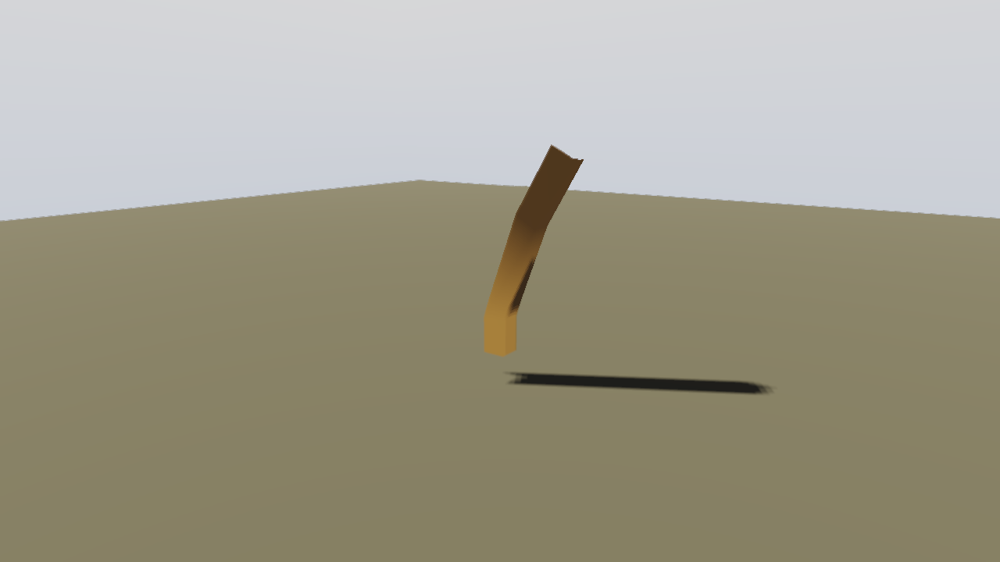
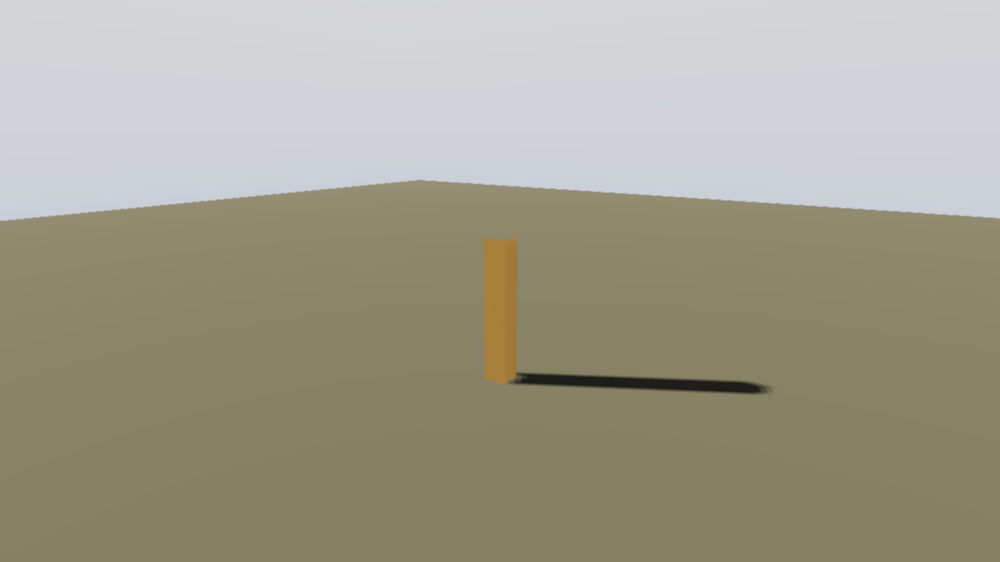

# Tutorial G14 — GPU skinning (GL ≥ 4.3, matrix-palette SSBO)

> 🇩🇪 **Deutsche Version:** [docs/de/tutorials/g14_gpu_skinning.md](../../de/tutorials/g14_gpu_skinning.md)

**Goal:** the G6 "future work" — skeletal skinning **on the GPU** instead of the CPU.
`anim::GpuSkinner` owns one skinned mesh's GPU side (VAO with the bind-pose vertices +
`JOINTS_0`/`WEIGHTS_0` as float4 attributes at locations 5/6, plus an SSBO with the joint
matrix palette at binding 0). When `render::Effect::GpuSkinning` is enabled and the GPU is
GL ≥ 4.3, the G3 G-buffer pass draws the skinner with a skinning vertex shader
(`#version 430`, `kGBufferVertSkin`) that computes `skin = Σ wᵢ · uPalette[jᵢ]` per vertex.
Below GL 4.3 (or with the effect off) the renderer falls back to the plain mesh — the app
keeps using CPU skinning (`anim::skinMeshCpu`, G6) there.

## Wiring

```cpp
anim::SkinWeights skin;              // JOINTS_0 / WEIGHTS_0 (4+4 per vertex)
fuhgl::render::MeshData base = ...;  // bind pose
fuhgl::render::Mesh mesh;  mesh.create(); mesh.setMeshData(base); // fallback mesh
anim::GpuSkinner skinner;
skinner.create(base, skin);          // needs a current GL >= 4.3 context

scene::MeshEntry& e = node.attach<scene::MeshComponent>().addMesh(&mesh);
e.gpuSkin = &skinner;                // Scene::fillFrame -> FrameData::skins (parallel to items)
e.meshData = &base;                  // CPU copy, e.g. for G18 picking

// per frame, after Skeleton::updatePalette(jointNodePtrs):
skinner.uploadPalette(skeleton.palette);            // palette -> SSBO
renderer.render(frame.view, &frame.materialIds, &frame.castShadow,
                &frame.particleSystems, frame.lightProbes, &frame.decals,
                frame.water, &frame.skins);          // G14: skins forwarded to the G-buffer pass
```

`Effect::GpuSkinning` is capability-gated (`effectSupported(Effect::GpuSkinning, ...)`
requires GL ≥ 4.3 — a pure function, unit-tested). glTF assets get skinners automatically:
`io::instantiateGltf()` creates one `GpuSkinner` per skinned primitive on GL ≥ 4.3 and sets
`MeshEntry::gpuSkin` (+ `meshData` for every primitive).

```cpp
scene.root().effects.enable(fuhglgraphics::render::Effect::GpuSkinning); // default on
// renderer.setEffectEnabled(render::Effect::GpuSkinning, false);       // -> CPU fallback
```

## Demo + result

`examples/gpu_skinning_screenshot` — the G6 robot arm, bent via the joint palette on the
GPU (no per-frame CPU skinning):

```bash
cmake --build build --target fuhglgraphics_gpu_skinning_screenshot
FUHGL_BACKEND=surfaceless ./build/examples/fuhglgraphics_gpu_skinning_screenshot \
    --out g14_on.png --width 1280 --height 720 --frames 16 --bend 1.05
FUHGL_BACKEND=surfaceless ./build/examples/fuhglgraphics_gpu_skinning_screenshot \
    --out g14_off.png --width 1280 --height 720 --frames 16 --bend 1.05 --cpu
```

GPU skinning on — the upper arm segment is bent by the palette:



Same scene with `--cpu` (`Effect::GpuSkinning` off — plain bind-pose mesh, the G6 fallback):



## Tests

- `tests/test_render.cpp` (unit): `kEffectCount = 16`, `effectName(Effect::GpuSkinning)`,
  `effectFromName()` round-trip for every effect, `effectSupported(GpuSkinning, 4, 3) = true`,
  `(4, 2) / (3, 3) = false`.
- `tests/gl_smoke_gpu_skin.cpp` (label `gl_context`, skips with 77 below GL 4.3): a 2-joint
  skinned ribbon rendered with `Effect::GpuSkinning` at two palettes — frames differ; with
  the effect off both frames are identical (fallback draws the bind-pose mesh); no GL error.
- CI: `docs-screenshots` renders `docs/images/ci/g14_gpu_skinning_{on,off}.png`.
