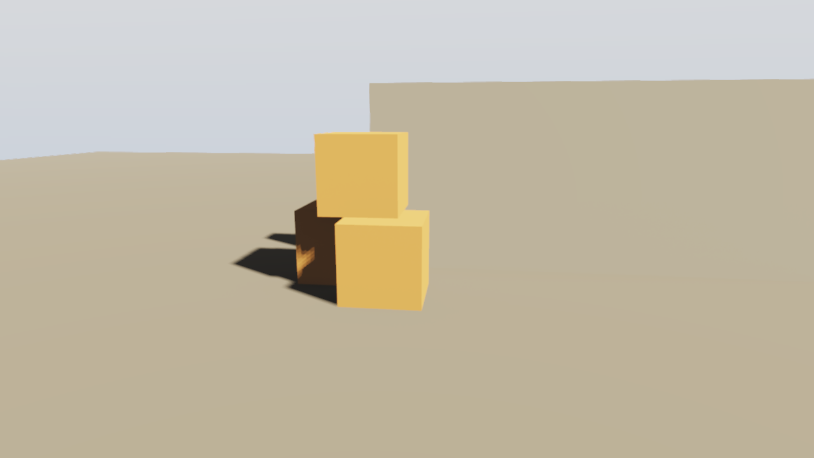
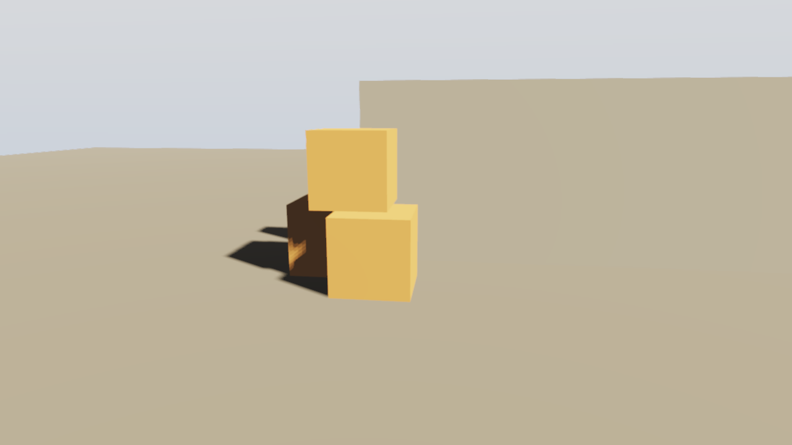

# Tutorial G15 — SSAO (screen-space ambient occlusion)

> 🇩🇪 **Deutsche Version:** [docs/de/tutorials/g15_ssao.md](../../de/tutorials/g15_ssao.md)

**Goal:** screen-space ambient occlusion from the extended G-buffer — a new post-graph pass
`ssao` runs **before** the lighting pass: it reconstructs world positions from the G-buffer
depth, samples a deterministic hemisphere kernel (rotated per pixel) around the surface
normal, projects each sample with the camera viewProj and compares linearized depths with a
range check. The result lands in the `ssao` resource (RG16F, `.r` = AO factor, 1 =
unoccluded); the lighting pass multiplies the material AO (`gPbr.b`) by it on texture unit 6.
`Effect::Ssao` is off by default (costs a fullscreen kernel loop).

## Usage

```cpp
scene.root().effects.enable(fuhglgraphics::render::Effect::Ssao);
scene.root().effects.params.ssaoRadius = 1.5f;    // world-space sample radius
scene.root().effects.params.ssaoIntensity = 1.4f; // occlusion strength
scene.root().effects.params.ssaoBias = 0.03f;     // depth bias (anti-acne)
scene.root().effects.params.ssaoSamples = 24;     // kernel samples (max 64)
// renderer.texSsao() exposes the raw AO texture for inspection
```

Pure helpers (unit-tested, no GL): `render::ssaoKernel(samples, seed)` (deterministic
hemisphere kernel, scale lerp(0.1,1,(i/n)²)), `render::ssaoRotation(px, py, seed)`,
`render::linearizeDepth(d, zn, zf)` in `render/ssao.hpp`.

## Demo + result

`examples/ssao_screenshot` — courtyard with crates and a wall; the contact corners/edges get
darker with SSAO on:

```bash
cmake --build build --target fuhglgraphics_ssao_screenshot
FUHGL_BACKEND=surfaceless ./build/examples/fuhglgraphics_ssao_screenshot \
    --out g15_on.png --width 1280 --height 720 --frames 16
FUHGL_BACKEND=surfaceless ./build/examples/fuhglgraphics_ssao_screenshot \
    --out g15_off.png --width 1280 --height 720 --frames 16 --no-ssao
```

SSAO on — darkened contact edges (crate/ground, crate/wall, wall/ground):



Same scene with `--no-ssao` (only the sun shadow remains, edges stay bright):



## Tests

- `tests/test_ssao.cpp` (unit): kernel size/hemisphere/scale/determinism/seed sensitivity,
  `ssaoRotation` range + determinism, `linearizeDepth` endpoints + monotonicity.
- `tests/test_render.cpp` (unit): `kEffectCount = 17`, `effectName(Effect::Ssao) == "SSAO"`.
- `tests/gl_smoke_ssao.cpp` (label `gl_context`, skips with 77): box on ground — SSAO on vs
  off differ, and the changed pixels get *darker* (AO is multiplicative); no GL error.
- CI: `docs-screenshots` renders `docs/images/ci/g15_ssao_{on,off}.png`.
