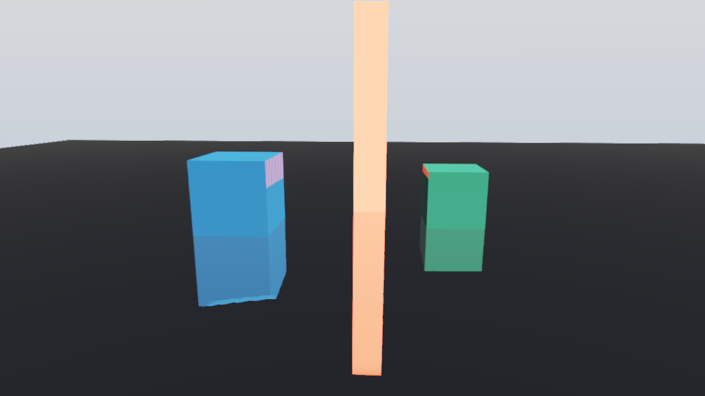
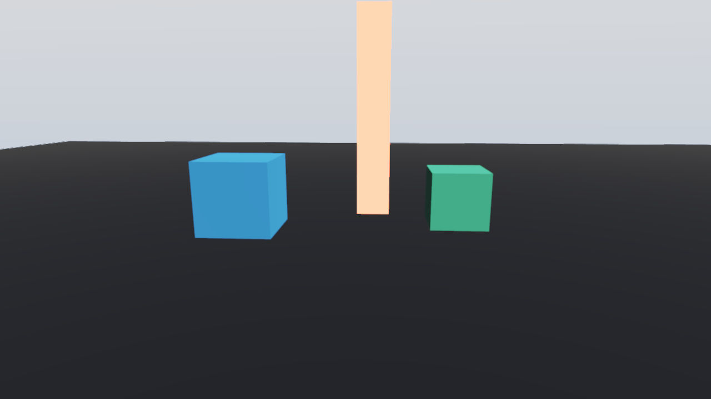

# Tutorial G16 — Screen-space reflections (SSR)

> 🇩🇪 **Deutsche Version:** [docs/de/tutorials/g16_ssr.md](../../de/tutorials/g16_ssr.md)

**Goal:** screen-space reflections in the deferred pipeline — a new post-graph pass `ssr`
runs **after** lighting: it reconstructs the world position/normal from the G-buffer, marches
the reflection vector `reflect(-V, N)` in world space against the G-buffer depth (linearized
compare with a thickness band + binary refine on hit), and adds the HDR color at the hit texel
masked by fresnel × (1−roughness)² × screen-edge fade × distance fade. Inputs
`hdr/gNormal/gDepth/gPbr`, output `hdrS` (which then feeds the water/particles passes).
`Effect::Ssr` is off by default (raymarch cost).

## Usage

```cpp
scene.root().effects.enable(fuhglgraphics::render::Effect::Ssr);
scene.root().effects.params.ssrMaxSteps = 48;     // raymarch steps (max 128)
scene.root().effects.params.ssrThickness = 0.4f;  // hit band in world units
scene.root().effects.params.ssrMaxDist = 30.f;    // max march distance
scene.root().effects.params.ssrStrength = 0.9f;   // reflection intensity
// G22 wetness adds renderer.ssrWetnessBoost on top of ssrStrength
```

Pure helpers (unit-tested) in `render/ssr.hpp`: `ssrEdgeFade(uv, margin)` and
`ssrMask(roughness, ndotv, metallic)` (the mask the shader applies).

## Demo + result

`examples/ssr_screenshot` — showroom with a mirror floor (metallic 1, roughness 0.05), a
bright emissive pillar and colored crates:

```bash
cmake --build build --target fuhglgraphics_ssr_screenshot
FUHGL_BACKEND=surfaceless ./build/examples/fuhglgraphics_ssr_screenshot \
    --out g16_on.png --width 1280 --height 720 --frames 16
FUHGL_BACKEND=surfaceless ./build/examples/fuhglgraphics_ssr_screenshot \
    --out g16_off.png --width 1280 --height 720 --frames 16 --no-ssr
```

SSR on — the floor reflects the red emissive pillar and the crates (floor region ~18 %
brighter, reddish reflection blob in front of the pillar):



Same scene with `--no-ssr` — plain PBR floor, no reflections:



## Tests

- `tests/test_ssr.cpp` (unit): `ssrEdgeFade` (center 1, border 0, smooth monotonic),
  `ssrMask` (dielectric F0 head-on/grazing, rough ≈ 0, metal > dielectric at grazing,
  clamping).
- `tests/test_render.cpp` (unit): `kEffectCount = 18`, `effectName(Effect::Ssr) == "SSR"`.
- `tests/gl_smoke_ssr.cpp` (label `gl_context`, skips with 77): mirror floor + emissive box
  — with `Effect::Ssr` on the floor region is brighter and differs; no GL error.
- CI: `docs-screenshots` renders `docs/images/ci/g16_ssr_{on,off}.png`.
