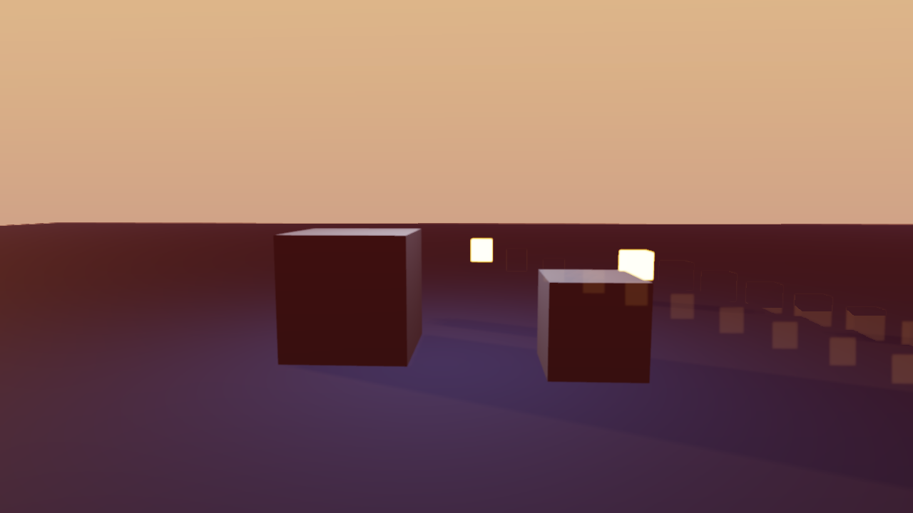
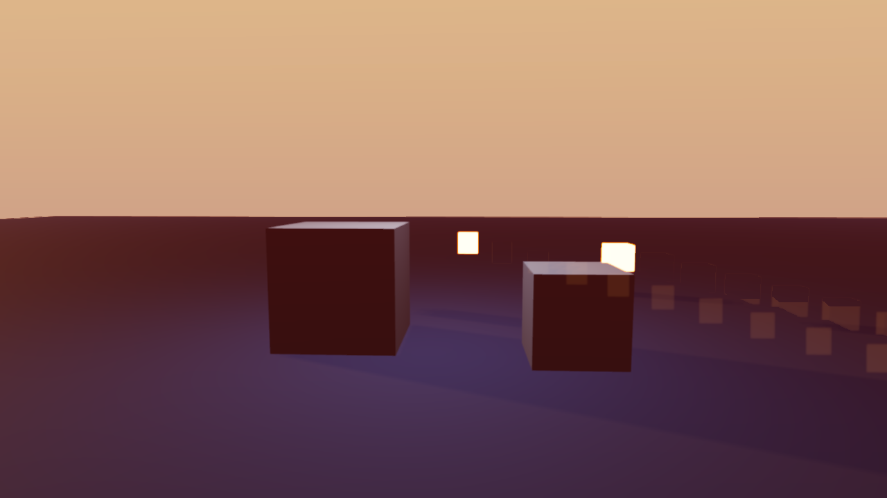

# Tutorial G17 — Bloom (adjustable threshold)

> 🇩🇪 **Deutsche Version:** [docs/de/tutorials/g17_bloom.md](../../de/tutorials/g17_bloom.md)

**Goal:** bloom in the HDR post chain — a new post-graph pass `bloom` runs **after particles,
before TAA** (so the halo is temporally stabilized by TAA): a per-channel bright-pass above
`bloomThreshold`, a 9-tap golden-angle blur at `bloomRadius` texels, added with
`bloomStrength`. Input `hdrP`, output `hdrB` (consumed by the TAA pass). `Effect::Bloom` is off
by default.

## Usage

```cpp
scene.root().effects.enable(fuhglgraphics::render::Effect::Bloom);
// set params on the merged frame effects (after fillFrame), or directly on the renderer:
frame.effects.params.bloomThreshold = 1.0f;  // HDR value above which a pixel blooms
frame.effects.params.bloomStrength = 0.6f;   // halo intensity
frame.effects.params.bloomRadius = 1.0f;     // blur radius in texels
```

Pure helpers (unit-tested) in `render/bloom.hpp`: `bloomBrightPass(c, threshold)` and the
deterministic `bloomTaps(count)` pattern.

## Demo + result

`examples/bloom_screenshot` — dusk plaza with HDR-bright lamps and the low sun (which blooms
too, feeding the god rays):

```bash
cmake --build build --target fuhglgraphics_bloom_screenshot
FUHGL_BACKEND=surfaceless ./build/examples/fuhglgraphics_bloom_screenshot --out g17_on.png  --width 1280 --height 720 --frames 16
FUHGL_BACKEND=surfaceless ./build/examples/fuhglgraphics_bloom_screenshot --out g17_off.png --width 1280 --height 720 --frames 16 --no-bloom
FUHGL_BACKEND=surfaceless ./build/examples/fuhglgraphics_bloom_screenshot --out g17_thr4.png --width 1280 --height 720 --frames 16 --threshold 4
```

Bloom on (threshold 1) — halos around the lamps and the sun:



Bloom off:


Same effect with `--threshold 4` — only the brightest cores (lamps, sun) bloom, the halo is
tighter (adjustable threshold):



## Tests

- `tests/test_bloom.cpp` (unit): `bloomBrightPass` (cut at/below threshold, c−t above, negative
  input, threshold 0), `bloomTaps` (count, radius growth, determinism, spread).
- `tests/test_render.cpp` (unit): `kEffectCount = 19`, `effectName(Effect::Bloom) == "bloom"`.
- `tests/gl_smoke_bloom.cpp` (label `gl_context`, skips with 77): dark scene + HDR lamp —
  bloom on creates a brighter halo ring; threshold 100 suppresses it (adjustable threshold);
  no GL error.
- CI: `docs-screenshots` renders `docs/images/ci/g17_bloom_{on,off,thr4}.png`.
