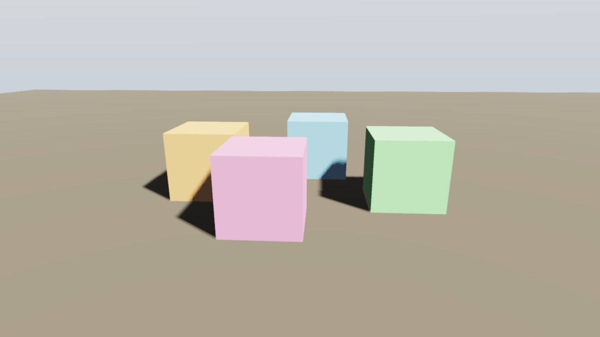

# Tutorial G18 — Picking / ray-casting on the scene graph

> 🇩🇪 **Deutsche Version:** [docs/de/tutorials/g18_picking.md](../../de/tutorials/g18_picking.md)

**Goal:** CPU ray-casting against the G9 scene graph — the basis for editor selection and
gizmos (G2/G11/G12). `scene/picking.hpp` (pure math, no GL): `rayFromScreen()` builds a
world-space ray through a pixel, `rayIntersectAabb()` (slab test) culls node subtrees by
their world AABBs, `rayIntersectTriangle()` (Möller–Trumbore) tests the triangles of a
`MeshEntry::meshData` (the CPU copy of the mesh — the glTF loader sets it for every
primitive; set it yourself for procedural meshes). `scene::pick()` returns the nearest
`PickHit` (node, mesh entry, distance, world point, triangle index).

## Usage

```cpp
fuhglgraphics::scene::MeshEntry& e = node.attach<fuhglgraphics::scene::MeshComponent>().addMesh(&mesh);
e.meshData = &myMeshData; // CPU triangles for picking (glTF sets this automatically)

fuhglgraphics::scene::PickHit hit;
if (fuhglgraphics::scene::pick(scene, &cam, width, height, mouseX, mouseY, hit)) {
    // hit.node, hit.meshEntry, hit.distance, hit.point, hit.triangle
    placeMarkerAt(hit.point);
}
```

## Demo + result

`examples/picking_screenshot` — plaza with four crates; picks pixel (560, 400), prints the
hit (`node=crateD dist=6.26 point=(-0.50, 1.04, 1.60) tri=9`) and renders a bright yellow
marker cube at the hit point:

```bash
cmake --build build --target fuhglgraphics_picking_screenshot
FUHGL_BACKEND=surfaceless ./build/examples/fuhglgraphics_picking_screenshot \
    --out g18.png --width 1280 --height 720 --frames 16 --px 560 --py 400
```

Marker at the picked point on the pink crate:


Same pick with `--no-marker` (no marker rendered):



## Tests

- `tests/test_picking.cpp` (unit): `rayFromScreen` (center ray = camera forward, corner rays
  symmetric), `rayIntersectAabb` (hit/miss/behind/inside), `rayIntersectTriangle`
  (hit + barycentrics, miss, back-facing), and a full `scene::pick()` (near vs far box,
  empty corner miss, null camera).
- `tests/gl_smoke_picking.cpp` (label `gl_context`, skips with 77): picks the center pixel
  of a rendered scene (hit node + distance checked), then verifies a marker placed at the
  hit point is visible in the rendered pixels; no GL error.
- CI: `docs-screenshots` renders `docs/images/ci/g18_picking_{marker,nomarker}.png`.
