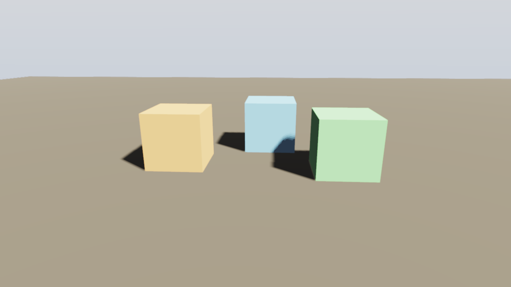

# Tutorial G19 — Scene serialization (JSON)

> 🇩🇪 **Deutsche Version:** [docs/de/tutorials/g19_serialization.md](../../de/tutorials/g19_serialization.md)

**Goal:** save and load a G9 `scene::Scene` as JSON — the basis for storable demos and for the
`.fasset` project files of the asset creator (G12). `scene/serialize.hpp` converts the scene
graph to/from `io::Json`: node hierarchy (name + translation/rotation/scale), per-node effects
(list + params), instancing, and the pure-data components — `MeshComponent` entries (material
params, materialId, castShadow, localOffset), `LightComponent`, `DecalComponent`,
`AnimationComponent` clips. GL-resource components (particles, light probes, water) are not
serialized. On top of that, `io::writeJson()` / `io::writeJsonFile()` are the pretty-printer
half of the JSON module (parseJson was already there); numbers are written as the shortest
string that round-trips exactly.

## Mesh references via a resolver

GL meshes cannot be serialized — the JSON stores a **mesh spec** per entry (e.g.
`{"shape":"box","halfExtents":[0.8,0.8,0.8],"color":[1,1,1]}`) and a caller-provided
`MeshResolver` turns it back into a `fuhgl::render::Mesh` owned by an arena:

```cpp
std::vector<std::unique_ptr<fuhgl::render::Mesh>> meshArena;
fuhglgraphics::scene::Scene loaded;
fuhglgraphics::scene::loadScene(loaded, "scene.json",
                                fuhglgraphics::scene::defaultShapeResolver, meshArena);
// defaultShapeResolver knows the procedural shapes "box" and "quad"; for .gltf files pass a
// resolver that runs io::loadGltf/io::instantiateGltf. Unknown specs -> nullptr (mesh-less
// entry, still serialized).
```

## Usage

```cpp
// save
fuhglgraphics::scene::saveScene(scene, "scene.json");
// or in-memory: io::Json j = fuhglgraphics::scene::sceneToJson(scene);
//                std::string text = fuhglgraphics::io::writeJson(j, 2);

// load
fuhglgraphics::scene::Scene scene;
std::vector<std::unique_ptr<fuhgl::render::Mesh>> meshArena;
std::string err;
if (!fuhglgraphics::scene::loadScene(scene, "scene.json",
                                     fuhglgraphics::scene::defaultShapeResolver, meshArena, &err))
    std::fprintf(stderr, "load failed: %s\n", err.c_str());
```

File format: `{"format":"fuhglgraphics-scene","version":1,"root":{node}}` — a node is
`{name, translation, rotation[x,y,z,w], scale, effects{list,params}, instancing{...},
components[...], children[...]}`. Malformed input is rejected with `false` + `err`
(bool + log convention, no exceptions).

## Demo + result

`examples/serialization_screenshot` — builds a scene (ground quad + three colored crates +
sun), renders it, saves it to a .json file, injects the procedural mesh specs (what an editor
would store), loads the file back with `defaultShapeResolver` and renders the loaded scene.
The demo prints `round-trip JSON equal=1` (re-serializing the loaded scene yields the identical
JSON) and both images match:

```bash
cmake --build build --target fuhglgraphics_serialization_screenshot
FUHGL_BACKEND=surfaceless ./build/examples/fuhglgraphics_serialization_screenshot \
    --prefix g19 --width 1280 --height 720 --frames 16
```

Programmatic scene (original):



Same scene loaded back from the .json file (only 0.33 % of pixels differ — TAA noise):


## Tests

- `tests/test_serialize.cpp` (unit): `writeJson`/`parseJson` round-trip (escapes, unicode,
  numbers incl. 1e300, null/bool, empty array/object, compact mode, invalid input rejected);
  full scene round-trip `writeJson(sceneToJson(fromJson(sceneToJson(scene)))) ==
  writeJson(sceneToJson(scene))` covering TRS, effects + params, instancing, mesh entries,
  light, decal (incl. materialIdMask 0x2), animation clip; `saveScene`/`loadScene` file
  round-trip; malformed scene rejected.
- `tests/gl_smoke_serialize.cpp` (label `gl_context`, skips with 77): saves a scene to a temp
  .json, patches a `{"shape":"box",...}` mesh spec into it, loads with
  `defaultShapeResolver` (real GL mesh in the arena), renders through the G3 renderer and
  checks the frame has the expected items/lights and is non-dark; no GL error.
- CI: `docs-screenshots` renders `docs/images/ci/g19_serialization_{original,loaded}.png`.
