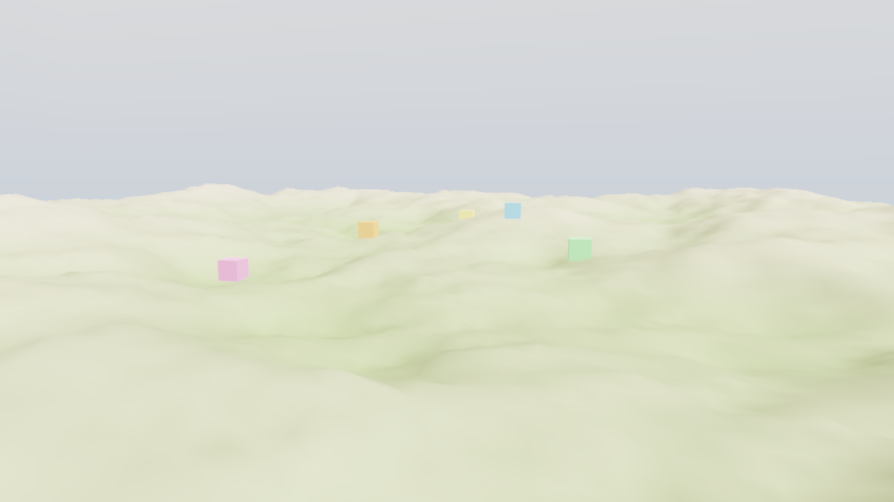
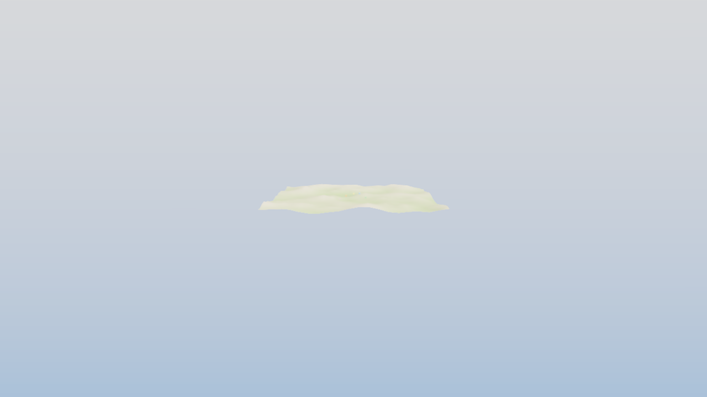

# Tutorial G20 — Terrain + LOD integration

> 🇩🇪 **Deutsche Version:** [docs/de/tutorials/g20_terrain_lod.md](../../de/tutorials/g20_terrain_lod.md)

**Goal:** use the FuhGLCore F38/F41 terrain+LOD in the G9 scene graph and the G3 renderer's
`fillFrame()` path. `scene::TerrainComponent` (in `scene/component.hpp`) owns a
`fuhgl::render::LodMesh` built by `terrainLods()` — several grid resolutions of one heightmap
with screen-space switch distances (`LodMesh::defaultDistances`, overridable via
`customDistances`). `fill()` appends one draw item whose `lod` pointer is set, so the G3
renderer resolves the level per frame from the camera distance (`resolveLodMesh`,
`SceneView::lodEnabled = false` forces level 0) and reports it in `SceneView::lastLodLevel`.
`heightAt(x, z)` places objects on the terrain (bilinear CPU heightmap sample). The terrain
node also contributes its bounding-sphere AABB to frustum culling (`Node::computeAabb`).

## Usage

```cpp
scene::Node& tn = scene.root().createChild("terrain");
scene::TerrainComponent& tc = tn.attach<scene::TerrainComponent>();
tc.levels = 4;                 // LOD levels (1 = plain mesh)
tc.seed = 11u;                 // procedural heightmap
tc.customDistances = {60, 150, 300}; // optional: override the default switch distances
if (!tc.create(160, 160, 160.f, 160.f, 12.f)) /* error */; // grid, sizeX/Z, heightScale — needs GL

// place objects on the terrain:
node.translation = {x, tc.heightAt(x, z) + 0.8f, z};

// per frame (unchanged): fillFrame -> the renderer picks the LOD level
int level = frame.view.lastLodLevel; // after renderer.render(...)
```

Any other mesh can use LOD too: set `MeshEntry::lod` to a `LodMesh*` — the draw item carries
it through `fillFrame()` (`DrawItem::lod`).

## Demo + result

`examples/terrain_screenshot` — 160×160 heightmap terrain (4 LOD levels, switch distances
60/150/300) with five crates placed via `heightAt()`, rendered near (camera distance < 60 →
**LOD level 0**) and far (distance ≈ 436 → **LOD level 3**):

```bash
cmake --build build --target fuhglgraphics_terrain_screenshot
FUHGL_BACKEND=surfaceless ./build/examples/fuhglgraphics_terrain_screenshot \
    --prefix g20 --width 1280 --height 720 --frames 16
# terrain_screenshot: wrote g20_near.png (lastLodLevel=0)
# terrain_screenshot: wrote g20_far.png  (lastLodLevel=3)
```

Near camera, LOD level 0 (crates on the terrain):



Far camera, LOD level 3 (coarsest grid — same terrain, fewer triangles):



## Tests

- `tests/test_terrain_lod.cpp` (unit): `LodMesh::selectLevel` (boundaries, clamping),
  `defaultDistances` (ascending, formula), `resolveLodMesh` (near/far/disabled/no-lod),
  `TerrainComponent::heightAt` on a manual heightmap (center/corners/clamped), and the
  `fillFrame()` path: the terrain draw item carries `lod`, materialIds/castShadow/skins stay
  parallel, the node's world AABB covers the terrain.
- `tests/gl_smoke_terrain.cpp` (label `gl_context`, skips with 77): creates a 4-level terrain,
  renders near (lastLodLevel == 0), far (lastLodLevel > 0) and with `lodEnabled = false`
  (lastLodLevel == -1); frames non-dark, no GL error.
- CI: `docs-screenshots` renders `docs/images/ci/g20_terrain_{near,far}.png`.
