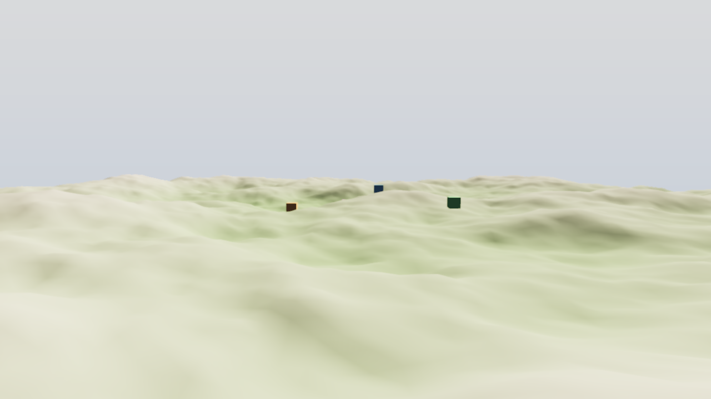
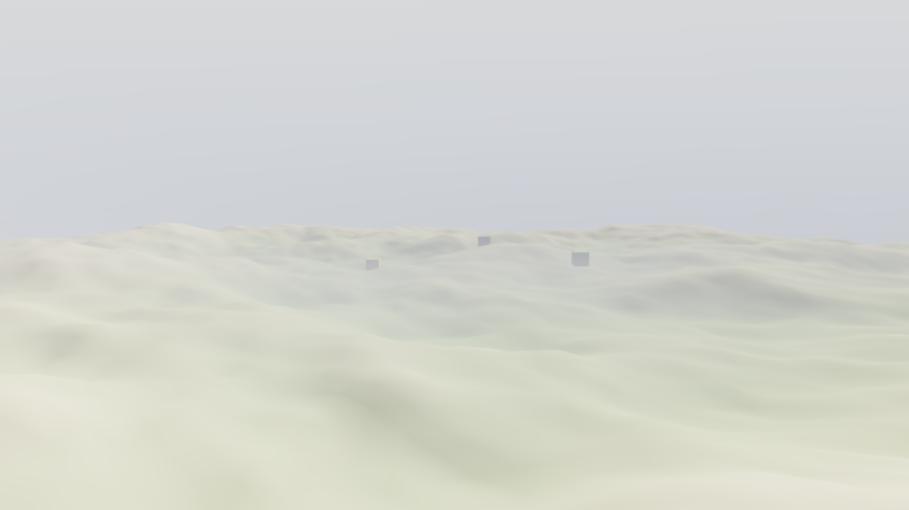

# Tutorial G21 — Volumetric fog / clouds

> 🇩🇪 **Deutsche Version:** [docs/de/tutorials/g21_volumetric_fog.md](../../de/tutorials/g21_volumetric_fog.md)

**Goal:** a raymarched volumetric fog/cloud pass in the G3 HDR chain. `render/volumetric.hpp`
holds the pure (GL-free) twins of the shader math — deterministic 3D value-noise/fBm
(`volumetricHash`/`volumetricNoise`/`volumetricFbm`), the height-falloff density
(`volumetricDensity`), the Henyey–Greenstein phase (`henyeyGreenstein`) and a CPU reference
raymarcher (`volumetricMarch`) — so the pass is unit-testable without GL. The GPU side is the
"volumetric" post pass (`kVolumetricFrag`): after particles and before bloom (hdrP → hdrV →
hdrB), each pixel's view ray is reconstructed from the G-buffer depth (sky pixels march to
`volumetricMaxDist`), marched through the noise volume in `volumetricSteps` samples,
accumulating transmittance `T` and single scattering (sun with HG phase + sky ambient).
Output: `hdr * T + inscatter`. Toggle with `Effect::VolumetricFog`, params in `EffectParams`
and on `DeferredRenderer`.

## Usage

```cpp
scene.root().effects.enable(fuhglgraphics::render::Effect::VolumetricFog);
// per frame, after frame.effects.applyTo(renderer) (or straight on the renderer):
renderer.volumetricDensity = 0.018f;      // ground-level density per world unit
renderer.volumetricCloudiness = 0.7f;     // 0 = uniform fog, 1 = billowy clouds
renderer.volumetricHeightFalloff = 10.f;  // scale height
renderer.volumetricNoiseScale = 7.f;      // world units per noise cell
renderer.volumetricAnisotropy = 0.5f;     // Henyey-Greenstein g (forward scattering)
renderer.volumetricMaxDist = 140.f;       // sky march end
renderer.volumetricSteps = 32;            // march samples (max 64)
renderer.volumetricStrength = 1.f;
renderer.volumetricTime += dt * 0.35f;    // cloud drift
```

The sun direction/color come from the first directional light of the frame; the ambient term
from the renderer's sky colors. The pass also fogs the sky itself.

## Demo + result

`examples/volumetric_screenshot` — terrain (G20 TerrainComponent) with crates, rendered with
volumetric fog off / on (density 0.018) / dense (0.06):

```bash
cmake --build build --target fuhglgraphics_volumetric_screenshot
FUHGL_BACKEND=surfaceless ./build/examples/fuhglgraphics_volumetric_screenshot \
    --prefix g21 --width 1280 --height 720 --frames 16
```

Fog off (analytic distance fog disabled, so only G21 fog is visible):



Fog on — distant terrain sinks into the haze, sky included:



Dense fog (density 0.06) — low visibility, crates half-swallowed:


## Tests

- `tests/test_volumetric.cpp` (unit): effect registry ("volumetric fog", count 20, supported
  on GL 3.3+); hash determinism + seed sensitivity, noise/fBm in [0,1] and continuity;
  density height falloff (matches exp(-y/h), clamped below ground, cloudiness bounds);
  Henyey–Greenstein (isotropic at g=0, forward peak); CPU raymarcher (T in (0,1], decreasing
  with density, zero density → identity, analytic uniform-fog T = exp(-d·tMax)).
- `tests/gl_smoke_volumetric.cpp` (label `gl_context`, skips with 77): renders a scene with
  the pass off vs on (density 0.06) — frames differ measurably, fog-on not dark, no GL error.
- CI: `docs-screenshots` renders `docs/images/ci/g21_volumetric_{off,on,dense}.png`.
