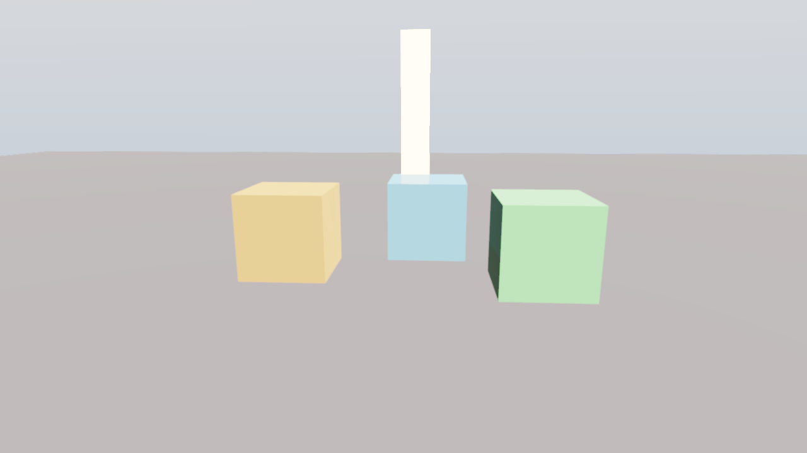
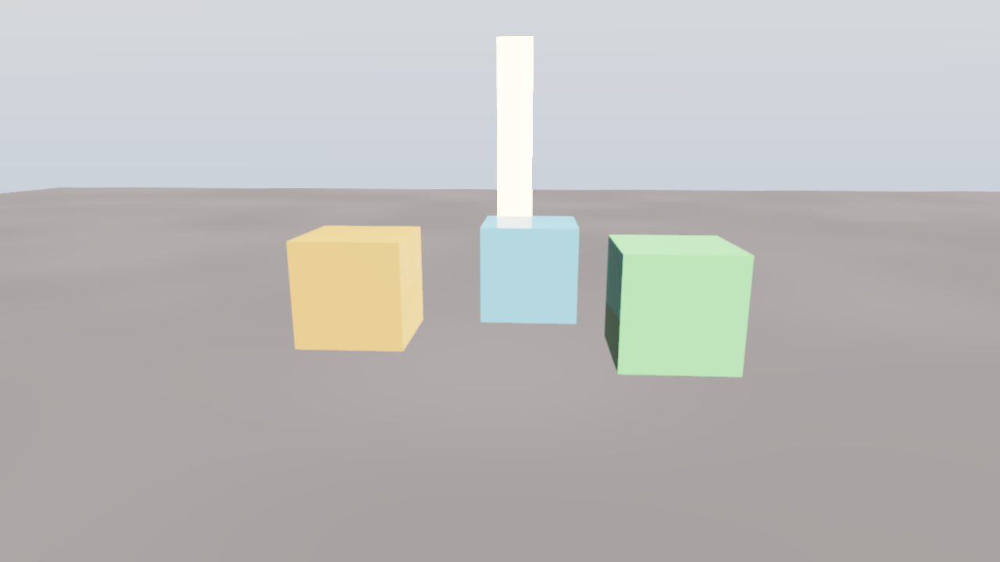
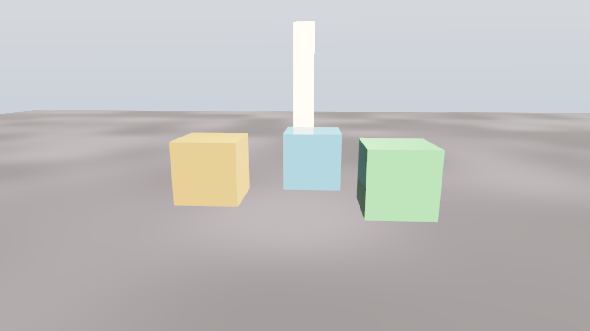

# Tutorial G22 — Wetness / rain on PBR materials

> 🇩🇪 **Deutsche Version:** [docs/de/tutorials/g22_wetness.md](../../de/tutorials/g22_wetness.md)

**Goal:** rain-wet surfaces in the G3 lighting pass. With `Effect::Wetness` the lighting shader
(`kLightFragWetness` block, applied in `kLightFragTail` before `shade()`) modulates the PBR
inputs per pixel: up-facing surfaces (`N.y`) get a glossy water film — roughness mixed toward
0.06 — and the albedo darkens ~35 % at full wetness; a noise **puddle mask** over world xz
deepens depressions (`wetnessPuddle`: 0 = flat film everywhere, 1 = only puddle spots). On top,
`wetnessAmount` is added to the SSR strength (wet ground reflects). Pure CPU twins of the
formulas live in `render/wetness.hpp` (`wetnessPuddleMask`, `wetnessFactor`,
`wetnessRoughness`, `wetnessAlbedoScale`) and are unit-tested. For rain *decals* (splashes,
drips) use the existing G8 decal pass on top.

## Usage

```cpp
scene.root().effects.enable(fuhglgraphics::render::Effect::Wetness);
scene.root().effects.enable(fuhglgraphics::render::Effect::Ssr); // wet reflections
// per frame after frame.effects.applyTo(renderer):
renderer.wetnessAmount = 0.9f;      // 0..1 rain amount
renderer.wetnessPuddle = 0.7f;      // puddle mask strength
renderer.wetnessNoiseScale = 3.5f;  // world units per noise cell
// animation: ramp wetnessAmount 0 -> 1 when it starts raining
```

## Demo + result

`examples/wetness_screenshot` — plaza (asphalt ground, three crates, an emissive pillar as the
SSR target) rendered dry / wet (amount 0.9, puddle 0.3) / puddly (amount 1, puddle 1):

```bash
cmake --build build --target fuhglgraphics_wetness_screenshot
FUHGL_BACKEND=surfaceless ./build/examples/fuhglgraphics_wetness_screenshot \
    --prefix g22 --width 1280 --height 720 --frames 16
```

Dry asphalt (roughness 0.85 — almost no reflection):



Wet — darker ground, glossy film, the pillar reflects in the floor (SSR boost):



Puddly — full rain, puddle mask concentrated in depressions:



## Tests

- `tests/test_wetness.cpp` (unit): effect registry ("wetness", count 21, GL 3.3+); hash/noise
  determinism + ranges; puddle mask (flat at strength 0, varying at 1, within [0,1]);
  wetness factor (0 on side-facing, = amount on flat up-facing, clamped); roughness monotone
  toward 0.06; albedo scale in [0.65, 1].
- `tests/gl_smoke_wetness.cpp` (label `gl_context`, skips with 77): plaza with SSR on, dry vs
  wet (amount 1, puddle 0.8) — frames differ measurably, wet frame not dark, no GL error.
- CI: `docs-screenshots` renders `docs/images/ci/g22_wetness_{dry,wet,puddles}.png`.
