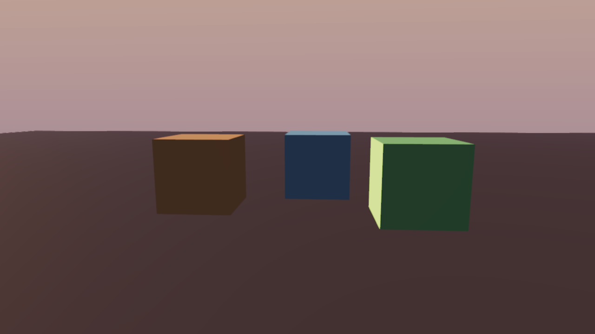
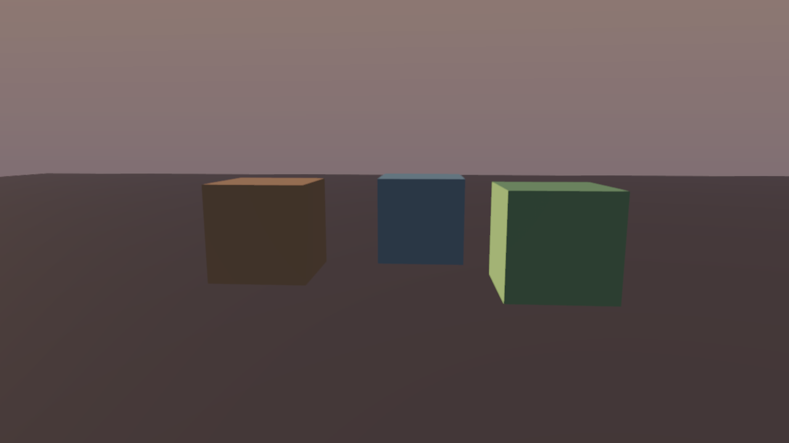
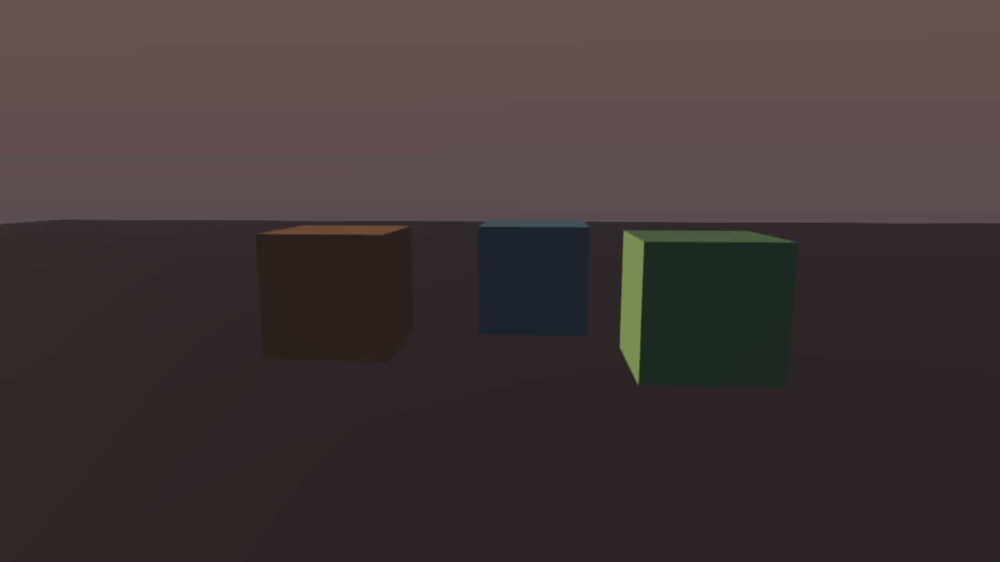
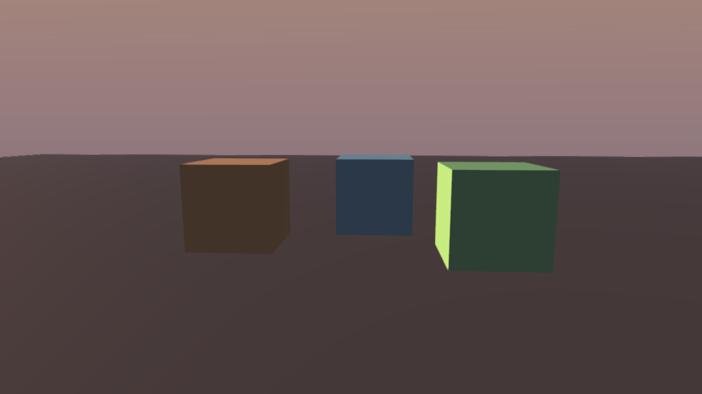

# Tutorial G23 — Tonemapping operators + adjustable bloom threshold

> 🇩🇪 **Deutsche Version:** [docs/de/tutorials/g23_tonemap.md](../../de/tutorials/g23_tonemap.md)

**Goal:** selectable tonemapping operators in the G3 final pass. `render/tonemap.hpp` defines
`render::TonemapOperator` — **ACES** (default, previous behavior), **Reinhard**, **Uncharted2**
(Hable, white point 11.2) and **linear** — plus pure CPU twins (`tonemapAces/Reinhard/
Uncharted2/Linear`, `tonemapApply`) that are unit-tested. The shader (`uOperator` in
`kTonemapFrag`) picks the curve per frame; gamma (1/2.2) is applied after, as before. Set it
per frame via `renderer.tonemapOperator` or per scene via `EffectParams::tonemapOperator`
(serialized with G19). The **bloom threshold** from G17 (`bloomThreshold`,
`EffectParams::bloomThreshold`) is likewise adjustable per frame — higher = only the
brightest HDR pixels (lamp cores, sun disk) bloom.

## Usage

```cpp
// per frame:
renderer.tonemapOperator = fuhglgraphics::render::TonemapOperator::Uncharted2;
renderer.bloomThreshold = 4.0f;  // G17: only pixels above HDR 4 bloom
// or per scene node (merged in fillFrame, serialized by G19):
node.effects.params.tonemapOperator = 2; // 0=aces 1=reinhard 2=uncharted2 3=linear
// CPU twin (e.g. for thumbnails/tests):
vec3 ldr = fuhglgraphics::render::tonemapApply(op, hdr * exposure);
```

## Demo + result

`examples/tonemap_screenshot` — dusk plaza with three HDR lamps (emissive 9/5/1.5) and a low
sun, rendered with each operator plus one ACES shot with bloom on and `bloomThreshold = 4`:

```bash
cmake --build build --target fuhglgraphics_tonemap_screenshot
FUHGL_BACKEND=surfaceless ./build/examples/fuhglgraphics_tonemap_screenshot \
    --prefix g23 --width 1280 --height 720 --frames 16
```

ACES (default, filmic shoulder):



Reinhard (softer rolloff):



Uncharted2 (punchy highlights, darker mids):



Linear (plain clamp — blown-out lamp cores, for comparison):



ACES + bloom with `bloomThreshold = 4` — only the lamp cores/sun disk above HDR 4 halo:


## Tests

- `tests/test_tonemap.cpp` (unit): enum/name round-trip (count 4, unknown rejected); every
  operator: black stays black, negatives clamped, monotone in [0,1] over 0..20 HDR, huge
  values clamp; Reinhard exact at x=1 (0.5); linear identity below 1; RGB overload.
- `tests/gl_smoke_tonemap.cpp` (label `gl_context`, skips with 77): HDR scene rendered with all
  four operators — every pair of frames differs measurably, none too dark, no GL error.
- CI: `docs-screenshots` renders `docs/images/ci/g23_tonemap_{aces,reinhard,uncharted2,linear,bloomthr4}.png`.
