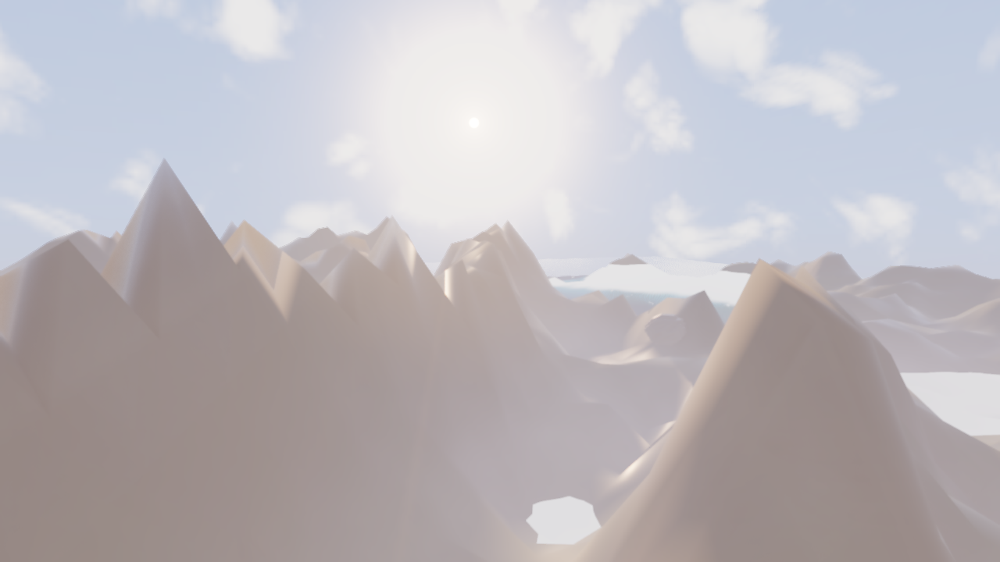
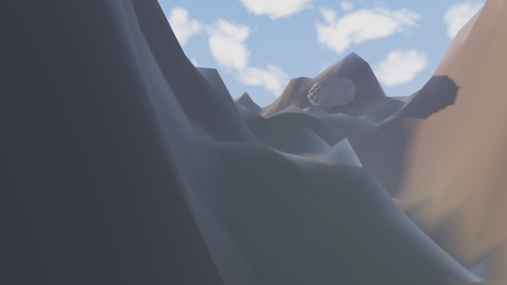

# Tutorial G24 — Procedural noise module (CPU)

> 🇩🇪 **Deutsche Version:** [docs/de/tutorials/g24_procedural_noise.md](../../de/tutorials/g24_procedural_noise.md)

**Goal:** one seeded, deterministic noise source for everything procedural in the engine —
`procedural::Noise` in `include/fuhglgraphics/procedural/noise.hpp`. It is a header-only
value type (like `fuhgl::math::Noise`): no GL, no allocation, no I/O, and the same seed
produces the same values on every platform. Perlin delegates to `fuhgl::math::Noise`
(improved Perlin); value and Simplex noise use their own splitmix32-seeded permutation.

## API

```cpp
#include <fuhglgraphics/procedural/noise.hpp>

fuhglgraphics::procedural::Noise noise(20240817u);   // seed

// base noises
float v = noise.value2(x, y);            // [0, 1]  (value3 for 3D)
float p = noise.perlin2(x, y);           // ~[-1, 1] (perlin3 for 3D)
float s = noise.simplex2(x, y);          // ~[-1, 1] (simplex3 for 3D, Gustavson)

// fractals over a selectable base (amplitude-normalized)
using B = fuhglgraphics::procedural::Noise::Base;    // Value | Perlin | Simplex
float f = noise.fbm2(x, y, 6, B::Perlin);            // ~[-1, 1]  (fbm3 for 3D)
float r = noise.ridged2(x, y, 6, B::Perlin);         // [0, 1], sharp crests — mountains
float t = noise.turbulence3(x, y, z, 5, B::Simplex); // [0, 1], billowy — clouds

// domain warp: p + strength * fBm(p), fBm(p + offset), ...
fuhgl::math::Vec2  wp2 = noise.warp2(x, y, 0.9f, 2);
fuhgl::math::Vec3  wp3 = noise.warp3(x, y, z, 0.6f, 2);

// convenience terrain height field in [0, 1]
float h = noise.height2(x, y, 6);        // ridged fBm
```

## Usage: carve a terrain heightmap

`scene::TerrainComponent` keeps a CPU copy of the heightmap (`heights`, normalized [0, 1],
row-major). Overwrite it and call `rebuildLod()` — `heightAt()` then matches the new terrain:

```cpp
scene::TerrainComponent& tc = tn.attach<scene::TerrainComponent>();
tc.create(200, 200, 260.f, 260.f, 34.f);              // needs a GL context
for (int j = 0; j < tc.gridH; ++j)
    for (int i = 0; i < tc.gridW; ++i) {
        const float x = (float(i) / (tc.gridW - 1) - 0.5f) * tc.sizeX;
        const float z = (float(j) / (tc.gridH - 1) - 0.5f) * tc.sizeZ;
        const auto wp = noise.warp2(x * 0.011f, z * 0.011f, 0.9f, 2);  // meandering ridges
        float h = 0.85f * noise.ridged2(wp.x, wp.y, 6, B::Perlin)
                + 0.15f * noise.fbm2(x * 0.045f, z * 0.045f, 4, B::Simplex);
        tc.heights[j * tc.gridW + i] = h;
    }
tc.rebuildLod();                                     // rebuild LOD meshes — needs GL
```

The same `Noise` instance can drive the sky cubemap (turbulence clouds), volume fields for
G25 marching cubes, jitter for G26/G27/G28, and SDF shapes for G29 — one seed, one world.

## Demo + result

`examples/noise_screenshot` — terrain carved with domain-warped ridged fBm + a carved lake
basin, G13 Gerstner-water lake, cloud-sky cubemap from the same `Noise` + IBL baked from it,
warm low sun with CSM shadows + god rays, SSAO + volumetric fog + wetness + bloom,
TAA + upscale + ACES:

```bash
cmake --build build --target fuhglgraphics_noise_screenshot
FUHGL_BACKEND=surfaceless ./build/examples/fuhglgraphics_noise_screenshot \
    --prefix g24_noise --width 1280 --height 720 --frames 16
```

Wide shot (lake, ridged mountains, clouds, sun with god rays, haze):



Ridge closeup with wetness puddles (G22) over the noise terrain:



## Tests

- `tests/test_procedural_noise.cpp` (unit): determinism per seed (same seed → identical,
  different seed → different), value-noise range [0, 1] + exact lattice values at integer
  coordinates, Perlin/Simplex range and ~zero mean over 4000 samples, improved-Perlin zero
  at integer lattice points, fBm/ridged/turbulence ranges, continuity (|Δ| < 0.05 for
  ε = 1e-3), warp bounds.
- CI: `docs-screenshots` renders `docs/images/ci/g24_noise_{wide,ridge}.png` and the
  perceptual diff compares them against the checked-in references above.
