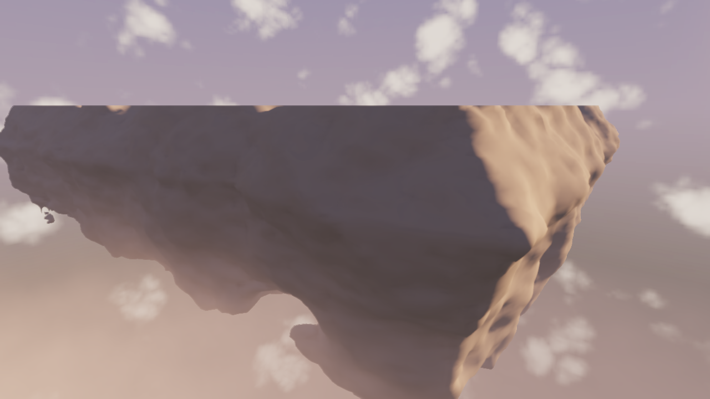
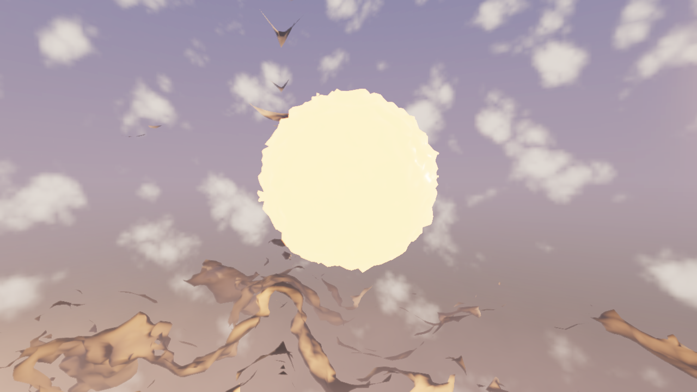

# Tutorial G25 — Marching cubes (voxel → mesh)

> 🇩🇪 **Deutsche Version:** [docs/de/tutorials/g25_marching_cubes.md](../../de/tutorials/g25_marching_cubes.md)

**Goal:** extract a smooth triangle surface from a sampled 3D scalar volume — the classic
marching-cubes algorithm (Lorensen & Cline 1987). In `procedural/marching_cubes.hpp`:
`VolumeGrid` + `sampleField()` sample any `std::function<float(Vec3)>` field;
`marchingCubes()` polygonises it into a watertight indexed `fuhgl::render::MeshData`;
`marchingCubesChunked()` does the same for large volumes in seam-exact chunks. Used for
cave/destructible terrain, metaballs and (in G29) SDF fractals.

## Usage

```cpp
#include <fuhglgraphics/procedural/marching_cubes.hpp>
#include <fuhglgraphics/procedural/noise.hpp>

fuhglgraphics::procedural::Noise noise(90210u);

// 1) sample the field into a volume grid (world box [vMin, vMax], VN^3 lattice points)
const fuhgl::math::Vec3 vMin{-70, -6, -70}, vMax{70, 44, 70};
const auto vol = fuhglgraphics::procedural::sampleField(
    [&](const fuhgl::math::Vec3& p) {
        const float h = 20.f * noise.height2(p.x * 0.018f, p.z * 0.018f, 6) + 4.f;
        const float cave = 7.f * noise.fbm3(p.x * 0.055f, p.y * 0.075f, p.z * 0.055f, 4,
                                            fuhglgraphics::procedural::Noise::Base::Simplex);
        return (h - p.y) + cave;        // < 0 inside the rock
    },
    vMin, vMax, 112, 112, 112);

// 2) polygonise (chunked: one MeshData per chunk, seams exact)
const auto chunks = fuhglgraphics::procedural::marchingCubesChunked(vol, 0.f, 4, 1, 4);

// 3) upload + attach: one Mesh per chunk, all as MeshEntries of one node
fuhgl::render::Mesh mesh;
mesh.setMeshData(chunks[0]);            // needs a GL context
auto& entry = node.attach<scene::MeshComponent>().addMesh(&mesh);
entry.albedo = {0.46f, 0.43f, 0.38f};
entry.roughness = 0.95f;
```


> ⚠️ **Closed volumes:** the pipeline culls back faces, so the iso-surface must be closed
> *inside* the sampled box — keep the field positive near the volume boundary (e.g. add a
> falloff beyond the terrain extent). If the solid touches the box border, the open boundary
> renders as see-through holes.

Details: a lattice point is "inside" when `value < isolevel`; crossing edges are linearly
interpolated, normals come from central differences of the grid (interpolated per edge), and
vertices are welded per lattice edge — so the mesh is closed (manifold) where the surface does
not touch the volume border. `MeshData` uses the standard 11-floats/vertex layout
(pos, normal, color, uv), so `Mesh::setMeshData()` + `MeshComponent` are all you need.

## Demo + result

`examples/marching_cubes_screenshot` — a 112³ G24-noise volume with fBm caves polygonised
into 16 chunks (~115k triangles), emissive crystal blobs (bloom), dusk sky cubemap + IBL,
sun with CSM shadows + god rays, SSAO, volumetric fog, TAA + upscale + ACES:

```bash
cmake --build build --target fuhglgraphics_marching_cubes_screenshot
FUHGL_BACKEND=surfaceless ./build/examples/fuhglgraphics_marching_cubes_screenshot \
    --prefix g25_marching_cubes --width 1280 --height 720 --frames 16
# marching_cubes_screenshot: 16 chunks, 115096 triangles
```

Cave terrain at dusk with glowing crystals:



Crystal closeup with bloom + god rays:



## Tests

- `tests/test_procedural_mc.cpp` (unit): `sampleField` values/positions, empty + degenerate
  volumes, sphere field → closed manifold mesh (every edge shared by exactly 2 triangles,
  Euler characteristic V−E+F = 2, normals outward, vertices on the shell), plane field → all
  vertices on the plane, consistent normals, exact triangle count 2·(N−1)², chunked triangle
  count == single-mesh count, G24-noise blob → closed manifold.
- `tests/gl_smoke_procedural.cpp` (label `gl_context`, skips with 77): noise-metaball blob
  uploaded and rendered through the G3 renderer — center pixel lit and differs from the
  mesh-less frame.
- CI: `docs-screenshots` renders `docs/images/ci/g25_marching_cubes_{cave,blob}.png`.
