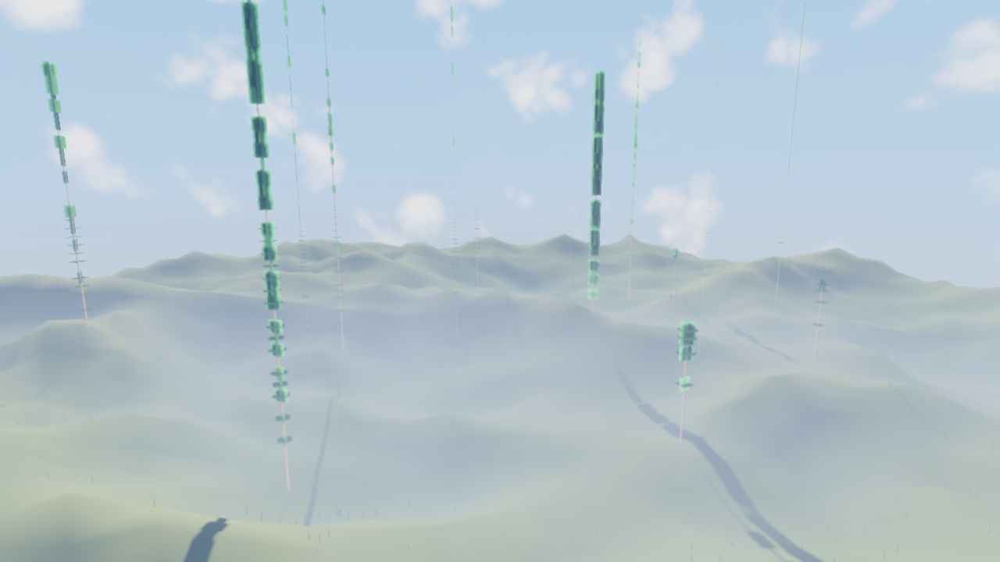
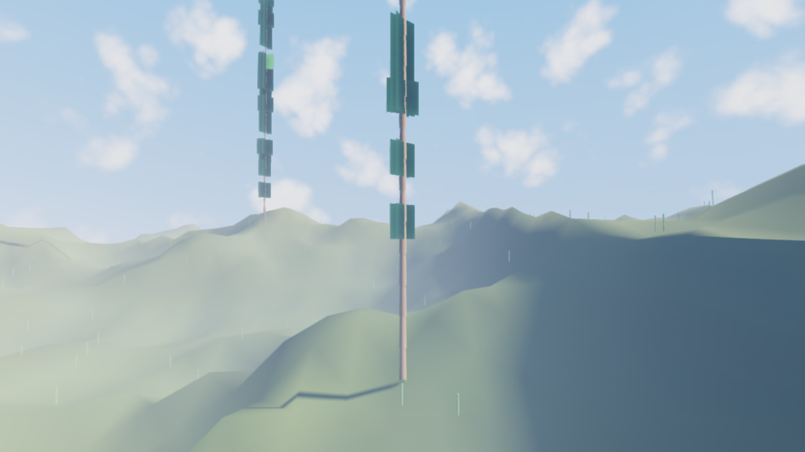

# Tutorial G26 — L-systems (Lindenmayer) → mesh

> 🇩🇪 **Deutsche Version:** [docs/de/tutorials/g26_lsystem.md](../../de/tutorials/g26_lsystem.md)

**Goal:** grow plants as meshes with rule-based string rewriting — L-systems
(`procedural::LSystem` in `procedural/lsystem.hpp`). `derive()` rewrites the axiom with the
production rules `iterations` times; `generate()` interprets the string with a 3D turtle and
emits a `fuhgl::render::MeshData` (tapered cylinders for branches, crossed-quad leaves).

## Usage

```cpp
#include <fuhglgraphics/procedural/lsystem.hpp>

// preset: branching tree (variants 0..2), Barnsley-style fern, bush
fuhglgraphics::procedural::LSystem tree = fuhglgraphics::procedural::LSystem::makeTree(0);

// or custom: axiom + rules + turtle parameters
fuhglgraphics::procedural::LSystem custom;
custom.axiom = "F";
custom.rules = {{'F', "FF+[+F-F-FL]-[-F+F+FL]"}};  // L = leaf quad at the tip
custom.iterations = 4;
custom.angleDeg = 22.5f;   // + - & ^ \ | turn angle
custom.step = 0.9f;        // F/f segment length
custom.radius0 = 0.11f;    // trunk radius
custom.radiusTaper = 0.7f; // per [ depth
custom.sides = 6;          // cylinder sides
custom.leaves = true;

const std::string code = tree.derive();              // deterministic rewriting
const fuhgl::render::MeshData md = tree.generate({0.30f, 0.20f, 0.12f},   // trunk color
                                                 {0.14f, 0.45f, 0.16f});  // leaf color

// upload + place on the terrain (needs a GL context)
fuhgl::render::Mesh mesh;
mesh.setMeshData(md);
scene::Node& n = scene.root().createChild("tree0");
n.translation = {x, tc.heightAt(x, z), z};
n.attach<scene::MeshComponent>().addMesh(&mesh);
```

Turtle symbols: `F` draw forward (cylinder, radius tapers with `[` depth), `f` move,
`+`/`-` roll around the heading, `&`/`^` pitch, `\`/`|` yaw, `[`/`]` push/pop the frame
(new branch), `L` two crossed leaf quads. Unknown symbols are ignored.

## Demo + result

`examples/lsystem_screenshot` — 9 L-system trees (3 variants, rotated/scaled) + 5 ferns on a
G24-noise terrain, 3000 instanced grass blades snapped to the ground via
`Instancing::heightFn`, noon sun with CSM shadows + god rays, day-sky cubemap + IBL, SSAO,
volumetric fog, TAA + upscale + ACES:

```bash
cmake --build build --target fuhglgraphics_lsystem_screenshot
FUHGL_BACKEND=surfaceless ./build/examples/fuhglgraphics_lsystem_screenshot \
    --prefix g26_lsystem --width 1280 --height 720 --frames 16
```

Forest overview:



Tree closeup (trunk, branches, leaf quads):



## Tests

- `tests/test_procedural_lsystem.cpp` (unit): `derive()` exact strings + determinism,
  unknown symbols pass through, presets produce balanced brackets and sane sizes,
  `generate()` output validity (indexed, finite, unit normals, grows upward, bounded),
  presets differ, trunk/leaf vertex colors present.
- CI: `docs-screenshots` renders `docs/images/ci/g26_lsystem_{forest,tree}.png`.
