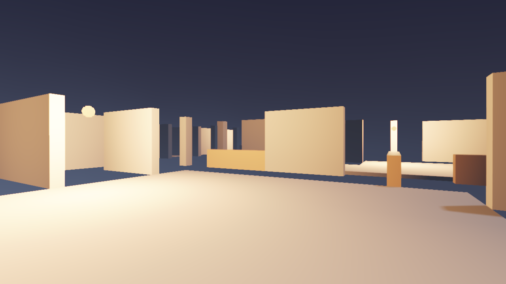
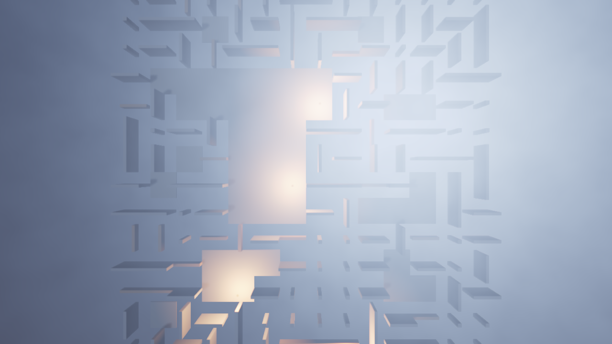

# Tutorial G27 — Wave function collapse (tiled)

> 🇩🇪 **Deutsche Version:** [docs/de/tutorials/g27_wfc.md](../../de/tutorials/g27_wfc.md)

**Goal:** generate coherent tile layouts (dungeons, cities, stations) with the wave function
collapse algorithm: `procedural::Wfc` in `procedural/wfc.hpp`. You define tiles with edge
tags ("sockets") and weights; the solver collapses every grid cell to one tile+rotation so all
adjacent tags match — min-entropy selection, constraint propagation, seeded backtracking.
Deterministic per seed; pure CPU. Placements then instantiate as G9 scene-graph nodes.

## Usage

```cpp
#include <fuhglgraphics/procedural/wfc.hpp>

// tile tags are in cyclic dir order: E(+x), S(+z), W(-x), N(-z); "o" = open, "w" = wall
fuhglgraphics::procedural::Wfc wfc(14, 14, /*borderTag=*/"w");   // border rings in walls
for (const auto& t : fuhglgraphics::procedural::Wfc::makeDungeonTiles()) wfc.addTile(t);
// makeDungeonTiles(): floor(oooo), wallH(w o w o), wallV(o w o w), wallCap(w o o o),
//                     corner(w w o o), doorH/doorV (same sockets as wall bands), pillar(wwww)

const auto cells = wfc.solve(/*seed=*/777u);   // row-major, cells[x + width*z] = {tile, rot}

// instantiate: merge all cells of one (tile, rot) into a single MeshData, one node per kind
for (int z = 0; z < wfc.height(); ++z)
    for (int x = 0; x < wfc.width(); ++x) {
        const auto& c = cells[x + wfc.width() * z];
        if (c.tile < 0) continue;                       // unsolved after backtracking
        const float wx = (x - (wfc.width() - 1) * 0.5f) * CELL;
        const float wz = (z - (wfc.height() - 1) * 0.5f) * CELL;
        const auto m = fuhgl::math::translate({wx, 0, wz}) *
                       fuhgl::math::rotateY(-c.rot * fuhgl::math::kPi * 0.5f);
        appendTransformed(mergedMesh[c.tile * 4 + c.rot], tileMesh[c.tile], m);
    }
```

Custom tiles: `WfcTile{name, weight, {tagE, tagS, tagW, tagN}}`. Rotating a tile by
`rot*90°` maps `wfcRotatedTags(rot)[d] = tags[(d + rot) mod 4]`; two cells are compatible when
the touching tags are equal (`Wfc::compatible`). The grid border acts as a fixed tag, so
`"w"` walls the map automatically.

## Demo + result

`examples/wfc_screenshot` — a 14×14 dungeon solved by WFC (seed 777: 44 floor, 131 wall,
21 door cells), instantiated as merged per-(tile, rotation) nodes, with torches (emissive
flames + point lights + bloom), wear decals on the floor (G8), dim directional light with CSM
shadows, SSAO, volumetric fog, TAA + upscale + ACES:

```bash
cmake --build build --target fuhglgraphics_wfc_screenshot
FUHGL_BACKEND=surfaceless ./build/examples/fuhglgraphics_wfc_screenshot \
    --prefix g27_wfc --width 1280 --height 720 --frames 16 --seed 777
# wfc_screenshot: 14x14 solved (seed 777): floor=44 wall=131 door=21 unsolved=0
```

Interior view with torch-lit door (bloom + fog + shadows):



Top-down overview of the solved layout:



## Tests

- `tests/test_procedural_wfc.cpp` (unit): rotation tag mapping, compatibility, full-solve
  validity (every cell collapsed, all adjacent edge tags match incl. the border), determinism
  per seed, dungeon structure (full wall ring, open floor inside), contradiction →
  backtracking terminates with unsolved cells.
- CI: `docs-screenshots` renders `docs/images/ci/g27_wfc_{dungeon,overview}.png`.
