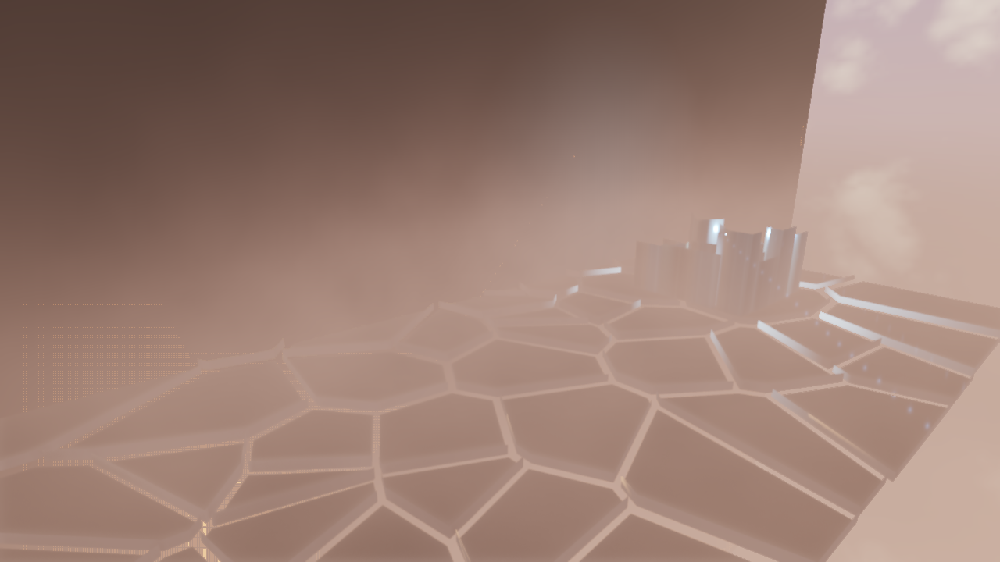
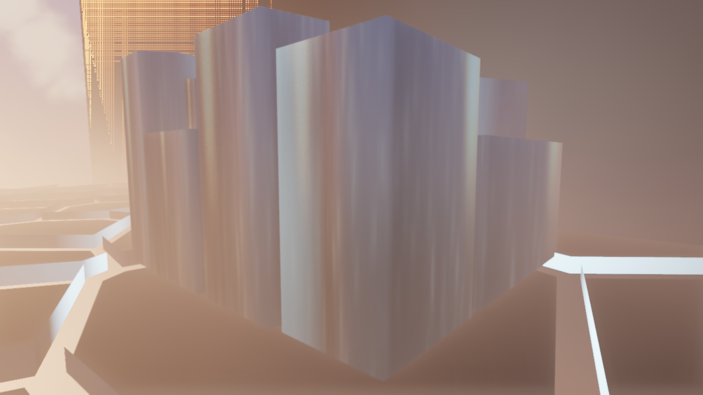

# Tutorial G28 — Voronoi diagrams + extrusion

> 🇩🇪 **Deutsche Version:** [docs/de/tutorials/g28_voronoi.md](../../de/tutorials/g28_voronoi.md)

**Goal:** split a rectangle into cells around seeded points with `procedural::Voronoi2D` in
`procedural/voronoi.hpp` — convex cell polygons (half-plane clipping against the bisectors),
adjacency edges, F1/F2 distance fields — and extrude the cells into prism meshes with
`procedural::extrudeCells`. Perfect for cracked ground plates, shattered glass, city blocks,
cellular structures or crystal shards. Deterministic per seed; pure CPU.

## Usage

```cpp
#include <fuhglgraphics/procedural/voronoi.hpp>

// 70 seeded points in [-30, 30]^2 -> 70 convex cells (CCW, clipped to the bounds)
fuhglgraphics::procedural::Voronoi2D v =
    fuhglgraphics::procedural::voronoi2d(70, {-30.f, -30.f}, {30.f, 30.f}, 2468u);

// F1/F2 distance fields at a point (F2-F1 = distance to the nearest cell border)
float f1, f2;
fuhglgraphics::procedural::voronoiDistances(v, {3.5f, -2.0f}, f1, f2);

// extrude every cell into a prism -> one MeshData (11 floats/vertex, ready for Mesh::setMeshData)
fuhgl::render::MeshData plates = fuhglgraphics::procedural::extrudeCells(
    v, /*y0=*/-0.15f, /*y1=*/0.30f,
    /*gap=*/0.055f,          // shrink each polygon towards its centroid -> cracks between plates
    /*heightJitter=*/0.12f,   // per-cell top-height variation (jitterSeed=11)
    /*jitterSeed=*/11u,
    /*color=*/{0.52f, 0.50f, 0.46f}, /*colorJitter=*/0.18f);   // per-vertex color per cell

// adjacency: v.edges holds the pairs of seed indices sharing a cell edge
```

`voronoi2d(n, min, max, seed)` places `n` points by a seeded RNG and clips each cell against the
perpendicular bisector of every point pair (O(n²), fine for n up to a few hundred). Every cell is
convex, CCW and inside `[min, max]`; border cells are clipped to the rectangle.
`extrudeCells` builds bottom + top fan + side quads per cell, so the result is a closed manifold
mesh per plate group.

## Demo + result

`examples/voronoi_screenshot` — a **shattered plaza**: 70 Voronoi cells extruded as stone plates
with gaps (`gap=0.055`) over an emissive underlay, so the cracks glow orange (bloom); next to it
a crystal-shard cluster (16 cells, `heightJitter=4.2`, metallic) lit by a point light. Sunset sky
cubemap (G24 turbulence clouds) + IBL, sun with CSM shadows + god rays, SSAO, volumetric fog,
bloom, TAA + upscale + ACES:

```bash
cmake --build build --target fuhglgraphics_voronoi_screenshot
FUHGL_BACKEND=surfaceless ./build/examples/fuhglgraphics_voronoi_screenshot \
    --prefix g28_voronoi --width 1280 --height 720 --frames 16
# voronoi_screenshot: plaza 70 cells -> 1288 tris
# voronoi_screenshot: wrote g28_voronoi_shattered.png
# voronoi_screenshot: wrote g28_voronoi_crystals.png
```

Wide shot over the shattered plaza with glowing cracks and low sun (god rays + fog + shadows):



Closeup of the crystal-shard cluster (point light + bloom):



## Tests

- `tests/test_procedural_voronoi.cpp` (unit): cell count = point count, cells convex + CCW +
  inside bounds, every point inside its own cell, every cell edge equidistant to its two seeds,
  adjacency symmetric and consistent with shared edges, F1/F2 correctness + F2-F1 border field,
  extrusion manifoldness (each undirected edge shared by exactly 2 triangles) and vertex count,
  gap/height/color jitter behaviour, determinism per seed.
- CI: `docs-screenshots` renders `docs/images/ci/g28_voronoi_{shattered,crystals}.png`.
