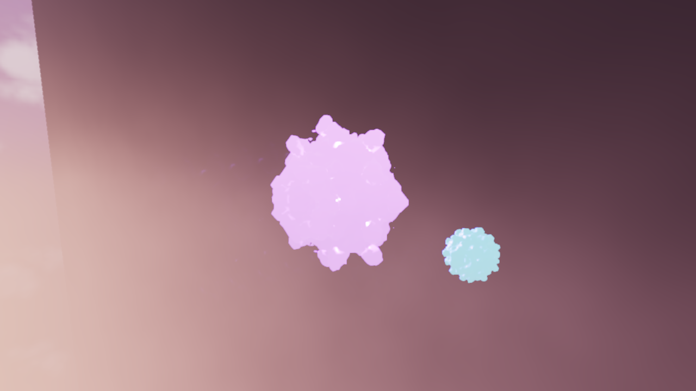
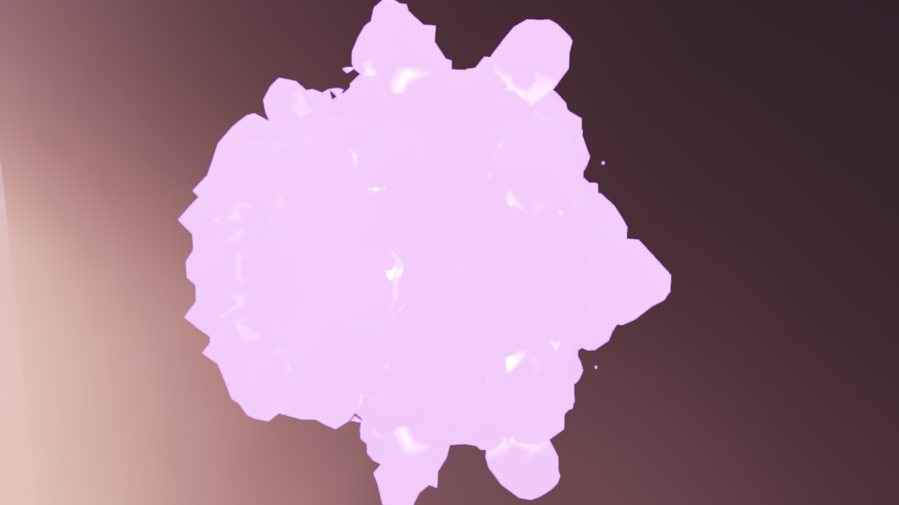

# Tutorial G29 — SDF / 3D fractals (Mandelbulb)

> 🇩🇪 **Deutsche Version:** [docs/de/tutorials/g29_mandelbulb.md](../../de/tutorials/g29_mandelbulb.md)

**Goal:** model 3D fractals and combine signed distance fields, then mesh them with marching
cubes. `procedural::sdf` (`procedural/sdf.hpp`) has primitives (sphere, box, roundedBox,
plane, cylinder), `smoothMin` for blending, and `mandelbulb` (the classic power-8 distance
estimator). `procedural::meshFromSdf(field, min, max, res)` samples any SDF over a box and
polygonises it with the G25 marching cubes — negative-inside, isolevel 0.

## Usage

```cpp
#include <fuhglgraphics/procedural/sdf.hpp>

using fuhglgraphics::procedural::sdf::mandelbulb;
using fuhglgraphics::procedural::sdf::smoothMin;
using fuhglgraphics::procedural::sdf::sphere;

// a Mandelbulb meshed at 56^3 samples (~22k triangles)
const fuhgl::render::MeshData bulb = fuhglgraphics::procedural::meshFromSdf(
    [](const fuhgl::math::Vec3& p) { return mandelbulb(p, 8.f, 10); },
    {-1.4f, -1.4f, -1.4f}, {1.4f, 1.4f, 1.4f}, 56);

// combine: bulb + two satellite spheres blended with smoothMin
const auto combo = [](const fuhgl::math::Vec3& p) {
    float d = mandelbulb(p, 8.f, 10);
    d = smoothMin(d, sphere(p - fuhgl::math::Vec3{1.1f, 0.f, 0.f}, 0.35f), 0.3f);
    d = smoothMin(d, sphere(p - fuhgl::math::Vec3{-0.9f, 0.4f, 0.3f}, 0.28f), 0.3f);
    return d;
};

// upload + render (needs a GL context)
fuhgl::render::Mesh mesh;
mesh.setMeshData(bulb);
auto& e = node.attach<scene::MeshComponent>().addMesh(&mesh);
e.emissive = {1.6f, 0.55f, 2.6f};   // HDR emissive -> bloom picks it up
e.metallic = 0.3f;
e.roughness = 0.3f;
```

## Demo + result

`examples/mandelbulb_screenshot` — Mandelbulb (56³ samples) scaled ×5 as a floating emissive
sculpture + 3 satellite bulbs, violet core point light (bloom), warm low sun with CSM shadows
+ god rays, dusk sky cubemap + IBL, SSAO, volumetric fog, TAA + upscale + ACES:

```bash
cmake --build build --target fuhglgraphics_mandelbulb_screenshot
FUHGL_BACKEND=surfaceless ./build/examples/fuhglgraphics_mandelbulb_screenshot \
    --prefix g29_mandelbulb --width 1280 --height 720 --frames 16
# mandelbulb_screenshot: main bulb 22548 tris
```

Wide shot (sculpture + satellites, god rays, fog):



Closeup of the fractal surface with bloom:



## Tests

- `tests/test_procedural_sdf.cpp` (unit): primitive signs/values on/off surface, smooth-min
  properties, mandelbulb DE sanity (origin ≈ 0, far point large, finite samples), sphere SDF →
  closed manifold mesh on the correct shell radius (every edge shared by 2 triangles),
  mandelbulb mesh bounded/finite/indexed.
- CI: `docs-screenshots` renders `docs/images/ci/g29_mandelbulb_{wide,closeup}.png`.
