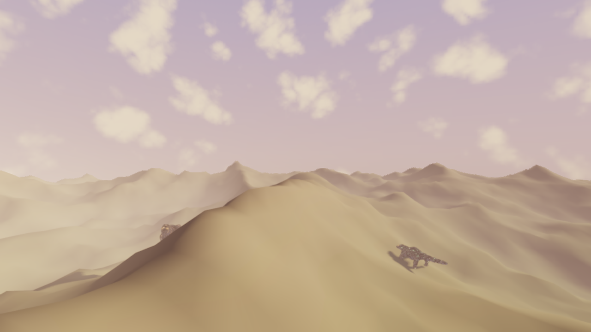
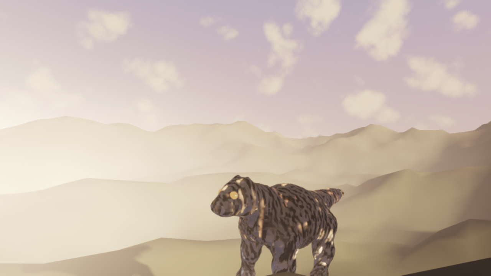

# Tutorial G30 — Procedural creatures (skeleton + SDF → mesh + baked skin)

> 🇩🇪 **Deutsche Version:** [docs/de/tutorials/g30_creature.md](../../de/tutorials/g30_creature.md)

**Goal:** generate complete 3D creatures (quadrupeds, reptiles) procedurally with
`procedural/creature.hpp`. Pipeline: a `Skeleton` graph (nodes = position/radius/`BodyPart`)
is baked into world-space SDF primitives (one ellipsoid per node + one tapered capsule per
parent link, each with a broadphase AABB — linear, cache-friendly evaluation). `creatureSdf()`
joins them with the G29 `sdf::smoothMin` (organic muscle/skin transitions) and modulates the
field with G24 simplex fBm (scales/ribs/folds directly in the geometry). `meshCreature()`
meshes it with the G25 marching cubes, computes analytic normals from the SDF gradient
(finite differences), per-vertex curvature (SDF Laplacian) into the vertex color channel and
a seamless cylindrical UV unwrap. `bakeCreatureMaps()` bakes albedo + tangent normal maps
from 3D object-space noise (worley scale cells, stripes, belly). Pure CPU, deterministic.

> Note on "shader texturing": FuhGLCore is a pinned external dependency, so the lighting
> shader can't be extended with a triplanar path. Instead the maps are baked on the CPU from
> 3D object-space noise at the reconstructed surface point of every texel (seamless in u),
> and the engine's G-buffer pass already multiplies the vertex color into the albedo
> (`albedo = uAlbedo * vColor [* map]`), so the curvature channel automatically darkens
> creases and brightens ridges at render time.

## Usage

```cpp
#include <fuhglgraphics/procedural/creature.hpp>

using namespace fuhglgraphics::procedural;

// preset skeletons: dog-like quadruped / lizard-like reptile
Skeleton skel = makeQuadruped();          // or makeReptile()

CreatureParams pr;
pr.seed = 21u;
pr.smoothK = 0.22f;                       // smooth-min blend radius
pr.detailAmp = 0.02f;                     // geometry noise (folds) amplitude
pr.detailFreq = 6.f;
pr.scaleFreq = 5.5f;                      // baked scale-cell frequency
pr.bodyColor = {0.48f, 0.38f, 0.24f};     // palette: body / belly / accent(stripes)
pr.bellyColor = {0.78f, 0.70f, 0.55f};
pr.accentColor = {0.30f, 0.16f, 0.10f};

// mesh: marching cubes + gradient normals + curvature in the color channel + cylindrical UVs
const CreatureMesh cm = meshCreature(skel, pr, /*resolution=*/80, {1.f, 1.f, 1.f});
// cm.mesh: color channel = curvature shade (concave creases darker), uv = cylindrical unwrap

// bake albedo + normal maps (RGBA8, size x size), seamless in u
const CreatureMaps maps = bakeCreatureMaps(skel, pr, 256);

// upload + place (needs a GL context)
fuhgl::render::Mesh mesh;
mesh.setMeshData(cm.mesh);
fuhgl::Texture albedoTex(fuhgl::Texture::Target::Tex2D), normalTex(fuhgl::Texture::Target::Tex2D);
albedoTex.bind();
albedoTex.setImage2D(0, fuhgl::gl::GL_RGBA8, maps.size, maps.size, fuhgl::gl::GL_RGBA,
                     fuhgl::gl::GL_UNSIGNED_BYTE, maps.albedo.data());
albedoTex.generateMipmap();                       // needed for LINEAR_MIPMAP_LINEAR
albedoTex.setParameteri(fuhgl::gl::GL_TEXTURE_MIN_FILTER, fuhgl::gl::GL_LINEAR_MIPMAP_LINEAR);
albedoTex.setParameteri(fuhgl::gl::GL_TEXTURE_MAG_FILTER, fuhgl::gl::GL_LINEAR);
albedoTex.setParameteri(fuhgl::gl::GL_TEXTURE_WRAP_S, fuhgl::gl::GL_REPEAT);   // seamless u
albedoTex.setParameteri(fuhgl::gl::GL_TEXTURE_WRAP_T, fuhgl::gl::GL_CLAMP_TO_EDGE);
// ... same for normalTex with maps.normal ...

auto& e = node.attach<scene::MeshComponent>().addMesh(&mesh);
e.albedo = {1.f, 1.f, 1.f};        // vertex color (curvature) * baked albedo map
e.albedoTexture = &albedoTex;
e.normalMap = &normalTex;
e.roughness = pr.roughness;
```

Custom skeletons: `skel.addNode(name, parent, offset, radius, ellipsoid, BodyPart, blend)` —
parents before children; body axis = +Z (head forward), up = +Y. `BodyPart` values:
`Torso, Neck, Head, Jaw, LegUpper, LegLower, Foot, Tail, Horn, Fin`.

## Demo + result

`examples/creature_screenshot` — a quadruped and a reptile on a G24-noise terrain, each with
baked scale/stripe/belly maps + normal map, curvature vertex colors, emissive amber eyes
(bloom), dusk sun with CSM shadows + god rays, sky cubemap + IBL, SSAO, volumetric fog, bloom,
TAA + upscale + ACES:

```bash
cmake --build build --target fuhglgraphics_creature_screenshot
FUHGL_BACKEND=surfaceless ./build/examples/fuhglgraphics_creature_screenshot \
    --prefix g30_creature --width 1280 --height 720 --frames 16
# creature_screenshot: mesh 16792 tris, maps 256x256
# creature_screenshot: mesh 17792 tris, maps 256x256
```

Wide shot — both creatures on the plain at dusk:



Closeup of the quadruped flank — scale cells, stripes, and curvature-darkened folds between
limbs and torso:



## Tests

- `tests/test_procedural_creature.cpp` (unit): skeleton finalize (world positions accumulate,
  prim count, bounds), `creatureSdf` sign inside/outside + determinism + continuity along a
  limb line + noise modulation bounded by `detailAmp`, `meshCreature` (indexed mesh, unit
  gradient normals, uv in [0,1], curvature variation, determinism), curvature sign (two-sphere
  dumbbell: the smin neck is darker than the convex pole), `bakeCreatureMaps` (sizes, alpha,
  determinism, pattern variation), presets differ.
- `tests/gl_smoke_procedural.cpp` (gl_context): uploads a `meshCreature` quadruped and
  verifies it changes the center pixel.
- CI: `docs-screenshots` renders `docs/images/ci/g30_creature_{wide,closeup}.png`.
