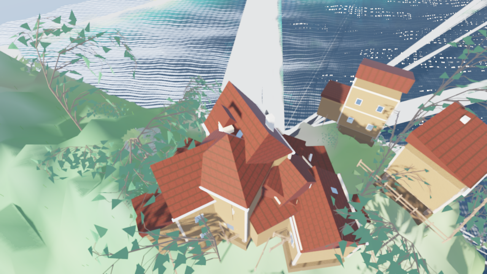
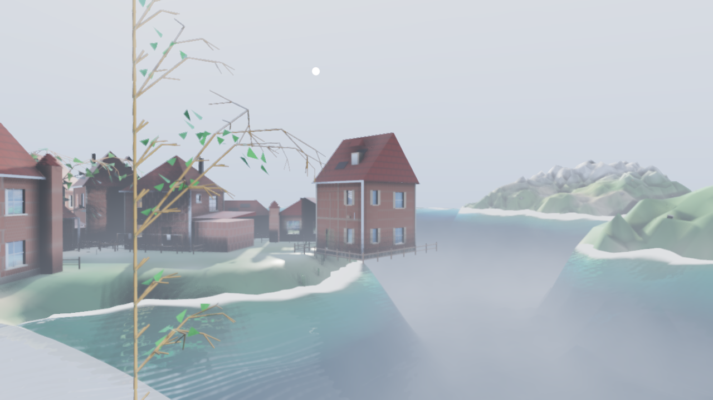
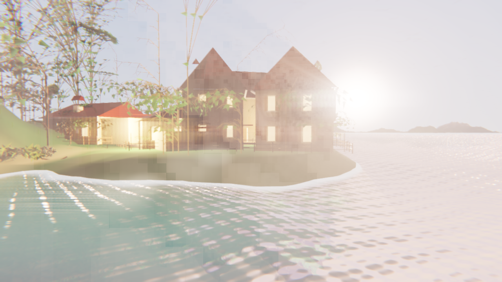
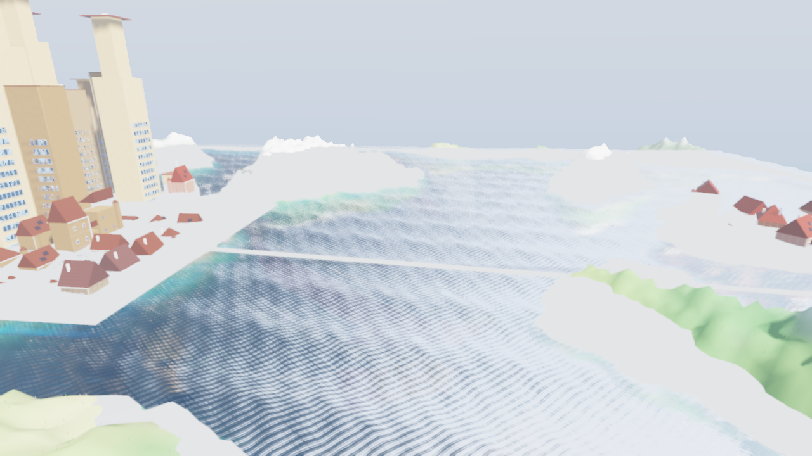
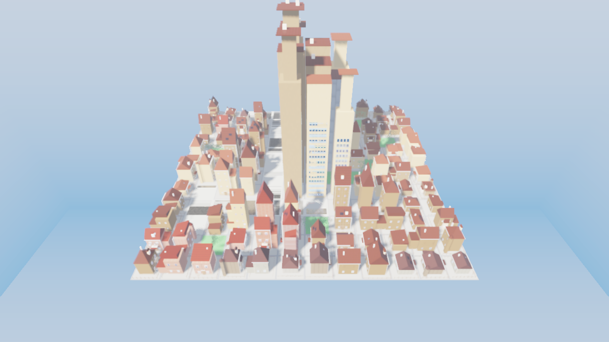
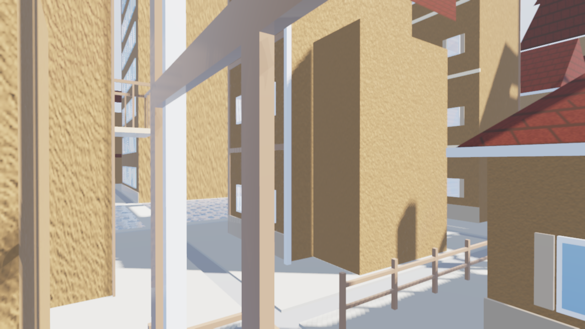

# Tutorial G31 — World generator helper (landscape or city)

> 🇩🇪 **Deutsche Version:** [docs/de/tutorials/g31_worldgen.md](../../de/tutorials/g31_worldgen.md)

**Goal:** generate a complete procedural **landscape** or **city** with one function call:
`procedural::generateWorld(params)` in `procedural/worldgen.hpp`. One parameter struct
(`WorldGenParams`) switches the mode; the result (`GeneratedWorld`) is plain CPU data —
heightmap, WFC placements, `MeshData`, placed meshes — that you attach to a `scene::Scene`.
Deterministic per seed, no GL needed for generation.

## Usage

```cpp
#include <fuhglgraphics/procedural/worldgen.hpp>

using fuhglgraphics::procedural::WorldGenParams;
using fuhglgraphics::procedural::generateWorld;

WorldGenParams p;
p.mode = WorldGenParams::Mode::Landscape;   // or Mode::City
p.seed = 777;
const auto world = generateWorld(p);
```

## Landscape mode

```cpp
WorldGenParams p;
p.mode = WorldGenParams::Mode::Landscape;
p.seed = 777;
p.worldSize = 200.f;        // X/Z extent in world units (centered at the origin)
p.terrainGrid = 129;        // heightmap resolution
p.terrainHeight = 34.f;     // height scale (heightmap itself is stored in [0,1])
p.noiseScale = 0.045f;      // noise-space scale per world unit
p.octaves = 6;              // fBm octaves of the plains layer
p.warpStrength = 0.6f;      // domain warp of the noise input (0 = off)
p.heightExponent = 0.85f;   // contrast shaping pow(h, exponent); <1 -> more pronounced peaks
p.waterLevel = 0.30f;       // >0: water/lake at this normalized level
p.lakeRadius = 55.f;        // >0: round lake basin of this radius around the center
p.lakeCarve = 0.18f;         // basin depth factor below the water level
p.erosionDroplets = 4000;   // hydraulic erosion: droplet particle sim (0 = off)
p.thermalPasses = 4;        // thermal erosion passes (0 = off)
p.talus = 0.09f;             // thermal talus threshold (normalized height drop per cell)
p.treeCount = 130;          // scattered L-system trees (poisson-disk, grass-weighted)
p.bushCount = 180;          // scattered bushes
p.rockCount = 60;           // scattered rocks (splatmap rock mask)
p.grassBlades = 6000;       // hint for the app: instanced grass via Instancing::heightFn
p.treeMinDist = 6.f;        // poisson-disk min distance
// shape shaping (spline-mapped noise layers + terracing):
p.contOcean = 0.40f;        // continentalness spline knot: below = deep ocean
p.contCoast = 0.45f;        // coast band up to here
p.contPlains = 0.70f;       // plains up to here, above rises steeply to mountains
p.erosionScale = 0.011f;    // erosion-map noise scale (high value = smooth terrain)
p.pvScale = 0.06f;          // peaks&valleys detail noise scale
p.pvWeight = 0.16f;         // peaks&valleys weight
p.terraceSteps = 0;         // >0: terrace high terrain into steps (mesa/canyon, 0 = off)
p.terraceStrength = 0.65f; // terracing blend strength
// hydrology (rivers) + climate/biomes:
p.riverCount = 10;          // rivers: gradient descent from mountain sources (0 = off)
p.riverSourceMinH = 0.55f;  // min height of a river source
p.riverDepth = 0.05f;       // riverbed carve depth (normalized)
p.riverWidth = 1.6f;        // riverbed half-width in cells
p.climateMaps = true;       // temperature/humidity/biome maps (Whittaker)
p.lapseRate = 0.5f;         // temperature drop per normalized altitude

const auto w = generateWorld(p);
w.heightmap;                // gridW*gridH floats, row-major (x + gridW*z), [0,1]
w.heightAt(x, z);           // world-space bilinear height (sample * heightScale, clamped)
w.waterLevelWorld;          // water level in world units (place a WaterComponent here)
w.splatmap;                 // gridW*gridH RGBA weights: R vegetation, G rock, B sand, A snow
w.flowmap;                  // gridW*gridH float [0,1]: flow accumulation (erosion + rivers)
w.temperature;              // gridW*gridH float [0,1]: latitude + noise - altitude (lapse rate)
w.humidity;                 // gridW*gridH float [0,1]: noise + near-water + river boost
w.biome;                    // gridW*gridH cast of Biome (Whittaker lookup + shore/rock/snow)
w.pondMask;                 // gridW*gridH: 1 = mountain-lake cell (river sink filled to spill)
w.trees;                    // PlacedMesh: mesh (L-system tree) + position/rotY/scale/tint
w.bushes;                   // PlacedMesh: bushes, same placement rules
w.rocks;                    // PlacedMesh: sphere rocks on steep/rock splatmap areas
```

### Landscape pipeline (what `generateLandscape` does)

1. **Macro relief** — Minecraft-style three noise layers, domain-warped first
   (`warpStrength`): (a) *continentalness* (very low-frequency simplex) mapped through a
   `Spline1D` curve with knots `contOcean`/`contCoast`/`contPlains` — below `contOcean` deep
   ocean, coast band, wide plains, above `contPlains` a steep rise to mountains; (b) an
   *erosion map* (low-frequency fBm) that blends smooth fBm (meadows/lake flats) with *ridged*
   multifractal (rugged crests) per cell; (c) a higher-frequency *peaks&valleys* ridged layer
   weighted by the continental base so oceans stay flat next to dramatic ridges.
   `pow(h, heightExponent)` contrast shaping, the round `lakeRadius` basin and an island
   falloff at the border follow.
2. **Erosion + geology + hydrology** — `erosionDroplets` virtual droplets run downhill, picking
   up/depositing sediment (hydraulic erosion carves valleys and fills `flowmap`), then
   `thermalPasses` relax slopes steeper than `talus` into debris fans. `terraceSteps > 0`
   quantizes high terrain into steps (mesa/canyon/rice terraces, blended by
   `terraceStrength`). `riverCount` rivers run by gradient descent from mountain source cells
   (`riverSourceMinH`) down to the water level, carving a V-shaped channel (`riverDepth` /
   `riverWidth`) into the heightmap and the flow map; a sink above the water level is filled to
   its spill point as a mountain lake (`pondMask`). Strata (sediment layers in cliffs) are a
   shading trick: color the rock splat channel by world Y + noise (see the demo).
3. **Climate & biomes** — `temperature` (latitude + variation noise − altitude·`lapseRate`)
   and `humidity` (noise + near-water boost + river/flow boost) maps per cell; the `biome` map
   is a Whittaker 2D lookup over (humidity, temperature) → Desert/Grassland/Forest/Jungle/
   Taiga/Tundra plus Ocean/Shore/Rock/Snow overrides. Because temperature/humidity are
   continuous low-frequency fields, biome borders blend softly (no hard edges — the app mixes
   biome colors with the same weights). Scatter uses the biome too: taiga/tundra → firs,
   deserts sparse, etc.
4. **Splatmap** — per cell: G rock from the world-space slope (band relative to the steepest
   slope present, so cliffs get rock at any heightScale/grid combination), A snow from altitude
   (`smoothstep(0.58, 0.8, h)`), B sand near the water level plus `flowmap` riverbeds, R
   vegetation as the remainder. Upload `splatmap` as an RGBA texture and use it as the terrain
   splat map.
5. **Meshing & LOD** — build a grid `MeshData` from `heightmap` (uv = grid uv, so the splatmap
   maps 1:1 onto the cells). For big worlds use `scene::TerrainComponent` instead: it wraps the
   same heightmap in a `LodMesh` (F38/F41 quadtree-style LOD with screen-space switch distances) —
   copy `w.heightmap` into `TerrainComponent::heights` and call `rebuildLod()`; triplanar mapping
   for steep cliffs lives in the terrain shader (shader-side).
6. **Scattering** — poisson-disk sampling (dart throwing with a spatial hash, guaranteed
   `treeMinDist`) weighted by the splatmap: trees/bushes on grass above the water line, rocks on
   the rock mask. Grass itself is app-side GPU instancing (`Node::instancing`) with a `heightFn`
   that snaps blades to `heightAt` and hides them under water / on rock-snow-sand texels
   (density mask).

Attach it to a scene (terrain grid mesh with the splatmap as albedo texture, or
`TerrainComponent` + splatmap shader; trees/bushes/rocks → one node each; grass → one instanced
node):

```cpp
scene::Scene scene;
scene::Node& tn = scene.root().createChild("terrain");
fuhgl::render::Mesh terrainMesh;
terrainMesh.setMeshData(terrainMeshData(w)); // grid from w.heightmap, uv = grid uv
auto& te = tn.attach<scene::MeshComponent>().addMesh(&terrainMesh);
te.albedoTexture = &splatmapTexture;         // RGBA: R grass / G rock / B sand / A snow
for (size_t i = 0; i < w.trees.size(); ++i) {
    auto& n = scene.root().createChild("tree" + std::to_string(i));
    n.translation = w.trees[i].position;
    n.rotation = fuhgl::math::fromAxisAngle(w.trees[i].rotY, {0, 1, 0});
    n.scale = {w.trees[i].scale, w.trees[i].scale, w.trees[i].scale};
    auto& e = n.attach<scene::MeshComponent>().addMesh(treeMeshes[i]); // Mesh::setMeshData(...)
    e.albedo = w.trees[i].tint;
}
```

See `examples/worldgen_screenshot/main.cpp` for a complete, runnable version.

## City mode

```cpp
WorldGenParams p;
p.mode = WorldGenParams::Mode::City;
p.seed = 777;
p.cityGrid = 12;            // WFC cells per side
p.cellSize = 8.f;           // world size of one cell
p.buildingHeight = 7.f;     // base wall height (jittered per block)
p.houseFootprint = 0.62f;   // house footprint as a fraction of the cell
p.blocksPerDistrict = 28;   // >0: voronoi district plates under the city
p.parkBushesPerPlaza = 3;   // bushes per plaza (park) cell
p.roadSurface = RoadSurface::Cobble; // Asphalt | Cobble | Paving | Dirt (texture choice app-side)
p.roadIrregularity = 0.06f; // edge jitter of the street slabs in world units (0 = straight)
p.roadDamage = 0.35f;       // probability of a pothole (dark patch) per street cell
p.wetRoads = false;         // wet streets: render dark + reflective app-side (low roughness)
p.allowPathCuts = false;    // false: roads are never interrupted by paths/parks (default)

const auto w = generateWorld(p);
w.cells;                    // cityW*cityH WfcCell {tile, rot}, row-major
w.tiles;                    // tile set (w.cells[].tile indexes into it)
w.cityGround;               // MeshData base plate (top at y = 0)
w.roads;                    // street slabs only (irregular edges, surface color/uv, potholes) —
                            // the textured mesh: attach the road texture set here (cobble gets POM)
w.pavements;                // sidewalk underlay + concrete lots + park lawns (plain vertex colors)
w.districts;                // voronoi plates (empty when blocksPerDistrict == 0)
w.buildings;                // one procedural house per non-park "block" cell, mesh parts:
                            // mesh = walls (facade POM set per `facade`), detailMesh = door/windows/
                            // shutters/chimney/bay window/gutter/garage/balcony (plain vertex colors),
                            // glassMesh = reflective window panes (own entry, metallic material),
                            // roofMesh = roof (roofType: 0 = gable/Satteldach, 1 = lean-to/Schleppdach,
                            // 2 = hipped, 3 = flat); facade: 0 = brick, 1 = plaster, 2 = stone;
                            // styles: Village (bay window + chimney), Town (windows per floor),
                            // Highrise (window grid + setback + flat roof)
w.roadSurface;              // echo of WorldGenParams::roadSurface (texture choice app-side)
w.wetRoads;                 // echo of WorldGenParams::wetRoads (wet material app-side)
w.bushes;                   // park greenery (PlantGenerator bushes) on park cells
```

The layout is a G27 WFC solve over `makeCityTiles()` — edge tags `"r"` (road), `"s"`
(lot/sidewalk, also the border tag) and `"p"` (plaza); tile names `block`, `plaza`, `streetH`,
`streetV`, `cross`, `tE`, `endE` with rotations handled by the solver. Street cells become the
textured road slabs in `w.roads` (irregular edges, potholes), plaza/block cells become lawn/lot
plates in `w.pavements`, and `block` cells additionally get a house with per-block jitter.

**Roads are never interrupted by paths by default** (`allowPathCuts = false`): plaza tiles are
dropped from the tile set and, after the solve, every road fragment outside the largest connected
road component is converted back to a `block` (the repair keeps the solve valid, because in a valid
solve every `"r"` edge is matched by an `"r"` edge, i.e. internal to one component).
`procedural::wfcRoadsConnected(cells, tiles, gridW, gridH)` checks the property (BFS over shared
`"r"` edges); with `allowPathCuts = true` any valid solve is accepted and roads may fragment.

## HouseGenerator class (variadic houses)

For full control over individual houses use `procedural::HouseGenerator` in
`procedural/house.hpp` directly — `generateWorld` uses it internally for the city blocks:

```cpp
fuhglgraphics::procedural::HouseGenerator gen;
auto p = fuhglgraphics::procedural::HouseGenerator::randomParams(
    fuhglgraphics::procedural::HouseStyle::Village, /*cellSize=*/8.f, /*seed=*/123u);
const auto house = gen.generate(p);
// house.walls    -> facade (attach the facade POM set per spec.facade here)
// house.details  -> door/windows/shutters/chimney/bay/dormers/timber frame/gutter/garage/balcony
//                   (plain vertex colors)
// house.glass    -> window glass panes (own MeshEntry with a reflective material)
// house.roof     -> roof solid; house.spec.roofType = Gable | Shed | Hipped | Flat
// house.spec     -> what was built (facade, hasGutter, hasShutters, hasGarage, hasBalcony,
//                   wallIrregular, hasBay, hasDormers, hasAnnex, hasPorch, ...)
```

Variants: roof types gable (Satteldach), lean-to (Schleppdach), hipped (Walmdach), flat;
features bay window (Erker), dormers (Dachgauben), side annex (Anbau), porch canopy (Vordach),
chimney, timber framing (Fachwerk); highrise style adds a facade window grid + setback + flat
roof. Facade material `spec.facade` is selectable: `Brick` (Backstein), `Plaster` (Rauhputz,
plinth band), `Stone` (Stein, relief courses every ~0.55 m). Additional details: roof gutter +
downpipe (`hasGutter`, Dachrinne), window shutters (`hasShutters`, Fensterlaeden), reflective
glass panes (`house.glass`), garage with roller door (`hasGarage`), balcony with balcony door
(`hasBalcony`), and slightly irregular walls (`wallIrregular`, per-vertex jitter in x/z —
bump-like without a texture). `Params::facade` forces a material, `randomParams()` picks one.
Deterministic per seed; unit tests in `tests/test_procedural_house.cpp`.

### BuildingContext: architecture & socio-economy rules

Passing a `BuildingContext` to `randomParams()` / `Params` (temperature, precipitation,
humidity, water proximity, wealth, density, biome, local material, soil color) makes the
generator derive form, materials and colors automatically:

- **Climate -> form**: lots of rain/snow -> steep gable/hipped roof (`spec.roofHeight` raised),
  wide eaves (`spec.roofOverhang`), gutter always on; arid/hot -> flat roof with parapet
  (`hasParapet`); hot -> small windows (`spec.windowScale < 1`), shutters, light high-albedo
  facade; cold -> large windows + chimney; flood zone / coast (`waterProximity > 0.55`) ->
  house on stilts over a high stone foundation (`onStilts`, `stiltHeight`).
- **Local resources -> material** (`resolveFacadeMaterial`): forest biome -> `Wood` + timber
  frame, mountains/rock -> `Stone` + slate roof, clay/river proximity -> `Brick` + red clay
  tiles, desert -> `Adobe`, metropolis (density > 0.85 + wealth > 0.6) -> `Concrete`.
- **Socio-economy**: low density -> 1-2 storeys + garden fence (`hasFence`); high density ->
  block-edge construction (footprint fills the lot), 4-6+ storeys, ground floor as a shop with
  display windows + sign band (`hasShopFront`); high wealth -> cornice bands per floor
  (`hasCornice`), clean walls; low wealth -> wall patches (`hasPatches`), stronger wall jitter.
- **Shader weathering** (`Effect::Weathering`, lighting pass, building material IDs 5..8 only):
  moss/lichen on north- and up-facing surfaces (via `params.weatherHumidity`), a splash-stain
  plinth in the lowest ~2 m above `params.weatherBaseY` tinted with the local soil color
  (`params.weatherSoilColor`), vertical rain streaks on walls (`params.weatherRainStreaks`).
  `generateWorld`/`generateCityWorld` fill the context per house from the climate/zone maps.

### Organic architecture (building history, imperfection, statics, clutter)

So houses don't look like sterile Lego bricks, the generator deliberately simulates time and
human use (`Params`): **additive building history** — core volume + later docked volumes
(overhanging timber upper floor on struts `hasOverhang`, stair tower with a CSG cone roof,
annex/garage/bay) plus roof penetrations (solar panels `hasSolar`, flush roof windows
`hasRoofWindow`). **Controlled imperfection**: chamfered edges (`bevelEdges`, chamfer box instead
of razor-sharp 90° edges → realistic specular highlights), low-frequency fbm3 vertex warp
(`warpAmount`: walls bow slightly, the ridge sags in the middle), micro-jitter (shutters hang at
slightly different angles, chimneys tilted). **Statics**: massive protruding plinth in the local
soil color (`hasPlinth`), corner pilasters, lintel beams above door/windows + recessed reveals
(`hasLintels`). **Human traces** (`clutter`): CSG flower boxes with sphere flowers, AC unit, CSG
satellite dish, CSG firewood stack, clothesline at the fence — CSG solids come from FuhGLCore
(`fuhgl/render/solid.hpp`, marching tetrahedra). **Ivy** (`ivy`): vines climb the sunny/damp facade
from the ground up (density follows `context.humidity`). In the shader, plaster additionally chips
off near the ground on walls (`Effect::Weathering`, material ID 5) exposing brick masonry
(`weatherBrickColor`).
## PlantGenerator class (trees + bushes)

`procedural::PlantGenerator` in `procedural/plant.hpp` generates plants on an L-system basis with
per-kind rules, palettes and seed jitter — `generateWorld` uses it for the landscape scatter and
the city parks:

```cpp
fuhglgraphics::procedural::PlantGenerator gen;
auto p = fuhglgraphics::procedural::PlantGenerator::randomParams(
    fuhglgraphics::procedural::PlantKind::Fir, /*seed=*/42u); // Deciduous | Fir | Birch | Bush
const auto plant = gen.generate(p);
// plant.mesh        -> trunk + crown (vertex colors: trunk/leaf per kind)
// plant.trunkColor / plant.leafColor / plant.kind / plant.height
```

Kinds: `Deciduous` (Laubbaum), `Fir` (Tanne — conical crown via a dedicated rule plus a conical
squash of the leaf vertices), `Birch` (Birke — white bark, light leaves, drooping branches),
`Bush` (Busch). Deterministic per seed; unit tests in `tests/test_procedural_plant.cpp`.

## Pipeline city generator (terrain -> roads -> lots -> houses)

`procedural::generateCityWorld(CityGenParams)` in `procedural/citygen.hpp` implements the full
pipeline as separate, unit-testable stages:

1. **Terrain & zones**: fBm heightmap with a flattened city plateau and a lake below
   `waterLevel`; zone grids `density` (city center -> highrises, rim -> village) and `wealth`
   from independent noise layers (`CityWorld::heightAt/densityAt/wealthAt`).
2. **Road network**: a noise-warped street grid stored as a planar graph (`RoadGraph`: nodes =
   intersections, edges = segments); nodes under water are dropped. Rendered into
   `CityWorld::roadMesh` (street quads with irregular edges, chosen surface + potholes — the
   textured mesh) and `CityWorld::sidewalkMesh` (sidewalk underlay + intersection squares).
   `CityGenParams` has the same road knobs as `WorldGenParams` (`roadSurface`,
   `roadIrregularity`, `roadDamage`, `wetRoads`, `allowPathCuts`).
3. **Lot subdivision**: each surviving grid cell is a block polygon, recursively OBB-split
   (half-plane split along the longest PCA axis, self-contained `clipHalfPlane`/`computeObb`)
   into lots; `earClip` triangulates the lot slabs (`lotMesh`). Boundary-touching lots get road
   access, interior lots become parks — and tiny lots that reach the street become "path" lots
   (park) only when `allowPathCuts` is set, otherwise the street frontage stays uninterrupted.
4. **Buildings**: per accessible lot a `HouseGenerator` house whose style comes from the
   density zone (Village/Town/Highrise); park lots get bushes.

No external polygon library is used (ear clipping, half-plane clip and OBB/PCA are implemented
in `citygen.cpp`). Performance notes for the app side: merge static city geometry into few
meshes (as the demo does), keep facade POM on the walls only, and use LOD/instancing for
repeated modules. Unit tests: `tests/test_procedural_citygen.cpp`.

```cpp
procedural::CityGenParams p;
p.seed = 777;
const auto city = procedural::generateCityWorld(p);
// city.heightmap -> TerrainComponent, city.roadMesh (textured surface) / city.sidewalkMesh /
// city.lotMesh -> nodes, city.houses -> PlacedMesh list (walls POM per facade + glass + details
// + roof); city.roadSurface / city.wetRoads echo the params
```

## Screenshot demo

`examples/worldgen_screenshot` renders all modes headless to PNG. CI renders and PSNR-gates
`docs/images/ci/g31_worldgen_{landscape,city,city_street}.png` plus the cobblestone+wet-streets
showcase `g31_cobble_{city,city_street}.png` (`--mode city --surface cobble --wet`; compressed
with optipng; checked-in references in [docs/images/](../../images/g31_worldgen_city.png)).
The pipeline shots (`--mode pipeline`, ~6500 houses) are flaky under headless llvmpipe, so CI
renders them into a non-gated `manual/` subdir of the artifact and good runs are copied into
`docs/images/g31_pipeline{,_street}.png` by hand:

```bash
cmake --build build --target fuhglgraphics_worldgen_screenshot
FUHGL_BACKEND=surfaceless ./build/examples/fuhglgraphics_worldgen_screenshot \
    --prefix g31_worldgen --width 1280 --height 720 --frames 16 --seed 777 --mode both
FUHGL_BACKEND=surfaceless ./build/examples/fuhglgraphics_worldgen_screenshot \
    --prefix g31 --width 1280 --height 720 --frames 16 --seed 777 --mode pipeline
FUHGL_BACKEND=surfaceless ./build/examples/fuhglgraphics_worldgen_screenshot \
    --prefix g31_worldgen --width 1280 --height 720 --frames 16 --seed 777 --mode village
FUHGL_BACKEND=surfaceless ./build/examples/fuhglgraphics_worldgen_screenshot \
    --prefix g31_worldgen --width 1280 --height 720 --frames 16 --seed 777 --mode tropical
# writes g31_worldgen_{landscape,city,city_street,village,tropical_sunset}.png and g31_pipeline{,_street}.png
# (--mode village: big landscape + small procedural village on the lake shore, rendered with
#  water, CSM shadows, IBL, HBAO, SSR, bloom, volumetric fog and wetness enabled)
# (--mode tropical: tropical fishing village by the sea at sunset with light clouds —
#  big bay, jungle climate, G38 weather sky with the low sun)
# road surface + wet streets for the city modes (default: asphalt, dry):
#   --surface asphalt|cobble|paving|dirt   (cobble/paving render with POM parallax)
#   --wet                                  (dark reflective streets: SSR + roughness 0.12)
```












## Tests

- `tests/test_procedural_worldgen.cpp` (unit): heightmap size/range/border/lake, `heightAt`
  sampling + clamping, erosion (droplets lower the peaks, flowmap stays in [0,1]), splatmap
  channels (vegetation/rock/sand/snow present and in range), Spline1D (knots, clamping,
  monotonicity), climate maps (ranges, lapse rate: low cells warmer than peaks, near-water
  wetter than inland, biome ids valid), rivers (flow channels, carving lowers terrain volume,
  pond mask), terracing (high terrain quantized to the step grid), poisson scatter (min
  distance, rocks on the rock mask, determinism per seed), tree placement rules (on terrain,
  out of the lake, min distance), WFC layout validity incl. border tags, block→building mapping, mode dispatch, roads (no plaza tiles + `wfcRoadsConnected`
  by default, pothole/irregularity/surface/wet effects on the slab mesh), glass + facade
  plumbing; `tests/test_procedural_citygen.cpp`: road graph connectivity, no roads under water,
  `sidewalkMesh`, lot access (no path cuts by default), road damage/irregularity/surface/wet on
  `roadMesh`; `tests/test_procedural_plant.cpp`: per-kind shapes (fir crown tapers, birch white
  bark), sizes, determinism.

## Notes

- Same seed → identical world on every platform (the generators are the seeded G24-G28 modules).
- Generation is pure CPU; only `Mesh::setMeshData` upload needs a GL context.
- For full control over the city tile set, pass your own tiles to `procedural::Wfc` directly
  (see [G27](g27_wfc.md)); `makeCityTiles()` is just the ready-made set used by `generateWorld`.
