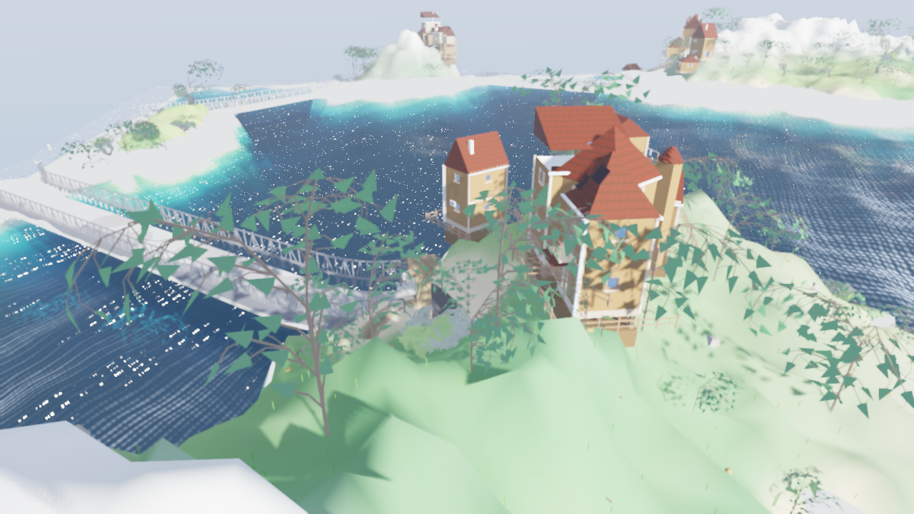

# Tutorial G31 — World generator helper (landscape or city)

> 🇩🇪 **Deutsche Version:** [docs/de/tutorials/g31_worldgen.md](../../de/tutorials/g31_worldgen.md)

**Goal:** generate a complete procedural **landscape** or **city** with one function call:
`procedural::generateWorld(params)` in `procedural/worldgen.hpp`. One parameter struct
(`WorldGenParams`) switches the mode; the result (`GeneratedWorld`) is plain CPU data —
heightmap, WFC placements, `MeshData`, placed meshes — that you attach to a `scene::Scene`.
Deterministic per seed, no GL needed for generation.

## Usage

```cpp
#include <fuhglgraphics/procedural/worldgen.hpp>

using fuhglgraphics::procedural::WorldGenParams;
using fuhglgraphics::procedural::generateWorld;

WorldGenParams p;
p.mode = WorldGenParams::Mode::Landscape;   // or Mode::City
p.seed = 777;
const auto world = generateWorld(p);
```

## Landscape mode

```cpp
WorldGenParams p;
p.mode = WorldGenParams::Mode::Landscape;
p.seed = 777;
p.worldSize = 200.f;        // X/Z extent in world units (centered at the origin)
p.terrainGrid = 129;        // heightmap resolution
p.terrainHeight = 14.f;     // height scale (heightmap itself is stored in [0,1])
p.noiseScale = 0.045f;      // noise-space scale per world unit
p.warpStrength = 0.8f;      // optional domain warp (0 = off)
p.heightExponent = 0.8f;    // contrast shaping pow(h, exponent); <1 -> more pronounced peaks
p.waterLevel = 0.30f;       // >0: carve a lake basin below this normalized level
p.lakeCarve = 0.18f;         // basin depth factor below the water level
p.treeCount = 140;          // scattered L-system trees
p.bushCount = 160;          // scattered L-system bushes
p.grassBlades = 4000;       // hint for the app: instanced grass via Instancing::heightFn
p.treeMinDist = 6.f;

const auto w = generateWorld(p);
w.heightmap;                // gridW*gridH floats, row-major (x + gridW*z), [0,1]
w.heightAt(x, z);           // world-space bilinear height (sample * heightScale, clamped)
w.waterLevelWorld;          // water level in world units (place a WaterComponent here)
w.trees;                    // PlacedMesh: mesh (L-system tree) + position/rotY/scale/tint
w.bushes;                   // PlacedMesh: bushes, same placement rules
```

The height field is G24 ridged fBm (Simplex base) with an island falloff at the border and an
optional lake basin below `waterLevel`. Trees are G26 L-systems placed by rejection sampling:
they stand on the terrain (`heightAt`), avoid the lake and keep `treeMinDist`.

Attach it to a scene (heightmap → grid `MeshData`, trees → one node each):

```cpp
scene::Scene scene;
// terrain: build a MeshData from w.heightmap (pos/normal/color/uv per vertex) ...
scene.root().createChild("terrain").attach<scene::MeshComponent>().addMesh(terrainMesh);
for (size_t i = 0; i < w.trees.size(); ++i) {
    auto& n = scene.root().createChild("tree" + std::to_string(i));
    n.translation = w.trees[i].position;
    n.rotation = fuhgl::math::fromAxisAngle(w.trees[i].rotY, {0, 1, 0});
    n.scale = {w.trees[i].scale, w.trees[i].scale, w.trees[i].scale};
    auto& e = n.attach<scene::MeshComponent>().addMesh(treeMeshes[i]); // Mesh::setMeshData(...)
    e.albedo = w.trees[i].tint;
}
```

See `examples/worldgen_screenshot/main.cpp` for a complete, runnable version.

## City mode

```cpp
WorldGenParams p;
p.mode = WorldGenParams::Mode::City;
p.seed = 777;
p.cityGrid = 12;            // WFC cells per side
p.cellSize = 8.f;           // world size of one cell
p.buildingHeight = 7.f;     // base wall height (jittered per block)
p.houseFootprint = 0.62f;   // house footprint as a fraction of the cell
p.blocksPerDistrict = 28;   // >0: voronoi district plates under the city
p.parkBushesPerPlaza = 3;   // bushes per plaza (park) cell

const auto w = generateWorld(p);
w.cells;                    // cityW*cityH WfcCell {tile, rot}, row-major
w.tiles;                    // tile set (w.cells[].tile indexes into it)
w.cityGround;               // MeshData base plate (top at y = 0)
w.roads;                    // merged slabs: sidewalk + dark asphalt (streets), concrete lots, park lawns
w.districts;                // voronoi plates (empty when blocksPerDistrict == 0)
w.buildings;                // one procedural house per "block" cell: mesh = walls+door+windows+chimney,
                            // roofMesh = gabled roof (separate MeshEntry, e.g. shingle texture);
                            // attach the brick POM set (albedo/normal/heightMap + parallaxScale) to the walls
w.bushes;                   // park greenery on plaza cells
```

The layout is a G27 WFC solve over `makeCityTiles()` — edge tags `"r"` (road), `"s"`
(lot/sidewalk, also the border tag) and `"p"` (plaza); tile names `block`, `plaza`, `streetH`,
`streetV`, `cross`, `tE`, `endE` with rotations handled by the solver. Street/plaza cells become
merged road slabs, `block` cells become building boxes with per-block height/tint jitter.

## Screenshot demo

`examples/worldgen_screenshot` renders both modes headless to PNG (CI renders
`docs/images/ci/g31_worldgen_{landscape,city,city_street}.png`, compressed with optipng;
checked-in references in [docs/images/](../../images/g31_worldgen_city.png)):

```bash
cmake --build build --target fuhglgraphics_worldgen_screenshot
FUHGL_BACKEND=surfaceless ./build/examples/fuhglgraphics_worldgen_screenshot \
    --prefix g31_worldgen --width 1280 --height 720 --frames 16 --seed 777
# writes g31_worldgen_landscape.png, g31_worldgen_city.png, g31_worldgen_city_street.png
```




## Tests

- `tests/test_procedural_worldgen.cpp` (unit): heightmap size/range/border/lake, `heightAt`
  sampling + clamping, tree placement rules (on terrain, out of the lake, min distance), WFC
  layout validity incl. border tags, block→building mapping, determinism per seed, mode dispatch.

## Notes

- Same seed → identical world on every platform (the generators are the seeded G24-G28 modules).
- Generation is pure CPU; only `Mesh::setMeshData` upload needs a GL context.
- For full control over the city tile set, pass your own tiles to `procedural::Wfc` directly
  (see [G27](g27_wfc.md)); `makeCityTiles()` is just the ready-made set used by `generateWorld`.
